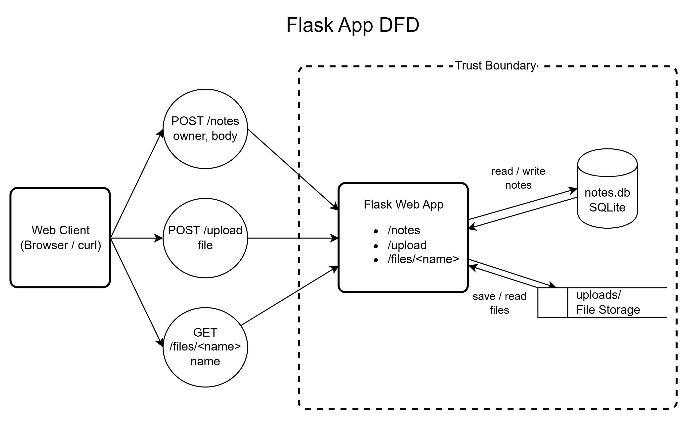

# Threat Model — Tiny Notes Web App

## 1. Data-flow diagram

(Insert your DFD image. Mark trust boundaries with dashed lines.)



## 2. Elements & trust boundaries

| Element                | Type (process/store/entity/flow) | Trust boundary crossed?                                   |
| ---------------------- | -------------------------------- | --------------------------------------------------------- |
| Web client             | External entity                  | **Yes** — Internet → Flask app                            |
| Flask app              | Process                          | **Yes** — receives untrusted requests from the Web client |
| SQLite DB (`notes.db`) | Data store                       | **No** — internal to the application                      |
| `uploads/` store       | Data store                       | **No** — internal to the application                      |

The main trust boundary is between the **Web Client** and the **Flask App**. Data received through `/notes`, `/upload`, and `/files/<name>` should be treated as untrusted because there is no authentication or authorization mechanism in the application.

## 3. STRIDE analysis

| Element         | S                                                                    | T                                                                                                      | R                                                            | I                                                                                          | D                                                                                           | E                                                                                |
| --------------- | -------------------------------------------------------------------- | ------------------------------------------------------------------------------------------------------ | ------------------------------------------------------------ | ------------------------------------------------------------------------------------------ | ------------------------------------------------------------------------------------------- | -------------------------------------------------------------------------------- |
| `/notes`        | **High:** No authentication; the client can claim any `owner` value. | **High:** The client can submit arbitrary `owner` and `body` values.                                   | **Medium:** There is no logging to prove who created a note. | **High:** `GET /notes` returns all stored notes, including owners and bodies.              | **Medium:** Repeated requests could consume application/database resources.                 | **High:** There is no authorization, so any requester can create and read notes. |
| `/upload`       | **High:** No authentication is required to upload a file.            | **High:** The client controls `f.filename`, which is directly used when saving the file.               | **Medium:** Upload activity is not logged.                   | **Medium:** Uploaded files may contain information that should not be publicly accessible. | **High:** There is no visible file-size or upload-rate limit, allowing resource exhaustion. | **High:** Any requester can upload a file without authorization.                 |
| `/files/<name>` | **High:** No authentication is required to request a file.           | **Low:** The endpoint does not modify the file, although the requested filename comes from the client. | **Medium:** File access is not logged.                       | **High:** Files in `uploads/` can be retrieved without an ownership/authorization check.   | **Low:** Repeated file requests could consume server resources.                             | **High:** There is no authorization check before serving an uploaded file.       |

### Code evidence

The `/notes` endpoint accepts the owner directly from the client:

```python
owner = request.json.get("owner", "anon")
```

The application then stores the supplied value:

```python
con.execute(
    "INSERT INTO notes (owner, body) VALUES (?, ?)",
    (owner, body)
)
```

Although the SQL query uses parameters and therefore avoids an obvious SQL-injection issue, the application does not verify that the requester is actually the specified owner.

The `/upload` endpoint directly uses the client-provided filename:

```python
f = request.files["file"]
f.save(os.path.join(UPLOAD_DIR, f.filename))
```

There is no authentication, file-type allowlist, apparent file-size limit, or server-generated filename.

The `/files/<name>` endpoint uses Flask's `send_from_directory()`:

```python
return send_from_directory(UPLOAD_DIR, name)
```

This is safer than directly constructing and opening an arbitrary filesystem path, but the endpoint still has **no authentication or authorization**, so access to uploaded files is not restricted to their owner.

## 4. Top 5 risks (likelihood × impact) + mitigation

### 1. Unauthorized access to all notes

**Likelihood: High × Impact: High = High Risk**

The `GET /notes` endpoint returns every note in the database without checking the identity or permissions of the requester. Add authentication and authorization, and only return notes that the authenticated user is permitted to access.

### 2. Arbitrary file write through `/upload`

**Likelihood: High × Impact: High = High Risk**

The application saves the uploaded file using the client-controlled `f.filename`. Validate and sanitize filenames with `secure_filename()`, use server-generated filenames, restrict allowed file types and sizes, and store uploads in a controlled directory.

### 3. Unauthorized access to uploaded files

**Likelihood: High × Impact: High = High Risk**

The `/files/<name>` endpoint does not verify whether the requester is allowed to access the requested file. Require authentication and perform an authorization/ownership check before serving an uploaded file.

### 4. Denial of service through excessive uploads

**Likelihood: Medium × Impact: High = High Risk**

The `/upload` endpoint has no visible file-size, rate, or storage limits. Set a maximum request/file size, apply rate limiting, and enforce storage quotas so that excessive uploads cannot exhaust server resources.

### 5. Spoofing the note owner

**Likelihood: High × Impact: Medium = High Risk**

The application trusts the `owner` value supplied by the client, so a requester can claim another user's identity when creating a note. Implement authentication and derive the owner from the authenticated account instead of accepting it as trusted client input.