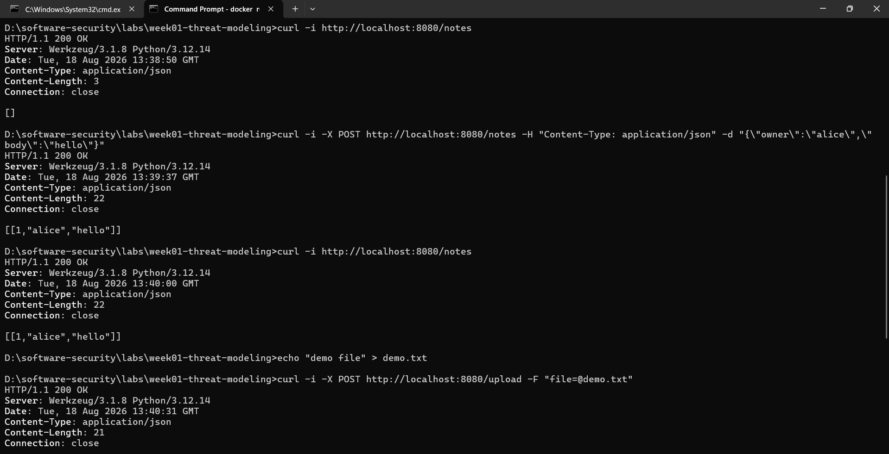
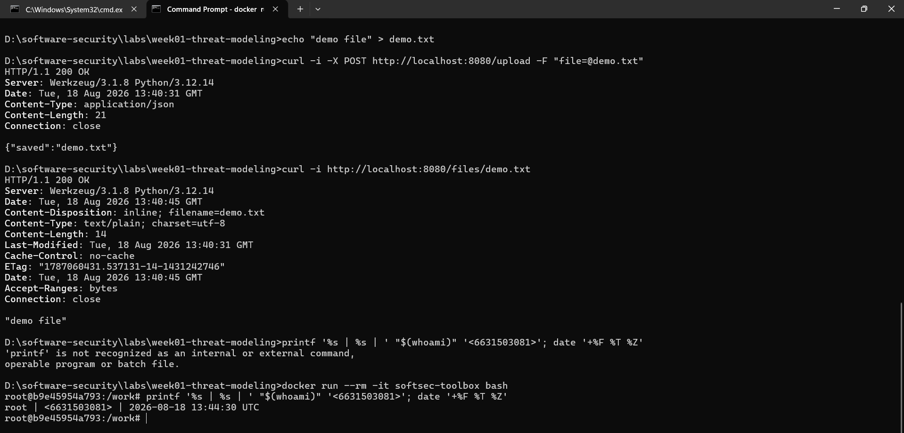

# Worksheet 1 — Security Mindset & Threat Modeling (3 hrs)

> **Course:** Software Security (KOSEN69) · **Week 1**
> **Aligned to:** OWASP 2025 A06 Insecure Design · CWE-501 (Trust Boundary Violation)
> **Signature game:** "Elevation of Privilege" (Microsoft STRIDE card deck)

> **Ethics note:** This week is *modeling only* — you analyze design, you do **not** attack the app. Run the sample app only on your own VM/localhost. Never apply these techniques to systems you do not own or lack written permission to test.

## Part 1 — Student Information
| Name | Student ID | Date | Group |  AI Tool |
|---|---|---|---|---|
| Nway Nway Zay Ya | 6631503081 | 15 August 2026 | - | ChatGPT |

## Part 2 — Lecture Questions
Answer in your own words (2–4 sentences each).
1. Define the CIA triad and give one concrete failure example for each of the three properties.
2. What is a *trust boundary*, and why does data crossing one deserve extra scrutiny?
3. Explain "attack surface." Name two things that increase it in a web app.
4. What does each STRIDE letter map to, and which security property does each threat violate?
5. What does "Secure by Design" (CISA) mean, and how does it differ from bolting security on after release?
### 1. The CIA Triad and Failure Examples
The CIA Triad is a foundational information security model built on three properties: Confidentiality (keeping data secret), Integrity (keeping data accurate), and Availability (keeping systems accessible).

* Confidentiality Failure: An employee loses an unencrypted laptop containing unmasked employee Social Security numbers.
* Integrity Failure: An attacker alters the official dosage value inside a hospital's digital medication database.
* Availability Failure: A DDoS attack knocks out a regional power grid's online monitoring system.

------------------------------
### 2. Trust Boundaries and Data Scrutiny
A trust boundary is a line separating distinct systems or zones that have different security privileges, trust levels, or access controls.
Data crossing a trust boundary deserves extra scrutiny because:

* Untrusted Origin: The data comes from a zone outside your control (e.g., public internet users).
* Malicious Payload: The data could contain attacks like SQL injections, malware, or corrupted inputs.
* Privilege Escalation: If processed blindly, the input could trick an internal system into executing unauthorized commands.

------------------------------
### 3. Attack Surface and Web App Factors
An attack surface is the total sum of all points, pathways, and vulnerabilities where an unauthorized user can try to enter, extract data from, or modify a software system.
Two things that increase the attack surface in a web application:

* Adding New Features/API Endpoints: Creating new forms, search bars, or public APIs gives attackers fresh entry points to probe for flaws.
* Third-Party Dependencies: Integrating external libraries, plugins, or open-source packages introduces new code that may contain unknown security bugs.

------------------------------
### 4. STRIDE Threat Model Mapping
The STRIDE framework identifies security threats and maps each one directly to a specific violation of the CIA triad (or related security pillars like Authenticity and Accountability).

| STRIDE Threat | Meaning | Violated Security Property |
|---|---|---|
| Spoofing | Pretending to be someone or something else. | Authenticity / Confidentiality |
| Tampering | Modifying data or code without authorization. | Integrity |
| Repudiation | Denying that an action or transaction took place. | Accountability / Non-repudiation |
| Information Disclosure | Exposing private data to unauthorized users. | Confidentiality |
| Denial of Service | Overwhelming or crashing a system to block users. | Availability |
| Elevation of Privilege | Gaining higher access levels than permitted. | Authorization / Confidentiality & Integrity |

------------------------------
### 5. Secure by Design vs. Bolted-On Security
Secure by Design (advocated by CISA) means integrating cybersecurity defenses, threat modeling, and risk reduction into every single phase of the software development lifecycle (SDLC) before the software ever ships.

| Approach | Timing | Focus | Cost & Efficiency |
|---|---|---|---|
| Secure by Design | Built-in from the foundation and planning phases. | Root causes, secure defaults, and architectural safety. | Low cost to fix bugs; highly resilient software. |
| Bolted-On Security | Added on after software release and deployment. | Patching vulnerabilities, firewalls, and reactive fixes. | High cost; creates weak, fragmented defense layers. |

## Part 3 — Hands-on Lab (180 min)
**Learning goals:** build a data-flow diagram (DFD), apply STRIDE to a real Flask app, rank risks, and propose mitigations.
**Prerequisites:** Docker + Docker Compose in your VM; a drawing tool (draw.io / paper + photo); the Elevation of Privilege deck (print or virtual) — free print-and-play PDF at [github.com/adamshostack/eop](https://github.com/adamshostack/eop).

**Environment setup**
```bash
cd labs/week01-threat-modeling
docker compose up --build           # starts sample-app on http://localhost:8080
curl -s -X POST localhost:8080/notes -H 'Content-Type: application/json' \
     -d '{"owner":"alice","body":"hello"}'   # observe behavior, do not attack
curl -s localhost:8080/notes

echo "demo file" > demo.txt
curl -s -X POST localhost:8080/upload -F "file=@demo.txt"   # observe behavior, do not attack
curl -s localhost:8080/files/demo.txt
```

Source to model lives in `sample-app/app.py`. Template to fill: `THREAT-MODEL-TEMPLATE.md` (copy it, do not edit the original).

**What to submit per task:** the threat/element identified + a screenshot (DFD, table, or running app) + a 2–3 sentence mitigation.

**Task 0 — Onboarding (5 min)** · *Goal:* prove the environment works. *Steps:* `docker compose up`, hit `/notes` and `/files/<name>`, read `sample-app/app.py`. *Deliverable:* screenshot of the running app + the JSON response.



**Task 1 — Draw the DFD (25 min)** · *Goal:* map the system. *Steps:* identify the external entity (web client), the process (Flask app), the data store (`notes.db` SQLite), the `uploads/` store, and the flows for `/notes`, `/upload`, `/files/<name>`; mark the Internet→app trust boundary with a dashed line. *Deliverable:* DFD image embedded in your copy of the template.


**Task 2 — STRIDE the elements (30 min)** · *Goal:* enumerate threats per element. *Steps:* for each element fill the S/T/R/I/D/E grid. Ground it in real code: `/notes` accepts a client-supplied `owner` with no auth (Spoofing); `/upload` saves raw `f.filename` — arbitrary-file-write (Tampering) — and echoes the resolved save path back in its response (Information disclosure); `/files/<name>` reads it back but is comparatively defended (see Task 5); no logging anywhere (Repudiation). *Deliverable:* completed STRIDE table.
| Element                    | S — Spoofing                                                                                              | T — Tampering                                                                                                                                 | R — Repudiation                                                                                         | I — Information Disclosure                                                                                                                                              | D — Denial of Service                                                                              | E — Elevation of Privilege                                                                                                                  |
| -------------------------- | --------------------------------------------------------------------------------------------------------- | --------------------------------------------------------------------------------------------------------------------------------------------- | ------------------------------------------------------------------------------------------------------- | ----------------------------------------------------------------------------------------------------------------------------------------------------------------------- | -------------------------------------------------------------------------------------------------- | ------------------------------------------------------------------------------------------------------------------------------------------- |
| **Web Client**             | **High:** A client can claim another user's identity by supplying an arbitrary `owner` value to `/notes`. | **High:** The client can modify application data by submitting arbitrary note contents and filenames.                                         | **Medium:** Requests are not logged, so a client can deny having created a note or uploaded a file.     | **High:** The client can request all notes and uploaded files without authentication or authorization.                                                                  | **Medium:** A client can send repeated requests or large uploads to consume application resources. | **High:** An unauthenticated client can perform actions that should require an authorized user, such as creating notes and uploading files. |
| **Flask App**              | **High:** The app trusts the client-supplied `owner` value instead of identifying the authenticated user. | **High:** `/upload` saves the client-controlled `f.filename`, allowing the client to influence where a file is written.                       | **Medium:** The application has no logging or audit trail for requests, uploads, or note creation.      | **High:** `/notes` returns stored notes, while `/upload` echoes the saved filename/path information and `/files/<name>` can serve uploaded files without authorization. | **High:** There are no visible request, upload-size, rate, or storage limits.                      | **High:** No authentication or authorization controls prevent untrusted clients from performing privileged application actions.             |
| **SQLite DB (`notes.db`)** | **Medium:** The database stores the client-supplied `owner`, so the stored identity is not trustworthy.   | **High:** Attackers can cause unauthorized note records to be inserted through `/notes`.                                                      | **Medium:** Without application logging, there is no reliable record of who created or modified a note. | **High:** `/notes` returns all stored notes, including owners and note bodies, to the requester.                                                                        | **Medium:** Repeated note creation can increase database size and consume resources.               | **High:** Any requester can insert data into the database without an authenticated identity or authorization check.                         |
| **`uploads/` store**       | **Low:** The store itself does not authenticate users; access control is handled by the Flask app.        | **High:** `/upload` uses the client-controlled `f.filename` when saving files, allowing the client to influence the saved file location/name. | **Medium:** File creation is not logged, making it difficult to determine who uploaded a file.          | **High:** Uploaded files can be retrieved through `/files/<name>` without checking ownership or authorization.                                                          | **High:** Unlimited or repeated uploads could consume disk space.                                  | **High:** An unauthenticated client can write files into the application's upload storage.                                                  |


**Task 3 — Elevation of Privilege game (20 min)** · *Goal:* find threats you missed. *Steps:* play the EoP deck against your DFD; each card you can tie to a real element/flow scores a point; record every valid threat. No printer or scissors? Draw from the digital deck below instead — same 78 cards, same rule. *Deliverable:* list of carded threats + score.

```sim
eop-deck
```

**Task 3b — Systems-level pass (25 min) 🔭** · *Goal:* find what the per-element grid cannot see. Tasks 2 and 3 enumerate threats **one element at a time**, and that is exactly where threat models are known to stop short — students taught STRIDE alone reliably identify component threats and *discount system-level ones* ([Joshi et al., ASEE 2024](https://arxiv.org/abs/2404.16632)). So do a second pass over the **whole** diagram:


- **Trust boundaries end-to-end.** Follow one request from the client to `notes.db` and back. List every boundary it crosses. Which crossing has no check on it?
- **Assume one element is fully owned.** Pick the Flask process, then the `uploads/` store. For each: what does the attacker now *reach* — not what is it, but where does it get them?
- **Chain two "low" findings.** Find two threats you or the EoP deck rated minor that combine into something you would not accept. Write the chain as `A → B → consequence`.
- **One-line system claim.** Finish: "Even if every element-level mitigation in Task 8 is implemented, this system still fails if ___."

Use the simulation below before you start — toggle a component to attacker-controlled and watch what it reaches:

```sim
trust-boundary
```
*Deliverable:* the boundary list, two owned-element reachability notes, one written chain, and the system claim.

#### 1. Trust boundaries end-to-end

> A POST /notes request starts at the Web Client and crosses the trust boundary into the Flask App. The Flask App then accesses notes.db to store or retrieve the note, and the result is returned through the Flask App to the Web Client. The main missing security check is at the Web Client → Flask App boundary because there is no authentication or authorization to verify who is making the request or whether they are allowed to access the notes.

#### 2. Flask process fully owned

> If the Flask process is fully compromised, an attacker can reach both notes.db and the uploads/ store because the Flask application has direct access to both. This could allow the attacker to read or modify stored notes and uploaded files and control the data returned to clients.

#### 3. uploads/ store fully owned

> If the uploads/ store is fully compromised, an attacker could modify or replace files that the Flask application later serves through /files/<name>. This could cause users to receive attacker-controlled content instead of the files they expected.

#### 4. Threat chain

> Unauthenticated upload → unrestricted file retrieval → attacker-controlled content can be served to other users.

#### 5. One-line system claim

> Even if every element-level mitigation in Task 8 is implemented, this system still fails if requests can cross trust boundaries without a verified user identity and consistent authorization.

**Task 4 — Abuse cases & attacker personas (20 min)** · *Goal:* think like specific adversaries. *Steps:* define 2 personas (e.g. a curious logged-in user; an anonymous internet attacker) and write 2 abuse cases each against the sample app, tied to DFD elements. *Deliverable:* 4 abuse cases.
#### Persona 1 - Curious User

- A user who can access the application but attempts to access information or perform actions beyond what they are authorized to do.

#### Persona 2 - Anonymous Internet Attacker

- An unauthenticated attacker who interacts directly with the application's public endpoints and takes advantage of missing authentication and input validation.

| Persona | Abuse Case | Endpoint | DFD Elements |
|---|---|---|---|
| Curious user | Read other users' notes | `/notes` | Web Client → Flask App → SQLite DB |
| Curious user | Read another user's uploaded file | `/files/<name>` | Web Client → Flask App → `uploads/` |
| Anonymous attacker | Impersonate another note owner | `/notes` | Web Client → Flask App → SQLite DB |
| Anonymous attacker | Upload an unauthorized file | `/upload` | Web Client → Flask App → `uploads/` |

**Task 5 — Path-traversal deep-dive (25 min)** · *Goal:* analyze the riskiest flow. *Steps:* trace `/upload` → `/files/<name>`; explain how `../` in a filename escapes `uploads/`; sketch the secure design (`secure_filename`, store outside web root, allow-list extensions). *Deliverable:* the data flow + secure-design note.

### Data Flow

The upload and file-retrieval flow is:

```text
Web Client
    │
    │ POST /upload
    │ filename + file content
    ▼
Flask App
    │
    │ f.save(os.path.join(UPLOAD_DIR, f.filename))
    ▼
uploads/
    │
    │ /files/<name>
    ▼
Flask App
    │
    │ send_from_directory(UPLOAD_DIR, name)
    ▼
Web Client
````

### Path-Traversal Risk

The `/upload` endpoint uses the filename supplied by the client when constructing the file's save path:

### Secure Design

The application should never use a client-supplied filename directly as a filesystem path. A safer design should:

* Sanitize filenames with `secure_filename()`.
* Prefer generating a unique filename on the server instead of trusting the original filename.
* Allow only approved file extensions and types.
* Enforce file-size and upload limits.
* Store uploaded files outside the web root when possible.
* Verify that the final resolved path remains inside the intended upload directory.

For example:

```python
from werkzeug.utils import secure_filename

filename = secure_filename(f.filename)
```

The application should then save the file using the sanitized or server-generated filename and ensure that the resulting path remains inside the intended upload directory.

**Task 6 — Threat-model the project target (30 min)** · *Goal:* kick off your term project. *Steps:* stop the sample-app first (`docker compose down` — both apps bind host port 8080), then run **NoteVault** (`cd ../../project/starter-app && docker compose up`), draw a quick DFD, and list the top 3 STRIDE threats you'd investigate. *Deliverable:* NoteVault DFD + top-3 threats (reuse these in your project report — `project/REPORT-TEMPLATE.md` in the repo root).

#### NoteVault Data-Flow Diagram

The NoteVault application consists of a web client communicating with a Flask application. The Flask application handles authentication, note management, searching, administration, and exporting. It stores user and note information in a SQLite database and can also invoke a system shell through the export functionality.


#### Top 3 STRIDE Threats

| Priority | STRIDE | Threat | DFD Element / Flow | Reason |
|---|---|---|---|---|
| 1 | **T — Tampering** | SQL injection through user-controlled input | Web Client → Flask App → SQLite DB (`/login`, `/search`) | User-controlled input is directly inserted into SQL queries, which could allow an attacker to change the intended database query. |
| 2 | **E — Elevation of Privilege** | User-controlled role during registration | Web Client → Flask App → SQLite DB (`/register`) | The registration endpoint accepts a client-supplied `role`, which could allow a user to assign themselves a higher-privileged role. |
| 3 | **E — Elevation of Privilege / T — Tampering** | Command injection through the export feature | Web Client → Flask App → System Shell (`/export`) | The `fmt` parameter is inserted directly into a shell command executed with `shell=True`, allowing untrusted input to influence an operating-system command. |


**Task 7 — Security requirements (15 min)** · *Goal:* turn threats into testable requirements. *Steps:* write 3 security requirements as acceptance criteria ("the system must … so that …"), each mapped to a threat from Task 2 or Task 6. *Deliverable:* 3 testable security requirements.

| # | Threat | Security Requirement / Acceptance Criteria |
|---|---|---|
| 1 | SQL Injection — `/login` and `/search` | **The system must use parameterized SQL queries for all user-controlled input so that user input cannot change the intended SQL query or database operation.** |
| 2 | Elevation of Privilege — `/register` | **The system must assign the `user` role server-side and reject client-supplied privileged roles so that users cannot register themselves as administrators.** |
| 3 | Command Injection — `/export` | **The system must not pass user-controlled input directly to a system shell and must validate export formats against an allowlist so that a request cannot execute unintended operating-system commands.** |

**Task 8 — Defend / fix it: rank & mitigate (25 min) 🛡️** · *Goal:* turn threats into action you can prove. *Steps:* rank the top 5 threats by likelihood × impact; propose one concrete mitigation each (e.g., auth on `/notes`, `secure_filename()` + allowlist for `/upload`, request logging for Repudiation, size/rate limits for DoS). Then **pick one and actually implement it** in your fork.

#### Top 5 Risks

| Rank | Threat | STRIDE | Likelihood | Impact | Risk | Mitigation |
|---|---|---|---|---|---|---|
| 1 | SQL injection in `/login` and `/search` | Tampering | High | High | **Critical** | Use parameterized SQL queries for all user-controlled input instead of constructing SQL statements with string formatting. |
| 2 | Command injection through `/export` | Tampering / Elevation of Privilege | High | Critical | **Critical** | Remove `shell=True`, avoid shell execution where possible, and allow only predefined export formats. |
| 3 | Privilege escalation through `/register` | Elevation of Privilege | High | High | **High** | Ignore client-supplied roles and assign the `user` role server-side during registration. |
| 4 | Unauthorized access to another user's note through `/api/notes/<id>` | Information Disclosure | High | High | **High** | Check that the authenticated user owns the requested note before returning it. |
| 5 | Weak MD5 password hashing | Spoofing / Information Disclosure | High | High | **High** | Replace MD5 with a password-hashing algorithm such as Argon2, bcrypt, or scrypt. |

#### Selected Fix — SQL Injection

I selected SQL injection protection because the application constructs SQL queries using user-controlled input in multiple endpoints.

#### Before

The `/login` endpoint directly inserts the username into the SQL query:

```python
q = "SELECT * FROM users WHERE username = '%s' AND password = '%s'" % (
    username, hashlib.md5((password or "").encode()).hexdigest())
row = con.execute(q).fetchone()
```

*Deliverable — the top-5 table, plus for the one you implemented:*
1. the **diff** (commit hash on your `wk01` branch),
2. **evidence it works**: the request that succeeded before your change and is refused after — both outputs,
3. **why it closes the class, not the instance** (2–3 sentences). `secure_filename()` on one endpoint is an instance fix; *"no user-supplied string ever becomes a path component"* is a class fix. Say which yours is, and if it's an instance fix, say what the class fix would be.

> **Why this is weighted.** Fewer than half of working developers can spot a security hole in code, and being shown vulnerabilities does not by itself teach you to find or close them. Exploiting is the half that feels like progress; defending is the half that transfers to your job.

## Part 4 — Reflection
1. Map your top finding to a CWE and to OWASP A06 (Insecure Design); explain the mapping in one sentence.
    > CWE-89 — SQL Injection; OWASP A06 — Insecure Design. The application design allows user-controlled input to be concatenated directly into SQL queries, showing that safe database-query handling was not built into the design; although SQL injection is primarily classified under OWASP A05 (Injection), this instance also represents an insecure design choice.
2. Name one real-world breach caused by a design flaw (not a missing patch) and what design control would have prevented it.
    > Capital One data breach (2019): A design/configuration weakness in the cloud environment allowed an attacker who gained access through the application layer to obtain data from an improperly authorized storage environment. Stronger least-privilege IAM controls and defense-in-depth access policies would have limited what the compromised component could access and reduced the impact of the breach.
3. Of your five mitigations, which gives the most risk reduction per unit of effort, and why?
    > Parameterized SQL queries provide the most risk reduction per unit of effort. The change is relatively small but protects multiple database queries from an entire class of SQL injection attacks, including different malicious inputs that developers may not have anticipated. It also establishes a reusable secure-coding pattern that can be applied throughout the application.

## Grading rubric (100)
| Criterion | Points |
|---|---|
| Lecture questions (Part 2) | 20 |
| Exploitation + evidence (DFD + STRIDE table + EoP findings + screenshots) | 40 |
| Defense (top-5 ranking + mitigations) | 25 |
| Reflection (CWE/OWASP mapping + breach + best mitigation) | 15 |

**Assessed within the rows above** (they are not extra points — they are what those points are for):
- **Systems-level reasoning** (inside *Exploitation + evidence*, Task 3b): does the model reach past single elements to boundaries, reachability and chains? Scored with the STRIDE + systems-thinking rubrics of [Joshi et al. 2024](https://arxiv.org/abs/2404.16632).
- **Defensive proof** (inside *Defense*, Task 8): a claimed mitigation with no before/after evidence scores at most half. A mitigation you can show closing a *class* scores full.
- **Adversarial thinking** (across the whole sheet): do the abuse cases, personas and chains show you reasoning as an attacker with goals and constraints — or just listing categories? This is the course's central disposition and it is assessed, not assumed.

---

## Evidence & Integrity (required)

- **Identity proof:** every screenshot/diagram must show a terminal running `printf '%s | %s | ' "$(whoami)" '<YOUR-STUDENT-ID>'; date '+%F %T %Z'` **in the
  same image as the evidence**. When the evidence is a browser page, a DevTools panel or a
  rendered response, put that terminal **beside the browser and capture the whole screen** — a
  cropped window carries nothing that identifies you, and the lab's own output is
  byte-identical for the whole cohort *by design*, so the stamp is the only thing that makes
  the shot yours. Generic or borrowed evidence is not accepted.
- **Personalized flag (if this lab issues one):** ____________________
  *Flags are unique per student — submitting another student's flag is a violation. How to submit: **learn.zcr.ai/submit** (full guide: `SUBMISSION.md` in the repo root).*
- **Explain in your own words** *(graded on your reasoning, not copied text):*
  1. What did you do, and **why did the vulnerability work**?
  2. **Why does your fix actually stop it** — and what could still break it?

---

## 🤖 Audit the AI (required)

AI is a power tool you must **distrust** — you are graded on your *critique*, not the AI's answer.

1. Ask an AI assistant to exploit **or** fix this week's vulnerability. Paste its full answer.
    #### Prompt given to the AI:
    > Fix the SQL injection vulnerability in the NoteVault /login endpoint. Provide the corrected Python code.

    #### AI response:
    > The SQL injection occurs because user input is directly inserted into the SQL query using string formatting. The safest solution is to use a parameterized query.

    ```python
    password_hash = hashlib.md5((password or "").encode()).hexdigest()

    row = con.execute(
        "SELECT * FROM users WHERE username = ? AND password = ?",
        (username, password_hash)
    ).fetchone()
    ```

    > This prevents the username or password from being interpreted as SQL syntax because SQLite treats the values as parameters rather than part of the SQL statement. The rest of the login functionality can remain unchanged.

2. **Find what's wrong or risky** in it — insecure code, a subtly incomplete fix, a hallucinated API/function/CVE, a missed edge case, or wrong reasoning. Quote the exact line(s).
    - The AI's proposed /login fix is correct for that particular query, but it is incomplete because it only fixes one endpoint. The application has another SQL injection vulnerability in /search, which still constructs a SQL query using string formatting:
    ```python
    q = "SELECT id,title,body FROM notes WHERE owner='%s' AND body LIKE '%%%s%%'" % (user, term)
    ```
    - The AI did not identify or fix this second vulnerable query, even though the same unsafe design pattern is used. Therefore, the AI fixed an individual instance of SQL injection but did not address the entire SQL injection class in the application.
3. Produce the **correct, verified** version yourself and explain in 2–3 sentences why the AI's output was insufficient.
    
    I changed both vulnerable queries to use SQLite parameterized queries.

    For /login:

    ```python
    password_hash = hashlib.md5((password or "").encode()).hexdigest()

    row = con.execute(
        "SELECT * FROM users WHERE username = ? AND password = ?",
        (username, password_hash)
    ).fetchone()

    For /search:

    q = """
        SELECT id, title, body
        FROM notes
        WHERE owner = ? AND body LIKE ?
    """
    rows = con.execute(q, (user, "%" + term + "%")).fetchall()
    ```

    - The corrected version separates SQL syntax from user-controlled data, so the input is treated as a value rather than as part of the SQL statement.

    #### Why the AI's answer was insufficient

    - The AI correctly fixed the SQL construction in /login, but it missed the same vulnerability in /search. My corrected version applies parameterized queries to both affected endpoints, addressing the broader SQL injection class rather than only one vulnerable query.

> Disclose your AI use in the Part 1 table. This task counts toward your **Defense + Reflection** score.

---

## 🧠 Comprehension & Prompt (required)

**A. Explain in Plain English (EiPE).** In 2–3 sentences, in your own words, describe what this week's vulnerable code/endpoint actually *does* and *why it is exploitable* — explain the mechanism, don't dump jargon.
- The /login endpoint takes the username and password submitted by the user and builds a SQL query by inserting those values directly into the query string. Because the username is treated as part of the SQL statement instead of only as data, specially crafted input can change what the database executes and potentially bypass the intended login check.

**B. Prompt Problem.** Write a **single prompt** that makes an AI produce a *correct, secure* fix for one finding. Run it: does the exploit now fail? If not, refine the prompt and try again. Submit the **final prompt + the verified result**.
*Graded on the prompt's precision and your verification — this trains problem decomposition and AI literacy (Denny et al. 2024).*
#### Final prompt
> Review the provided NoteVault Flask code for SQL injection. Fix the vulnerability without changing the application's intended behavior. Identify every SQL query in the code where user-controlled data is incorporated into SQL syntax, not just /login. Replace unsafe string formatting or concatenation with parameterized SQLite queries using ? placeholders. Preserve the existing password hashing and authentication behavior for this task, because password hashing is a separate security finding. Show the exact before/after code changes and explain why the fix prevents SQL injection. Do not invent APIs or libraries.
#### Verified result
> Verification: I applied the generated parameterized-query changes to /login and /search, restarted the NoteVault application, and repeated the same test used before the fix. The malicious input was no longer interpreted as part of the SQL statement, and the request was rejected instead of producing the previous unintended authentication/query behavior.
