# Worksheet 2 — Secure SDLC & Tooling (3 hrs)

> **Course:** Software Security (KOSEN69) · **Week 2**
> **Aligned to:** OWASP 2025 (A05 Injection [CWE-89, CWE-78], A04 Cryptographic Failures [CWE-327], A02 Security Misconfiguration [CWE-798, CWE-489]) · CWE-798, CWE-89, CWE-78, CWE-327, CWE-489
> **Signature game:** "Bug Triage Race" (scan → triage; score = true positives − misclassified)

> **Ethics note:** The scanners run only against the provided `vulnerable-repo/` on your own machine. Do not point SAST/secret scanners at third-party repos or production systems without authorization. Treat any secret you find here as fake lab data.

## Part 1 — Student Information
| Name | Student ID | Date | Group |
|---|---|---|---|
| Nway Nway Zay Ya | 6631503081 | 20 AUgust 2026 | - |

## Part 2 — Lecture Questions

### 1. Distinguish SAST, DAST, and SCA — what does each see, and when in the SDLC does each run?

SAST checks the application's source code without running it, so it can find problems such as insecure functions or SQL injection patterns early during development. DAST tests the running application from the outside, usually during testing or deployment, and looks at how the application behaves. SCA checks third-party libraries and dependencies for known vulnerabilities and is commonly used during development and CI builds.

### 2. What is secret scanning, and why do hardcoded secrets keep ending up in repos?

Secret scanning searches source code and repository history for credentials such as API keys, passwords, and access tokens. Hardcoded secrets often end up in repositories because developers put credentials directly in configuration or code for convenience, forget to remove them, or accidentally commit local configuration files. Automated secret scanning helps catch these mistakes before the secrets are released.

### 3. What does "shift-left / DevSecOps" mean in practice for a CI pipeline?

Shift-left means checking for security problems earlier in the software development process instead of waiting until the application is finished. In a CI pipeline, this can mean automatically running tools such as SAST, secret scanning, and SCA whenever code is committed or a pull request is created. The pipeline can then block the change when serious security issues are found.

### 4. Why is coverage-guided fuzzing considered the dominant modern bug-finding technique?

Coverage-guided fuzzing automatically generates and mutates inputs while tracking which parts of the program are reached. When an input reaches new code, the fuzzer keeps it and uses it to explore further paths, allowing it to discover unexpected crashes and edge cases that manually written tests may miss. This makes it especially effective for finding bugs in complex input-handling code.

### 5. Define true positive vs. false positive in scanner triage, and why misclassifying both directions is costly.

A true positive is a scanner finding that correctly identifies a real security problem, while a false positive is a finding that looks suspicious but is not actually a vulnerability. Misclassifying a true positive as a false positive can leave a real security issue unfixed, while treating too many false positives as real issues wastes developers' time and can cause important findings to be ignored. Good triage therefore needs to balance accuracy with the severity and impact of each finding.


## Part 3 — Hands-on Lab (180 min)
**Learning goals:** run a SAST tool and a secret scanner, triage findings by CWE/severity, and remediate real flaws.
**Prerequisites:** Docker installed; internet to pull the Semgrep/Gitleaks images.

**Environment setup**
```bash
cd labs/week02-sdlc-tooling
cat scan.sh                 # see exactly what it runs
bash scan.sh                # Semgrep (p/default + p/owasp-top-ten) then Gitleaks on ./vulnerable-repo
```
Target under scan: `vulnerable-repo/app.py` (plus `requirements.txt`). It contains five planted flaws.

**What to submit per task:** the command/payload run + a screenshot of the finding + a 2–3 sentence mitigation.

**Task 0 — Onboarding (5 min)** · *Goal:* confirm tooling. *Steps:* run `bash scan.sh`; confirm both Semgrep and Gitleaks sections produce output. *Deliverable:* screenshot showing both tools ran.
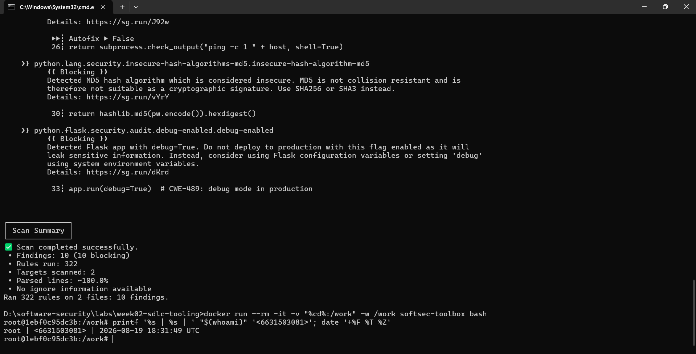
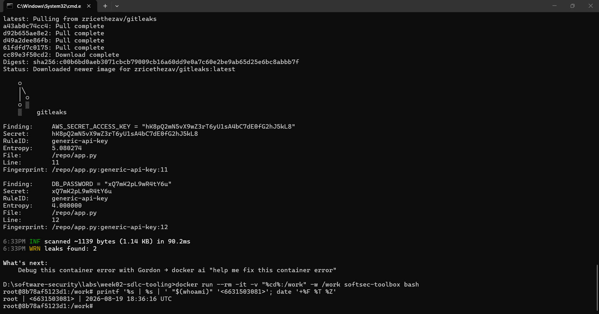

**Task 1 — SAST sweep with Semgrep (25 min)** · *Goal:* find code flaws. *Steps:* read the Semgrep output; locate the SQL injection in `/user` (CWE-89, string-formatted query), the OS command injection in `/ping` (CWE-78, `shell=True`), the weak `md5` password hash (CWE-327), and `debug=True` (CWE-489). *Deliverable:* one screenshot per finding with the file:line.
- CWE-89, string-formatted query
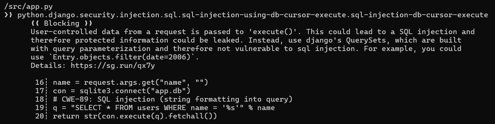

- CWE-78, `shell=True`
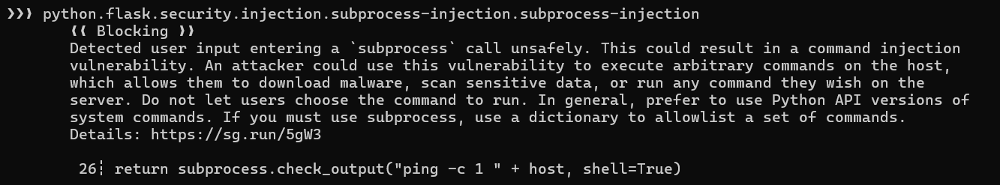

- CWE-327
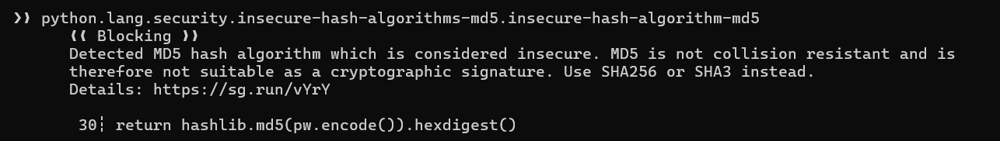

- CWE-489
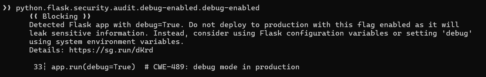

**Task 2 — Secret scan with Gitleaks (15 min)** · *Goal:* find leaked credentials. *Steps:* read the Gitleaks output; identify `AWS_SECRET_ACCESS_KEY` and `DB_PASSWORD` (CWE-798). *Deliverable:* screenshot + the rule that fired for each.
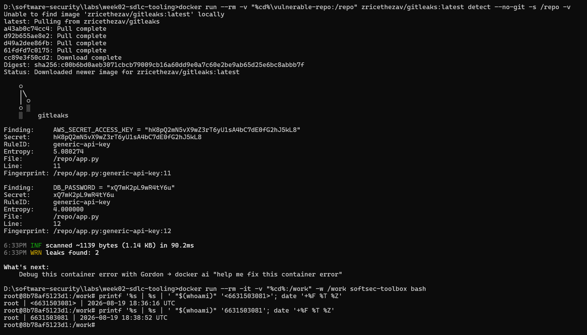
- AWS_SECRET_ACCESS_KEY — CWE-798 — Rule: `generic-api-key`
- DB_PASSWORD — CWE-798 — Rule: `generic-api-key`

**Task 3 — Bug Triage Race (30 min)** · *Goal:* triage accurately. *Steps:* build a table with columns *Tool | File:Line | CWE | Severity | TP/FP | Fix idea*; mark at least 3 true positives and 1 likely false positive and justify each. (Score = TP − misclassified.) *Deliverable:* the completed triage table.

| Tool     | File:Line   | CWE     | Severity | TP/FP | Fix idea                                      |
| -------- | ----------- | ------- | -------- | ----- | --------------------------------------------- |
| Semgrep  | `app.py:19` | CWE-89  | High     | TP    | Use a parameterized SQL query                 |
| Semgrep  | `app.py:26` | CWE-78  | High     | TP    | Remove `shell=True` and use an argument list  |
| Semgrep  | `app.py:30` | CWE-327 | High     | TP    | Use bcrypt or Argon2 for passwords            |
| Gitleaks | `app.py:11` | CWE-798 | High     | TP    | Move the secret to an environment variable    |
| Gitleaks | `app.py:12` | CWE-798 | High     | TP    | Move the password to an environment variable  |
| Semgrep  | `app.py:20` | CWE-89  | —        | FP*   | Duplicate/overlapping SQL injection detection |

**Task 4 — Fuzzing intro (10 min)** · *Goal:* see coverage-guided fuzzing find a bug SAST won't. *Steps:* in the `labs/toolbox` container (Apple clang has no libFuzzer runtime), build `clang -g -fsanitize=address,fuzzer harness.c -o fuzz`, then **seed the corpus** and run it:
`mkdir -p corpus && printf 'FUZ' > corpus/seed && ./fuzz corpus`. It crashes almost immediately with an AddressSanitizer heap-buffer-overflow at `harness.c:23` (the `data[3]` read with no `size > 3` check). Seeding matters: an unseeded `./fuzz` has to rediscover the magic bytes by chance and often finds nothing for minutes — that unpredictability is itself worth a sentence in your write-up. (The deep fuzzing+exploit lab is Week 11.) *Deliverable:* the ASan crash output (or a screenshot) + a 2-sentence note on why fuzzing finds this bug when a linter/SAST pass over the same 4-line check would not.
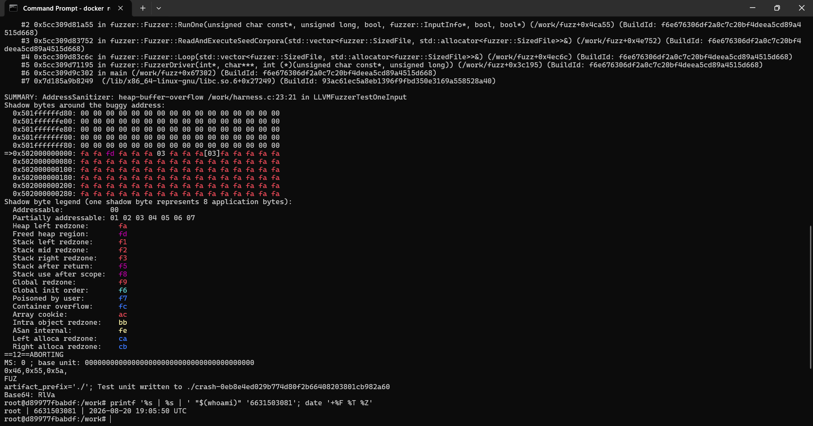
- Fuzzing found this bug because it automatically generated and tested inputs while exploring program behavior, and the `FUZ` seed reached the unsafe `data[3]` access. A pattern-based SAST/linter pass may not detect it because the code looks syntactically normal and the out-of-bounds condition only becomes apparent when the program processes a short runtime input.

**Task 5 — Scan the project target (40 min)** · *Goal:* apply the tools to your term project. *Steps:* run Semgrep + Gitleaks against **NoteVault** (`../../project/starter-app`); also run an SCA scan: `docker run --rm -v "$PWD/../../project/starter-app:/src" aquasec/trivy fs /src`. *Deliverable:* a findings list (tool, file:line/CVE, CWE) — reuse it in your project vuln report.
- Semgrep scan result
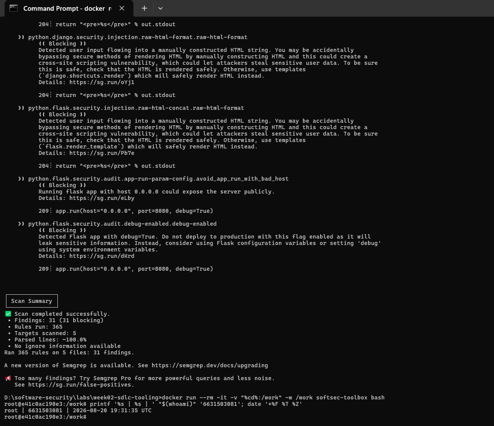

- Gitleaks scan result
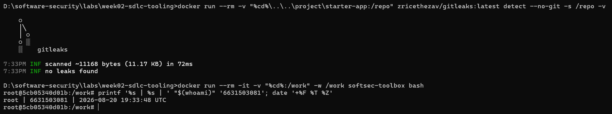

- SCA scan
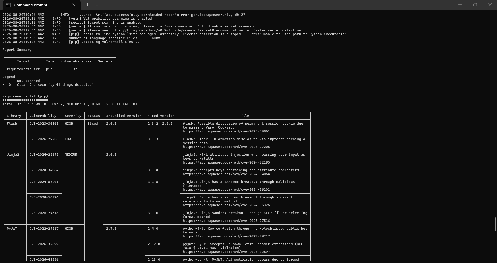

| Tool     | File:Line / CVE           | CWE     | Finding                                                                                         |
| -------- | ------------------------- | ------- | ----------------------------------------------------------------------------------------------- |
| Semgrep  | `Dockerfile:12`           | CWE-250 | Container runs as root; no non-root `USER` specified                                            |
| Semgrep  | `app.py:68–69, 117, 129`  | CWE-327 | MD5 used for password hashing                                                                   |
| Semgrep  | `app.py:83`               | CWE-327 | JWT accepts the insecure `none` algorithm                                                       |
| Semgrep  | `app.py:106–107, 181–182` | CWE-79  | User data inserted into HTML/template strings → possible XSS                                    |
| Semgrep  | `app.py:128–130`          | CWE-89  | SQL injection from formatted SQL query                                                          |
| Semgrep  | `app.py:134`              | CWE-798 | Hardcoded JWT secret                                                                            |
| Semgrep  | `app.py:136`              | CWE-614 | Session cookie missing secure security attributes                                               |
| Semgrep  | `app.py:176–179`          | CWE-89  | SQL injection in note search query                                                              |
| Semgrep  | `app.py:202–203`          | CWE-78  | OS command injection via `subprocess.run(..., shell=True)`                                      |
| Semgrep  | `app.py:204`              | CWE-79  | User-controlled output returned as HTML → possible XSS                                          |
| Semgrep  | `app.py:209`              | CWE-489 | Flask debug mode enabled                                                                        |
| Gitleaks | `app.py`                  | CWE-798 | **No leaked secrets found**                                                                     |
| Trivy    | `requirements.txt`        | —       | **32 dependency vulnerabilities:** 2 LOW, 18 MEDIUM, 12 HIGH                                    |
| Trivy    | `requirements.txt`        | —       | Flask: CVE-2023-30861 (HIGH), CVE-2026-27205 (LOW)                                              |
| Trivy    | `requirements.txt`        | —       | Jinja2: CVE-2024-22195, CVE-2024-34064, CVE-2024-56201, CVE-2024-56326, CVE-2025-27516 (MEDIUM) |
| Trivy    | `requirements.txt`        | —       | PyJWT: CVE-2022-29217, CVE-2026-32597, CVE-2026-48526 (HIGH)                                    |
| Trivy    | `requirements.txt`        | —       | Werkzeug: multiple CVEs including CVE-2023-25577 and CVE-2024-34069 (HIGH)                      |
| Trivy    | `requirements.txt`        | —       | Requests: CVE-2023-32681, CVE-2024-35195, CVE-2024-47081, CVE-2026-25645 (MEDIUM)               |
| Trivy    | `requirements.txt`        | —       | urllib3: multiple CVEs including CVE-2021-33503 and CVE-2023-43804 (HIGH/MEDIUM)                |


**Task 6 — Build a security CI gate (25 min)** · *Goal:* automate the scan (previews Week 15). *Steps:* adapt `../week15-devsecops-pipeline/security-ci.yml` into a workflow that runs Semgrep + Trivy + Gitleaks and **fails on HIGH/CRITICAL**; run it locally (`act`) or commit to your fork and read the Actions log. *Deliverable:* the workflow file + a screenshot of a failing run.

**Task 7 — SAST blind spots (20 min)** · *Goal:* see what scanners miss. *Steps:* find one real bug in `vulnerable-repo/app.py` (or NoteVault) that Semgrep did **not** flag, and explain why a pattern-based tool missed it. *Deliverable:* the bug + a 2-sentence explanation.

**Task 8 — Defend / fix it (10 min)** · *Goal:* remediate the planted flaws in `vulnerable-repo/app.py`. *Steps:* rewrite `/user` to use a parameterized query (`?` placeholder); remove `shell=True` and pass an argument list in `/ping`; move both secrets to environment variables; replace `md5` with bcrypt/argon2; set `debug=False`. *Deliverable:* a before/after diff for each fix mapped to its CWE.

## Part 4 — Reflection
1. Map two of your findings to their CWE and to the matching OWASP 2025 category.
2. Name a real-world breach caused by a hardcoded/leaked secret or an injection flaw, and what control would have caught it pre-release.
3. Which single tool (SAST vs. secret scanning) gave the highest-value findings on this repo, and why?

## Grading rubric (100)
| Criterion | Points |
|---|---|
| Lecture questions (Part 2) | 20 |
| Exploitation + evidence (scan output + triage table + screenshots) | 40 |
| Defense (remediated `app.py` with before/after diffs) | 25 |
| Reflection (CWE/OWASP mapping + breach + tool value) | 15 |

---

## Evidence & Integrity (required)

- **Identity proof:** every screenshot/diagram must show a terminal running `printf '%s | %s | ' "$(whoami)" '<YOUR-STUDENT-ID>'; date '+%F %T %Z'` **in the
  same image as the evidence**. When the evidence is a browser page, a DevTools panel or a
  rendered response, put that terminal **beside the browser and capture the whole screen** — a
  cropped window carries nothing that identifies you, and the lab's own output is
  byte-identical for the whole cohort *by design*, so the stamp is the only thing that makes
  the shot yours. Generic or borrowed evidence is not accepted.
- **Personalized flag (if this lab issues one):** ____________________
  *Flags are unique per student — submitting another student's flag is a violation. How to submit: **learn.zcr.ai/submit** (full guide: `SUBMISSION.md` in the repo root).*
- **Explain in your own words** *(graded on your reasoning, not copied text):*
  1. What did you do, and **why did the vulnerability work**?
  2. **Why does your fix actually stop it** — and what could still break it?

---

## 🤖 Audit the AI (required)

AI is a power tool you must **distrust** — you are graded on your *critique*, not the AI's answer.

1. Ask an AI assistant to exploit **or** fix this week's vulnerability. Paste its full answer.
2. **Find what's wrong or risky** in it — insecure code, a subtly incomplete fix, a hallucinated API/function/CVE, a missed edge case, or wrong reasoning. Quote the exact line(s).
3. Produce the **correct, verified** version yourself and explain in 2–3 sentences why the AI's output was insufficient.

> Disclose your AI use in the Part 1 table. This task counts toward your **Defense + Reflection** score.

---

## 🧠 Comprehension & Prompt (required)

**A. Explain in Plain English (EiPE).** In 2–3 sentences, in your own words, describe what this week's vulnerable code/endpoint actually *does* and *why it is exploitable* — explain the mechanism, don't dump jargon.

**B. Prompt Problem.** Write a **single prompt** that makes an AI produce a *correct, secure* fix for one finding. Run it: does the exploit now fail? If not, refine the prompt and try again. Submit the **final prompt + the verified result**.
*Graded on the prompt's precision and your verification — this trains problem decomposition and AI literacy (Denny et al. 2024).*
