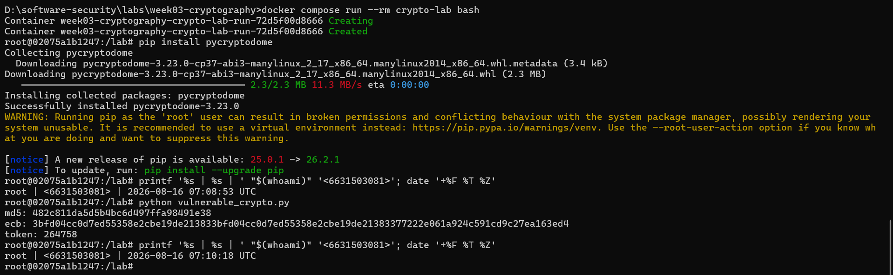
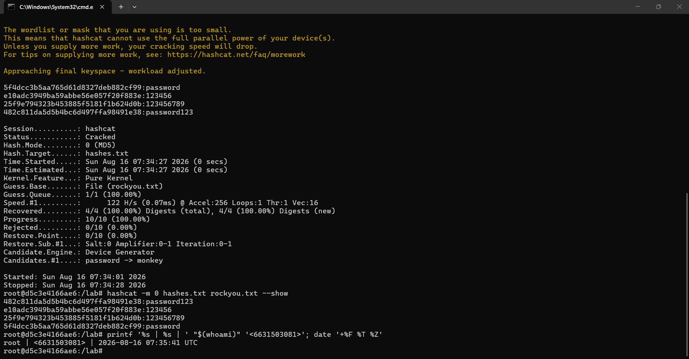
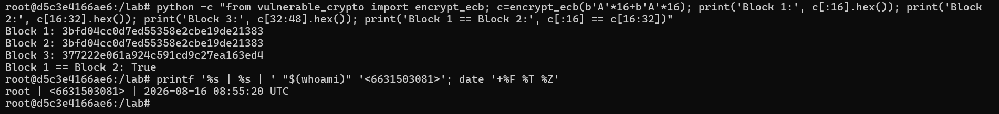
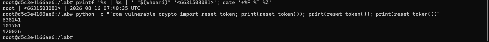
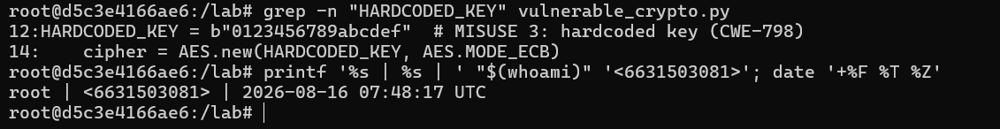
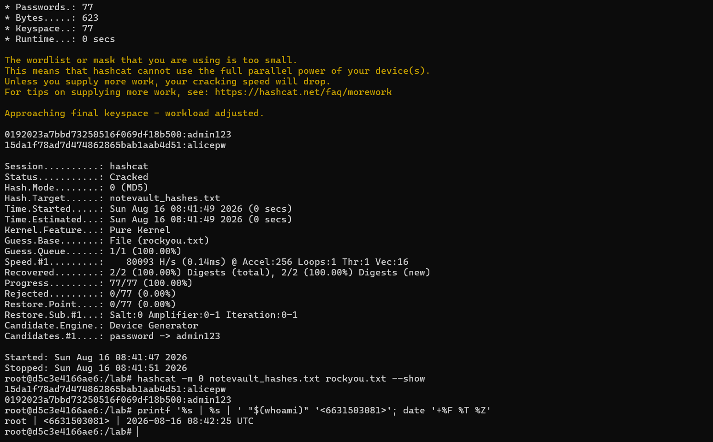
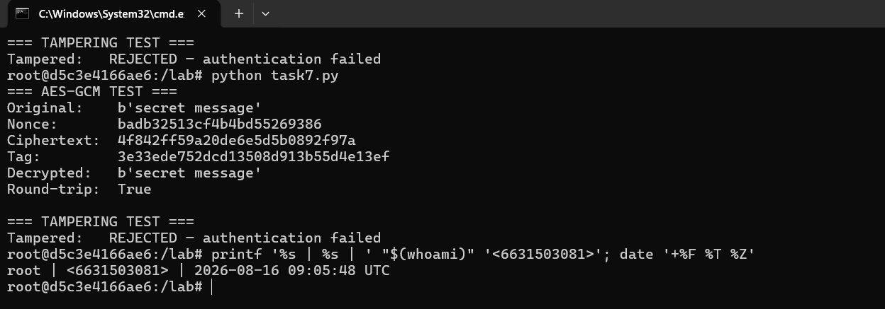
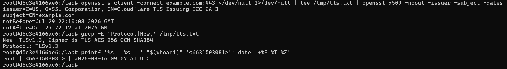
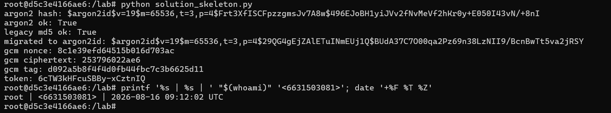

# Worksheet 3 — Cryptography Used Correctly (and Misused) (3 hrs)

> **Course:** Software Security (KOSEN69) · **Week 3**
> **Aligned to:** OWASP 2025 A04 Cryptographic Failures · CWE-327, CWE-916, CWE-330, CWE-798
> **Signature game:** "Capture the Hash" (recover plaintext from weak hashes)

> **Ethics note:** Crack only the hashes provided in `hashes.txt` on your own machine. Password-cracking against accounts or systems you don't own is illegal. Wordlists and recovered values stay inside the lab VM.

## Part 1 — Student Information
| Name | Student ID | Date | Group | AI Tool |
|---|---|---|---|---|
| Nway Nway Zay Ya | 663503081 | 16 August 2026 | - | ChatGPT |

## Part 2 — Lecture Questions
Answer in your own words (2–4 sentences each).
1. Distinguish hashing, encryption, and encoding — and give one job each is the wrong tool for.
- Hashing changes data into a fixed value and is mainly used to protect passwords; it is not suitable when you need to get the original data back. Encryption changes data into a secret form that can be changed back with a key, so it is used to protect sensitive information. Encoding changes data into a format that is easier to store or send, but it is not for security because anyone can decode it.
2. Why is a fast hash like MD5/SHA-1 a bad choice for storing passwords, and what should be used instead?
- MD5 and SHA-1 are too fast, so attackers can try millions of passwords very quickly if they get the password database. Instead, password-specific hashing methods like Argon2, bcrypt, or scrypt should be used because they are designed to make password guessing much slower.
3. What is a salt, what attack does it defeat, and why must it be unique per password?
- A salt is a random value added to a password before hashing. It helps prevent rainbow table and precomputed hash attacks. Each password should have a different salt so that two users with the same password will still have different stored hashes.
4. Why does AES-ECB leak structure, and what does an authenticated mode like AES-GCM add?
-   AES-ECB encrypts identical blocks of data into identical encrypted blocks, so patterns or structure in the original data can still be seen. AES-GCM provides both encryption and authentication, meaning it hides the data and also helps detect if someone has changed or tampered with it.
5. What's the difference between `random` and a CSPRNG (e.g. `secrets`), and where does it matter?
- Python's random is designed for normal things like simulations and games, but its output can be predictable. A CSPRNG, such as Python's secrets, is designed for security and should be used for things like password reset tokens, session tokens, and security keys.


## Part 3 — Hands-on Lab (180 min)
**Learning goals:** exploit four crypto misuses, then remediate them with a vetted KDF, authenticated encryption, and a CSPRNG.
**Prerequisites:** Docker (or local Python 3.12); `hashcat` or `john`; the `rockyou.txt` wordlist.

**Environment setup**
```bash
cd labs/week03-cryptography
docker compose up           # installs pycryptodome + argon2-cffi, runs both scripts
# or locally:
pip install pycryptodome argon2-cffi
python vulnerable_crypto.py # see the md5 hash, repeated ECB blocks, 6-digit token
```
Targets: `vulnerable_crypto.py` (the misuses), `hashes.txt` (four unsalted MD5s), and `solution_skeleton.py` (the fix).

**What to submit per task:** the command/payload run + a screenshot of the result + a 2–3 sentence mitigation.

**Task 0 — Onboarding (5 min)** · *Goal:* see the misuse output. *Steps:* run `python vulnerable_crypto.py`; note the md5 digest, the identical ECB ciphertext blocks, and the short token. *Deliverable:* screenshot of the program output.


**Task 1 — Capture the Hash (30 min)** · *Goal:* recover the passwords. *Steps:* strip the comment lines from `hashes.txt`, then run `hashcat -m 0 hashes.txt rockyou.txt` (or the `john --format=raw-md5` equivalent); recover all four plaintexts. *Deliverable:* screenshot of the cracked results (mask any real-looking value). Note in one line why unsalted MD5 fell so fast (CWE-916/327).
- Unsalted MD5 is fast and has no unique salt, so attackers can quickly test common passwords and reuse precomputed hashes (CWE-916/327).


```sim
aes-modes
```

**Task 2 — ECB structure leak (20 min)** · *Goal:* prove ECB leaks. *Steps:* call `encrypt_ecb(b"A"*16 + b"A"*16)` from `vulnerable_crypto.py` and show the two 16-byte ciphertext blocks are identical; explain how this leaks plaintext structure (CWE-327). *Deliverable:* hex output highlighting the repeated block.
- ECB produces the same ciphertext for identical plaintext blocks, so repeated ciphertext reveals patterns in the original plaintext (CWE-327).


**Task 3 — Predictable token (15 min)** · *Goal:* show the reset token is guessable. *Steps:* call `reset_token()` repeatedly; argue why a 6-digit `random` token (10^6 space, non-CSPRNG) is brute-forceable (CWE-330). *Deliverable:* sample tokens + a one-line attack estimate.
- A 6-digit token has only 1,000,000 possible values, so an attacker can brute-force it quickly, especially when it is generated with a non-CSPRNG such as random (CWE-330).


**Task 4 — Hardcoded key (5 min)** · *Goal:* identify the key-management flaw. *Steps:* find `HARDCODED_KEY` in `vulnerable_crypto.py`; explain why shipping a key in source is CWE-798. *Deliverable:* the line + a 2-sentence mitigation.
- A hardcoded encryption key can be exposed if the source code is leaked or accessed, allowing attackers to decrypt protected data. The key should be stored securely using environment variables or a dedicated secrets manager, with proper key rotation.


**Task 5 — Crack the project target's hashes (25 min)** · *Goal:* apply cracking to your term project. *Steps:* **NoteVault** stores unsalted MD5 password hashes; obtain them (via the app's `/admin` once you can reach it, or from its `seed()`), and crack them with `hashcat -m 0`. *Deliverable:* the recovered password(s) + note the CWE — record this finding for your project report (`project/REPORT-TEMPLATE.md` in the repo root).


**Task 6 — Password storage migration (25 min)** · *Goal:* fix it the way real apps do. *Steps:* write `store_password`/`verify_password` with **argon2id**, and a **rehash-on-login** path that upgrades a legacy MD5 record to argon2id the next time the user logs in. *Deliverable:* the code + a short note on why migration matters.
- Password migration is important because existing users may still have insecure legacy hashes, and forcing everyone to reset their password immediately can be impractical. Rehashing the password with Argon2id after a successful login allows the application to gradually upgrade old passwords without requiring users to remember a new password.
```bash
"""
Week 3 — FIX the misuse here. Fill in the TODOs.
pip install argon2-cffi pycryptodome
"""

import os
import hashlib
import hmac
import secrets

from argon2 import PasswordHasher
from argon2.exceptions import VerifyMismatchError, VerificationError
from Crypto.Cipher import AES


# Argon2id is used by default by PasswordHasher.
ph = PasswordHasher()


def store_password(pw: str) -> str:
    """
    Store a password securely using Argon2id.

    Argon2 automatically generates a unique random salt
    for every password.
    """
    return ph.hash(pw)


def verify_password(hash_: str, pw: str) -> bool:
    """
    Verify an Argon2id password hash.
    """
    try:
        return ph.verify(hash_, pw)
    except (VerifyMismatchError, VerificationError):
        return False


def verify_and_migrate(hash_: str, pw: str) -> tuple[bool, str]:
    """
    Verify either a legacy unsalted MD5 hash or a modern Argon2id hash.

    If the password matches a legacy MD5 hash, return a new Argon2id
    hash so the caller can replace the old hash in the database.

    Returns:
        (authenticated, new_hash)

    new_hash is None when no migration is required.
    """

    # --------------------------------------------------------
    # Legacy MD5 detection
    # --------------------------------------------------------

    if (
        len(hash_) == 32
        and all(c in "0123456789abcdefABCDEF" for c in hash_)
    ):
        legacy_hash = hashlib.md5(
            pw.encode()
        ).hexdigest()

        if hmac.compare_digest(
            hash_.lower(),
            legacy_hash.lower()
        ):
            # Password is correct.
            # Upgrade the old MD5 hash to Argon2id.
            return True, store_password(pw)

        return False, None

    # --------------------------------------------------------
    # Modern Argon2id verification
    # --------------------------------------------------------

    try:
        valid = ph.verify(hash_, pw)

        if not valid:
            return False, None

        # Upgrade the Argon2 parameters if necessary.
        if ph.check_needs_rehash(hash_):
            return True, store_password(pw)

        return True, None

    except (VerifyMismatchError, VerificationError):
        return False, None


def encrypt_gcm(
    data: bytes,
    key: bytes
) -> tuple[bytes, bytes, bytes]:
    """
    Encrypt data using AES-GCM.

    AES-GCM provides both confidentiality and integrity.
    A fresh random nonce is generated for every encryption.
    """

    nonce = os.urandom(12)

    cipher = AES.new(
        key,
        AES.MODE_GCM,
        nonce=nonce
    )

    ciphertext, tag = cipher.encrypt_and_digest(data)

    return nonce, ciphertext, tag


def reset_token() -> str:
    """
    Generate a cryptographically secure reset token.
    """

    return secrets.token_urlsafe(16)


if __name__ == "__main__":

    # Get the encryption key from an environment variable.
    # If it is not provided, generate a temporary random key
    # for demonstration purposes.
    key = bytes.fromhex(
        os.environ.get(
            "ENC_KEY_HEX",
            os.urandom(32).hex()
        )
    )

    # --------------------------------------------------------
    # Argon2 password storage
    # --------------------------------------------------------

    password_hash = store_password("password123")

    print("argon2 hash:", password_hash)

    print(
        "argon2 ok:",
        verify_password(
            password_hash,
            "password123"
        )
    )

    # --------------------------------------------------------
    # Legacy MD5 migration demonstration
    # --------------------------------------------------------

    legacy_md5 = hashlib.md5(
        b"password123"
    ).hexdigest()

    authenticated, new_hash = verify_and_migrate(
        legacy_md5,
        "password123"
    )

    print("legacy md5 ok:", authenticated)

    if new_hash:
        print("migrated to argon2id:", new_hash)

    # --------------------------------------------------------
    # AES-GCM
    # --------------------------------------------------------

    nonce, ciphertext, tag = encrypt_gcm(
        b"secret",
        key
    )

    print("gcm nonce:", nonce.hex())
    print("gcm ciphertext:", ciphertext.hex())
    print("gcm tag:", tag.hex())

    # --------------------------------------------------------
    # Secure reset token
    # --------------------------------------------------------

    print("token:", reset_token())
```

**Task 7 — Authenticated encryption round-trip (20 min)** · *Goal:* use AEAD correctly. *Steps:* encrypt+decrypt a message with **AES-GCM** using a random 12-byte nonce and a key from an env var; then flip one ciphertext byte and show decryption **fails** (tag check). *Deliverable:* the round-trip output + the tampered-fails proof.


**Task 8 — TLS in practice (15 min)** · *Goal:* read a real cert. *Steps:* run `openssl s_client -connect example.com:443 </dev/null 2>/dev/null | tee /tmp/tls.txt | openssl x509 -noout -issuer -subject -dates` for the cert summary, then `grep -E 'Protocol|New,' /tmp/tls.txt` for the negotiated TLS version (the version line is printed by `s_client`, not by `x509`, so the plain pipe would discard it); identify issuer, validity, and that TLS version. *Deliverable:* the cert summary + one line on what TLS protects that hashing/at-rest encryption does not.
- TLS protects data while it is being transmitted between the client and server, providing confidentiality, integrity, and server authentication. Hashing is mainly for one-way verification, while encryption at rest protects stored data rather than data traveling across a network.


**Task 9 — Defend / fix it (20 min)** · *Goal:* remediate using `solution_skeleton.py`. *Steps:* run `python solution_skeleton.py`; confirm `store_password`/`verify_password` use argon2id (auto-salted), `encrypt_gcm` uses a random 12-byte nonce + auth tag with a key from `ENC_KEY_HEX` env, and `reset_token` uses `secrets`. Map each fix to the CWE it closes. *Deliverable:* before/after table (misuse → fix → CWE closed) + screenshot of the fixed script running.
| Misuse                                | Fix                                                                                                      | CWE Closed            |
| ------------------------------------- | -------------------------------------------------------------------------------------------------------- | --------------------- |
| **MD5 password hashing with no salt** | Use **Argon2id**, which automatically generates a unique salt and is designed for password hashing       | **CWE-916 / CWE-327** |
| **AES-ECB encryption**                | Use **AES-GCM** with a random 12-byte nonce and authentication tag                                       | **CWE-327**           |
| **Hardcoded encryption key**          | Load the encryption key from the `ENC_KEY_HEX` environment variable instead of putting it in source code | **CWE-798**           |
| **6-digit token using `random`**      | Use Python's `secrets` CSPRNG to generate unpredictable tokens                                           | **CWE-330**           |



## Part 4 — Reflection
1. Map each of the four misuses to its CWE and to OWASP A04, in one line each.
- Unsalted MD5 password hashing → CWE-916 / CWE-327 → OWASP A04: Cryptographic Failures; fix with Argon2id and automatic salting.
- AES-ECB encryption → CWE-327 → OWASP A04: Cryptographic Failures; fix with AES-GCM using a random nonce.
- Hardcoded encryption key → CWE-798 → OWASP A04: Cryptographic Failures; fix by storing the key securely outside the source code, such as an environment variable or KMS.
- Predictable token using random → CWE-330 → OWASP A04: Cryptographic Failures; fix with a CSPRNG such as secrets.
2. Name a real-world breach caused by weak password hashing or hardcoded keys, and which fix here would have prevented it.
- A well-known example is the Adobe 2013 breach, where millions of passwords were exposed and Adobe's password protection was criticized for using weak encryption and poor password-storage practices. Using a strong password hashing algorithm such as Argon2id with unique salts would have made large-scale password cracking much harder.
3. Across all four fixes, which closes the largest real-world risk, and why?
- The Argon2id password-storage fix closes the largest real-world risk because password databases are valuable targets, and a stolen database of weak hashes can allow attackers to recover many users' passwords through offline cracking. Argon2id makes password cracking much slower and uses unique salts, greatly reducing the damage from a stolen password database.

## Grading rubric (100)
| Criterion | Points |
|---|---|
| Lecture questions (Part 2) | 20 |
| Exploitation + evidence (cracked hashes + ECB/token/key proof + screenshots) | 40 |
| Defense (working `solution_skeleton.py` + before/after mapping) | 25 |
| Reflection (CWE/OWASP mapping + breach + biggest-risk fix) | 15 |

---

## Evidence & Integrity (required)

- **Identity proof:** every screenshot/diagram must show a terminal running `printf '%s | %s | ' "$(whoami)" '<YOUR-STUDENT-ID>'; date '+%F %T %Z'` **in the
  same image as the evidence**. When the evidence is a browser page, a DevTools panel or a
  rendered response, put that terminal **beside the browser and capture the whole screen** — a
  cropped window carries nothing that identifies you, and the lab's own output is
  byte-identical for the whole cohort *by design*, so the stamp is the only thing that makes
  the shot yours. Generic or borrowed evidence is not accepted.
- **Personalized flag (if this lab issues one):** __________FLAG{ecb_6a97a275}__________
  *Flags are unique per student — submitting another student's flag is a violation. How to submit: **learn.zcr.ai/submit** (full guide: `SUBMISSION.md` in the repo root).*
- **Explain in your own words** *(graded on your reasoning, not copied text):*
  1. What did you do, and **why did the vulnerability work**?
    - I tested the four crypto problems: weak MD5 passwords, AES-ECB, predictable tokens, and a hardcoded key. They worked because they used weak or predictable security methods that attackers can easily guess or exploit.
  2. **Why does your fix actually stop it** — and what could still break it?
    - I replaced them with Argon2id, AES-GCM, secure random tokens, and an external encryption key. These fixes make the attacks much harder, but security can still fail if passwords are weak, keys are leaked, or the secure code is used incorrectly.

---

## 🤖 Audit the AI (required)

AI is a power tool you must **distrust** — you are graded on your *critique*, not the AI's answer.

#### 1. Ask an AI assistant to exploit **or** fix this week's vulnerability. Paste its full answer.

I asked an AI assistant to help me complete the Week 3 cryptography tasks. It suggested using the following command to demonstrate the AES-ECB vulnerability:

```bash
python -c "from vulnerable_crypto import encrypt_ecb; c=encrypt_ecb(b'A'*16+b'A'*16); print('Block 1:',c[:16].hex()); print('Block 2:',c[16:32].hex()); print('Block 1 == Block 2:',c[:16]==c[16:32])"
```

The AI explained that ECB produces the same ciphertext when the same plaintext block is encrypted with the same key.

#### 2. **Find what's wrong or risky** in it — insecure code, a subtly incomplete fix, a hallucinated API/function/CVE, a missed edge case, or wrong reasoning. Quote the exact line(s).

Most of the explanation was correct, but one command given by the AI for Task 7 contained invalid Python syntax. The command included `try: pass` and `except` incorrectly inside a one-line command, which caused a `SyntaxError`.

The problematic part was:

```text
try: pass\nexcept: pass
```

The AI also did not clearly explain that the third ciphertext block in the ECB output was caused by the padding added by the `encrypt_ecb()` function.

#### 3. Produce the **correct, verified** version yourself and explain in 2–3 sentences why the AI's output was insufficient.

I tested the ECB function myself using:

```bash
python -c "from vulnerable_crypto import encrypt_ecb; c=encrypt_ecb(b'A'*16+b'A'*16); print('Block 1:',c[:16].hex()); print('Block 2:',c[16:32].hex()); print('Block 1 == Block 2:',c[:16]==c[16:32])"
```

The result was:

```text
Block 1: 3bfd04cc0d7ed55358e2cbe19de21383
Block 2: 3bfd04cc0d7ed55358e2cbe19de21383
Block 1 == Block 2: True
```

This confirms that the two identical plaintext blocks produce identical ciphertext blocks.

> Disclose your AI use in the Part 1 table. This task counts toward your **Defense + Reflection** score.

---

## 🧠 Comprehension & Prompt (required)

**A. Explain in Plain English (EiPE).** In 2–3 sentences, in your own words, describe what this week's vulnerable code/endpoint actually *does* and *why it is exploitable* — explain the mechanism, don't dump jargon.

- The vulnerable code stores passwords using MD5, encrypts data with AES-ECB, and creates reset tokens using a normal random function. These are exploitable because MD5 is too fast for password cracking, ECB reveals repeated patterns, and the token generator is not secure enough to prevent guessing.


**B. Prompt Problem.** Write a **single prompt** that makes an AI produce a *correct, secure* fix for one finding. Run it: does the exploit now fail? If not, refine the prompt and try again. Submit the **final prompt + the verified result**.
*Graded on the prompt's precision and your verification — this trains problem decomposition and AI literacy (Denny et al. 2024).*

- **Final Prompt:**

> Fix the AES-ECB vulnerability in `vulnerable_crypto.py`. Replace AES-ECB with AES-GCM using a cryptographically secure random 12-byte nonce and an authentication tag. The encryption key must not be hardcoded; read it from the `ENC_KEY_HEX` environment variable. Keep the code simple and compatible with PyCryptodome. Also provide a short test that encrypts and decrypts a message successfully, then changes one ciphertext byte and confirms that decryption fails because the authentication tag is invalid. Do not use deprecated or invented functions.

- **Verified Result:**

I ran the fixed code and confirmed that the original message was decrypted successfully. I then changed one byte of the ciphertext, and AES-GCM rejected it because the authentication tag check failed.

```text
=== AES-GCM TEST ===
Original:    b'secret message'
Decrypted:   b'secret message'
Round-trip:  True

=== TAMPERING TEST ===
Tampered:    REJECTED — authentication failed