# Worksheet 5 — Cross-Site Scripting & Client-Side Risks (3 hrs)

> **Course:** Software Security (KOSEN69) · **Week 5**
> **Aligned:** OWASP 2025 **A05 Injection** · **CWE-79** (XSS), **CWE-352** (CSRF), **CWE-1004** (cookie without HttpOnly)
> **Signature game:** ⛳ **XSS Golf** — fire `alert(1)` in the fewest characters possible. Lower payload length = lower score = better. Par for reflected is the `` vector; can you go under par?

> ⚠️ **Ethics note:** Use only the provided `vulnerable_app.py` sandbox and your own Juice Shop container. Stealing real users' cookies or sessions is illegal. All "session theft" steps here target the sandbox cookie `session=abc123` only.

## Part 1 — Student Information

| Name | Student ID | Date | Group | AI Tool |
|---|---|---|---|---|
| Nway Nway Zay Ya | 6613503081 | 10 September 2026 | - | ChatGPT |

## Part 2 — Lecture Questions

Answer in 2–4 sentences each.

1. Distinguish **reflected**, **stored**, and **DOM-based** XSS by *where* the untrusted data is injected and *when* it executes. Which two does our `vulnerable_app.py` implement, and at which routes?
      - Reflected XSS occurs when untrusted input is immediately returned in a response and executes when the victim opens the malicious request, while stored XSS is saved on the server and executes when the stored content is viewed. DOM-based XSS occurs when client-side JavaScript inserts untrusted data into the DOM and executes in the browser. Our vulnerable_app.py implements reflected XSS at /hello and stored XSS at /comments.

2. How does **contextual output encoding** (`markupsafe.escape`) stop `<script>` from executing? Why is HTML-context encoding different from JavaScript- or URL-context encoding?
      - `markupsafe.escape` converts characters such as < and > into safe HTML entities, so `<script>` is displayed as text instead of being interpreted as a script element. HTML encoding is designed for HTML contexts, while JavaScript and URL contexts have different syntax and therefore require their own context-specific encoding.

3. Explain how a strict **Content-Security-Policy** (`script-src 'self'`) defeats an *injected* inline script even when encoding is missing.
      - `Content-Security-Policy: script-src 'self'` tells the browser that JavaScript may only execute from the site's own allowed source, so an injected inline `<script>` is blocked. Therefore, CSP can prevent the injected script from executing even if the application failed to encode the input, although output encoding should still be used as the primary defense.

4. What do the cookie flags **HttpOnly**, **SameSite**, and **Secure** each protect against? Map each to a concrete attack (cookie theft via XSS, CSRF, network sniffing).

      - `HttpOnly` prevents JavaScript from reading cookies, helping protect against cookie theft through XSS; SameSite restricts cookies on cross-site requests, helping prevent CSRF; and Secure ensures cookies are only sent over HTTPS, helping prevent network sniffing. Thus, each flag protects against a different part of the attack surface.

5. Why does **CSRF** (CWE-352) work even without any script injection, and how does `SameSite=Strict` plus the same-origin policy blunt it?

      - CSRF works without script injection because an attacker can trick a victim's browser into sending a request to a site where the victim is already authenticated, and the browser may automatically include the session cookie. `SameSite=Strict` prevents the cookie from being sent with cross-site requests, while the same-origin policy limits an attacker's ability to read or interact with the target site's responses.

## Part 3 — Hands-on Lab (150 min)


**Learning goals:** land reflected + stored XSS, abuse a JS-readable cookie, build a CSRF PoC against the comment board, then prove `fixed_app.py` blocks all of it.

**Prerequisites:** Docker + Docker Compose, a browser with DevTools, a text editor. Working dir: `labs/week05-xss-client-side/`.

### Environment setup

```bash
cd labs/week05-xss-client-side
docker compose up            # python:3.12-slim + flask, runs vulnerable_app.py
# vulnerable app -> http://localhost:8080   (service name: xss-lab, port 8080)
```
Optional secondary target (for DOM XSS, which our app does not expose):
```bash
docker run --rm -p 3000:3000 bkimminich/juice-shop       # -> http://localhost:3000
```

**What to submit per task:** the exact **payload**, a **screenshot** of the alert/effect, and a **2–3 sentence mitigation**.

---

**Task 0 — Onboarding (5 min).** Browse `http://localhost:8080/`. Open DevTools → Application → Cookies and confirm `session=abc123` is set with **no HttpOnly / SameSite**. Screenshot it. *Deliverable: screenshot.*
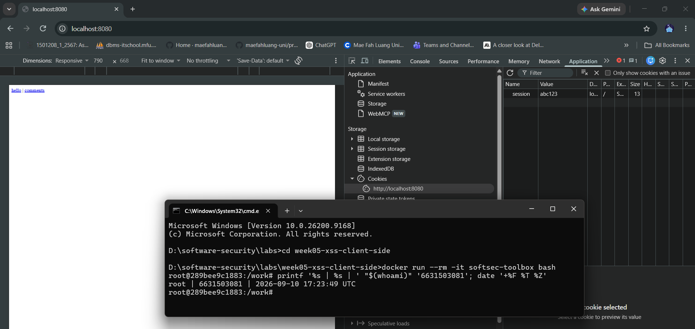

**Task 1 — Reflected XSS + XSS Golf (30 min) ⛳.**
- *Goal:* execute JS via `/hello`, then minimize the payload.
- *Steps:* visit `/hello?name=<script>alert(1)</script>`, then the alternate `/hello?name=` (useful when `<script>` tags specifically are filtered — note it's actually 3 characters longer, not shorter). Record each payload's character count for your golf score.
- *Deliverable:* both payloads + char counts + screenshot of `alert(1)` + your lowest score.

> `http://localhost:8080/hello?name=<script>alert(1)</script>`

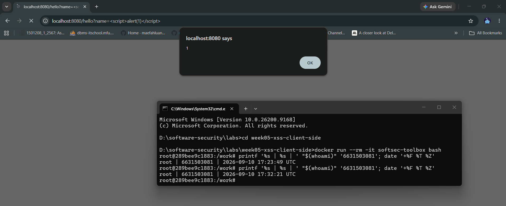

> `http://localhost:8080/hello?name=`

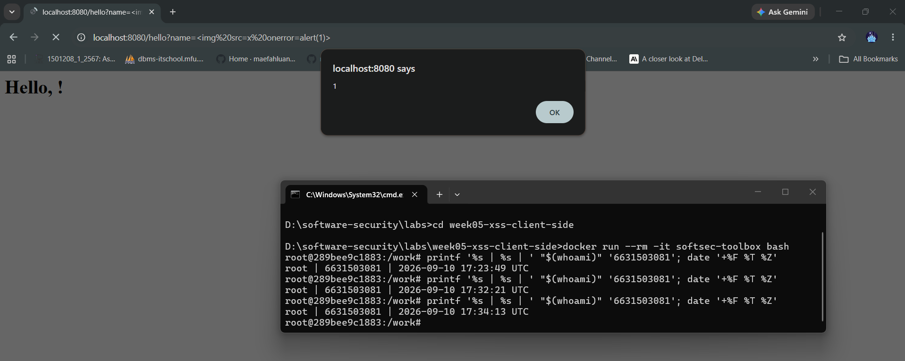

- Payload 1: `<script>alert(1)</script>` — 25 characters
- Payload 2: `` — 27 characters
- Lowest score: 25 characters using the `<script>` vector.

**Task 2 — Stored XSS (30 min) ⛳.**
- *Goal:* persist a script that runs for every visitor of `/comments`.
- *Steps:* POST a comment with body `<script>alert(document.cookie)</script>` (use the form or `curl -d 'body=...'`). Reload `/comments` and watch the cookie pop.
- *Deliverable:* payload + screenshot of the alert showing `session=abc123` + why stored XSS is more dangerous than reflected.
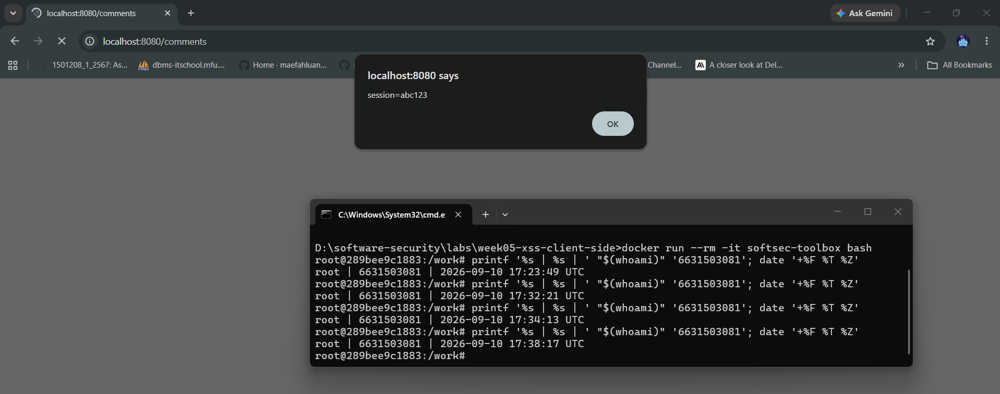
- Stored XSS is more dangerous than reflected XSS because the malicious payload is saved on the server and can execute whenever users visit the affected page. Unlike reflected XSS, an attacker does not need to make each victim open a specially crafted URL.

**Task 3 — Cookie theft via XSS (25 min).**
- *Goal:* show the cookie is readable by injected JS because **HttpOnly is missing** (CWE-1004).
- *Steps:* store `<script>new Image().src='http://localhost:8080/hello?name='+document.cookie</script>` (a beacon), or simply ``. Observe the cookie value being exfiltrated/displayed.
- *Deliverable:* payload + screenshot + 2–3 sentences on how HttpOnly would have stopped this.

- The `HttpOnly` flag prevents JavaScript from accessing a cookie through `document.cookie`, so an XSS payload could still execute but could not directly steal the session cookie. Therefore, setting `HttpOnly` would prevent this specific cookie-theft technique, although it would not fix the underlying XSS vulnerability.

**Task 4 — CSRF PoC (30 min).**
- *Goal:* make a third-party page force a state-changing POST to `/comments`.
- *Steps:* create a local `csrf.html` with an auto-submitting form targeting the board (no token exists, cookie has no SameSite, so the browser attaches `session` cross-site):
  ```html
  <body onload="document.forms[0].submit()">
    <form action="http://localhost:8080/comments" method="POST">
      <input name="body" value="CSRF posted this comment">
    </form>
  </body>
  ```
  Open the file and confirm the comment appears on `/comments`.
- *Deliverable:* the HTML + screenshot of the forged comment + why `SameSite=Strict` blocks it.

```sim
xss-context
```
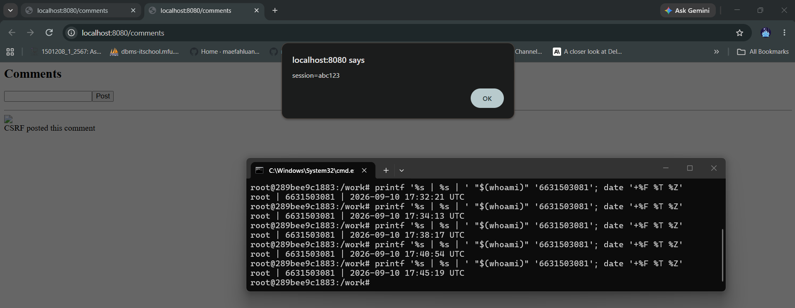
- `SameSite=Strict` prevents the browser from sending the session cookie with a cross-site request, so a forged request from another site would not contain the user's authentication cookie. However, in this lab the endpoint does not actually check the session or require a CSRF token, so the request itself can still reach `/comments` and be processed even without the cookie.


**Task 5 — Defend / fix it (30 min) 🛡️.**
- *Goal:* prove `fixed_app.py` blocks Tasks 1–3, then show that Task 4's CSRF PoC still gets through and explain why.
- *Steps:* stop the vulnerable container (`Ctrl-C`), then:
  ```bash
  docker compose run --rm --service-ports xss-lab bash -c "pip install --no-cache-dir flask && python fixed_app.py"
  ```
  Re-fire each payload. Expected: `/hello` renders the script **as text** (escape, L21), stored comments render literally (Jinja autoescape, L30–33), a strict CSP header is now present as defense-in-depth (`Content-Security-Policy: script-src 'self'`, L12 — check DevTools → Network → Response Headers; escaping already neutralizes these payloads, so no CSP *violation* fires in the console), and the cookie now has `HttpOnly; SameSite=Strict; Secure` (L42). Then re-run Task 4's `csrf.html` PoC against `fixed_app.py`: it **still posts the forged comment** — `/comments` (L25–28) never checks the `session` cookie or a CSRF token before accepting a POST, so hardening the cookie only stops the browser from *attaching* it cross-site; it doesn't stop the request itself from being processed.
- *Deliverable:* screenshots of escaped output + the CSP response header + the hardened cookie flags + the still-successful Task 4 forgery against `fixed_app.py`, with 2–3 sentences on why cookie hardening alone doesn't close CSRF here (no server-side check tied to the cookie, and no CSRF token).

>Task 1

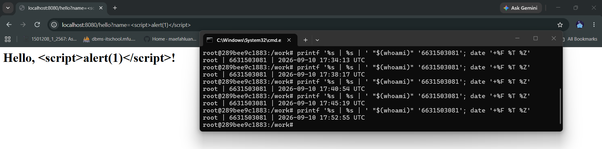

>Task 2

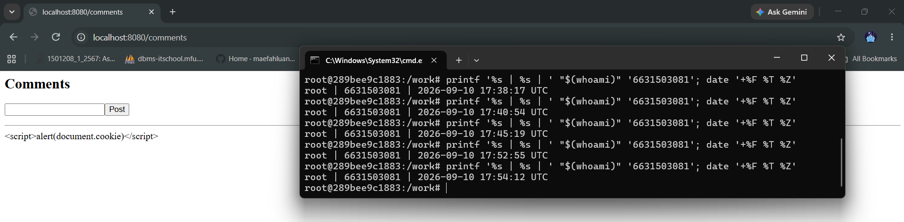

>Task 3

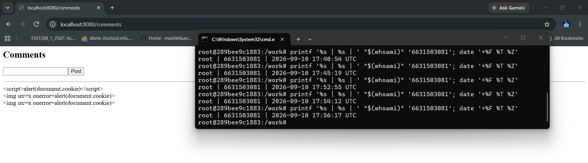

>CSP Response Header

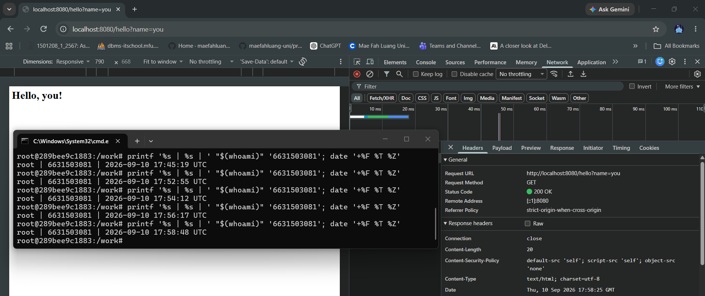

>The Hardened Cookie Flag

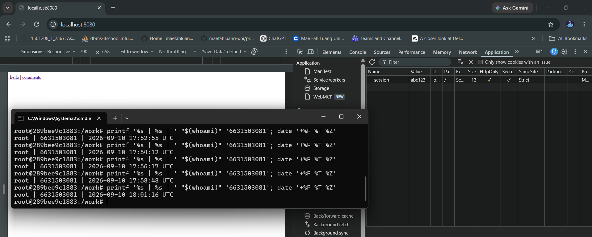

>Task 4

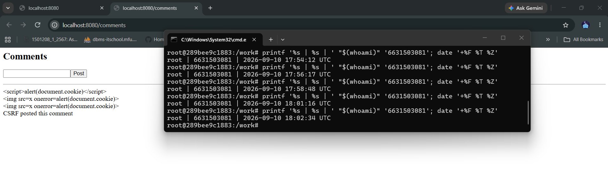

- The XSS attacks are blocked because `/hello` uses `escape()` and `/comments` uses Jinja autoescaping, while the CSP provides an additional defense against injected scripts and the cookie is protected with `HttpOnly`, `SameSite=Strict`, and `Secure`. However, the CSRF PoC still succeeds because `/comments` accepts POST requests without checking a CSRF token or performing any server-side validation tied to the session. `SameSite=Strict` prevents the cookie from being sent cross-site, but it does not prevent the server from processing the forged POST itself.


## Part 4 — Reflection

1. **CWE/OWASP mapping:** map your reflected/stored XSS to **CWE-79** and your CSRF PoC to **CWE-352**, both under OWASP 2025 **A05 Injection** (CSRF historically A01/A05).
      - The reflected and stored XSS vulnerabilities in this lab are mapped to CWE-79 (Improper Neutralization of Input During Web Page Generation) because untrusted input is rendered as executable HTML/JavaScript. The CSRF vulnerability is mapped to CWE-352 (Cross-Site Request Forgery) because the server accepts a state-changing request without verifying that it came from the legitimate user. In the worksheet's OWASP 2025 mapping, both are placed under A05: Injection, although CSRF has historically been associated with A01.

2. **Real breach:** the **2018 British Airways breach** (~380k payment records) used malicious JavaScript (Magecart) injected into the site to skim card data — a client-side script-injection failure. In 3–4 sentences relate it to this lab's XSS and CSP lessons.
      - The 2018 British Airways breach shows how malicious JavaScript can turn a client-side weakness into a large-scale data theft, with attackers modifying JavaScript to capture payment information and send it to an attacker-controlled server. The incident affected roughly 380,000 booking transactions and demonstrated the danger of allowing untrusted or compromised scripts to run in a trusted website context. This lab demonstrates the same basic lesson on a smaller scale: output encoding prevents injected code from becoming executable, while a strict CSP provides an additional layer that restricts which scripts can run.

3. **Best mitigation:** between output encoding, a strict CSP, and HttpOnly+SameSite cookies, which gives the broadest defense-in-depth, and why is "encoding alone" still risky?
      - The broadest defense-in-depth approach is to use all three: output encoding prevents untrusted input from becoming executable, CSP limits which scripts can execute, and HttpOnly + SameSite cookies reduce the impact of XSS and help protect against cookie theft and CSRF. Encoding should still be the primary XSS defense because CSP can be misconfigured or weakened, while encoding directly prevents the untrusted data from being interpreted as code.

## Grading rubric (100)

| Criterion | Points |
|-----------|-------:|
| Part 2 — Lecture questions (conceptual accuracy) | 20 |
| Part 3 — Exploitation + evidence (payloads + screenshots, Tasks 1–4) | 40 |
| Part 3 — Defense (Task 5: fixes proven, lines cited) | 25 |
| Part 4 — Reflection (CWE/OWASP mapping, breach, mitigation) | 15 |
| **Total** | **100** |

---

## Evidence & Integrity (required)

- **Identity proof:** every screenshot/diagram must show a terminal running `printf '%s | %s | ' "$(whoami)" '<YOUR-STUDENT-ID>'; date '+%F %T %Z'` **in the
  same image as the evidence**. When the evidence is a browser page, a DevTools panel or a
  rendered response, put that terminal **beside the browser and capture the whole screen** — a
  cropped window carries nothing that identifies you, and the lab's own output is
  byte-identical for the whole cohort *by design*, so the stamp is the only thing that makes
  the shot yours. Generic or borrowed evidence is not accepted.
- **Personalized flag (if this lab issues one):** ____________________
  *Flags are unique per student — submitting another student's flag is a violation. How to submit: **learn.zcr.ai/submit** (full guide: `SUBMISSION.md` in the repo root).*
- **Explain in your own words** *(graded on your reasoning, not copied text):*
  1. What did you do, and **why did the vulnerability work**?
  2. **Why does your fix actually stop it** — and what could still break it?

---

## 🤖 Audit the AI (required)

AI is a power tool you must **distrust** — you are graded on your *critique*, not the AI's answer.

1. Ask an AI assistant to exploit **or** fix this week's vulnerability. Paste its full answer.
      - #### AI request:
      - Fix the reflected XSS vulnerability in vulnerable_app.py. The /hello route currently inserts the name query parameter directly into an HTML response. Provide a secure fix using contextual HTML output encoding and explain why it prevents <script>alert(1)</script> from executing.
      - #### AI answer:
      - The /hello route can be fixed by escaping the user input before inserting it into the HTML response. For example:
          ```python
          from markupsafe import escape

          @app.route("/hello")
          def hello():
              name = request.args.get("name", "world")
              html = "<h1>Hello, " + str(escape(name)) + "!</h1>"
              return Response(html, mimetype="text/html")
          ```

      -  escape() converts HTML-special characters such as < and > into safe entities, so `<script>alert(1)</script>` is rendered as text instead of being interpreted as a script.

2. **Find what's wrong or risky** in it — insecure code, a subtly incomplete fix, a hallucinated API/function/CVE, a missed edge case, or wrong reasoning. Quote the exact line(s).
      - The AI answer correctly fixes the reflected XSS vulnerability, but it only addresses the `/hello` endpoint. It does not address the stored XSS vulnerability in `/comments` or provide additional defense-in-depth controls such as CSP, so the application would still be vulnerable to stored XSS.
      - Exact line to critique:

        `"The /hello route can be fixed by escaping the user input before inserting it into the HTML response."`

      - This is correct for reflected XSS, but incomplete for the whole vulnerable application because /comments also renders untrusted input.

3. Produce the **correct, verified** version yourself and explain in 2–3 sentences why the AI's output was insufficient.
      - The verified fix for /hello is to use escape() before inserting the name value into the HTML response:
        ```python
        html = "<h1>Hello, " + str(escape(name)) + "!</h1>"
        ```

      - After applying the fix, <script>alert(1)</script> is displayed as text instead of executing. The AI's answer was insufficient because it fixed only one XSS entry point and did not address the stored XSS endpoint or defense-in-depth measures. 


> Disclose your AI use in the Part 1 table. This task counts toward your **Defense + Reflection** score.

---

## 🧠 Comprehension & Prompt (required)

**A. Explain in Plain English (EiPE).** In 2–3 sentences, in your own words, describe what this week's vulnerable code/endpoint actually *does* and *why it is exploitable* — explain the mechanism, don't dump jargon.
- The vulnerable application takes user input from the `/hello` URL and `/comments` form and puts it directly into the webpage without making it safe first. Because the browser interprets the input as HTML, an attacker can insert HTML elements containing JavaScript that runs when the page is opened or viewed.

**B. Prompt Problem.** Write a **single prompt** that makes an AI produce a *correct, secure* fix for one finding. Run it: does the exploit now fail? If not, refine the prompt and try again. Submit the **final prompt + the verified result**.

>Final prompt

Fix the reflected XSS vulnerability in the `/hello` route of this Flask application. Keep the existing functionality unchanged. Use proper contextual HTML output encoding with `markupsafe.escape()` before inserting the user-controlled `name` parameter into the HTML response. Do not rely only on input validation or CSP as the fix. Provide the corrected `/hello` route and briefly explain why `<script>alert(1)</script>` will no longer execute after the fix.

>AI Answer 

The AI recommended using markupsafe.escape() on the user-controlled name parameter before inserting it into the HTML response. This prevents characters such as < and > from being interpreted as HTML, so the XSS payload is displayed as text instead of executing.

>The Verified Result

I tested the original reflected XSS payload `<script>alert(1)</script>` on the `/hello` endpoint after applying the fix. The alert did not execute, and the payload was displayed as text instead of being interpreted as HTML/JavaScript. Therefore, the reflected XSS exploit failed and the fix was successful.

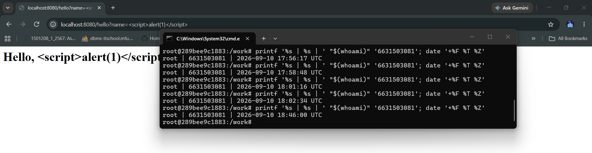

*Graded on the prompt's precision and your verification — this trains problem decomposition and AI literacy (Denny et al. 2024).*
