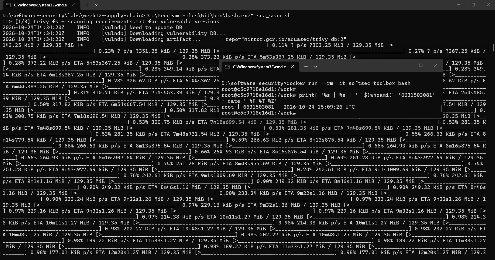
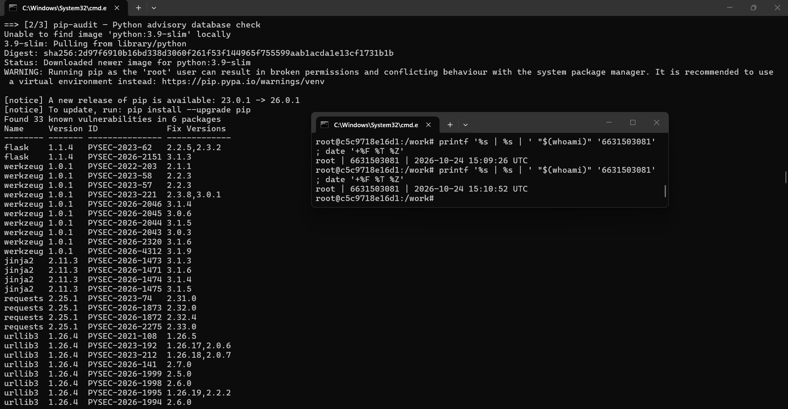
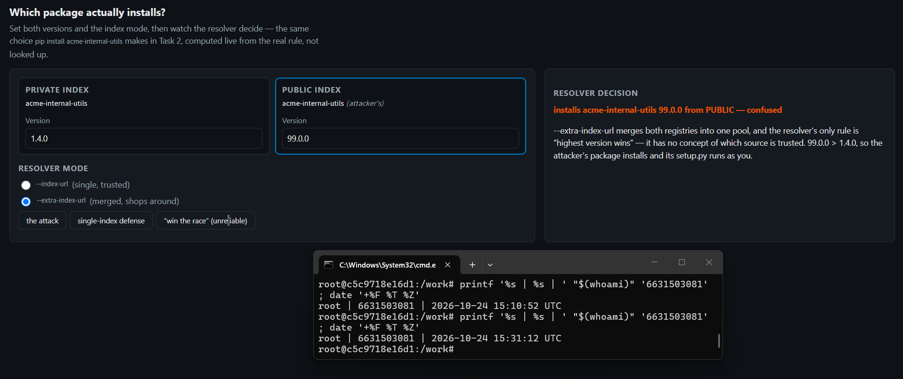
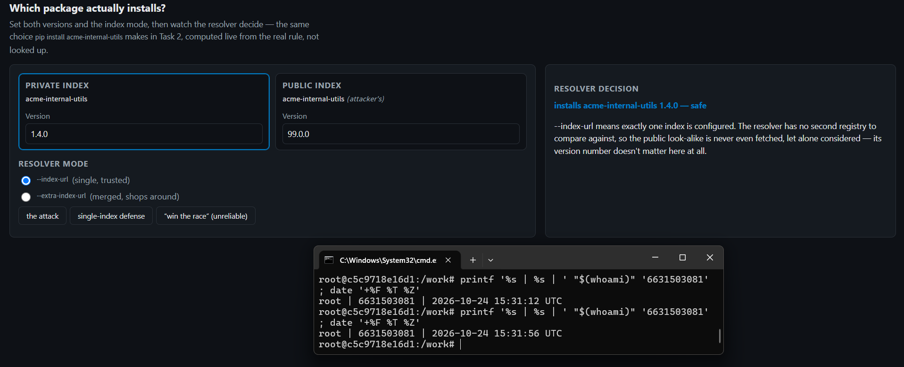
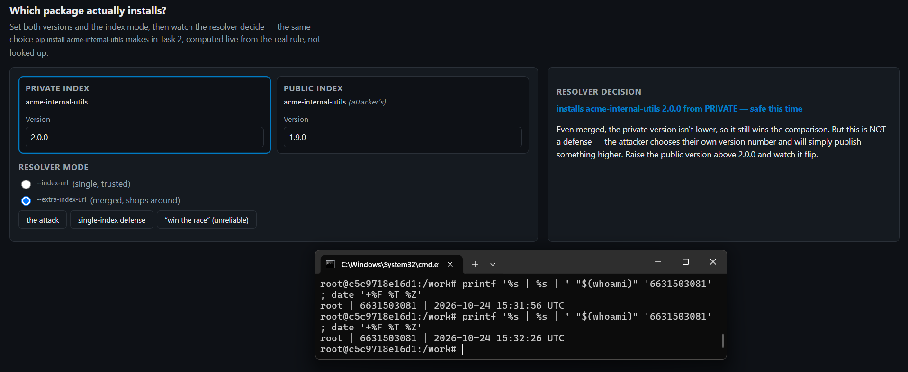
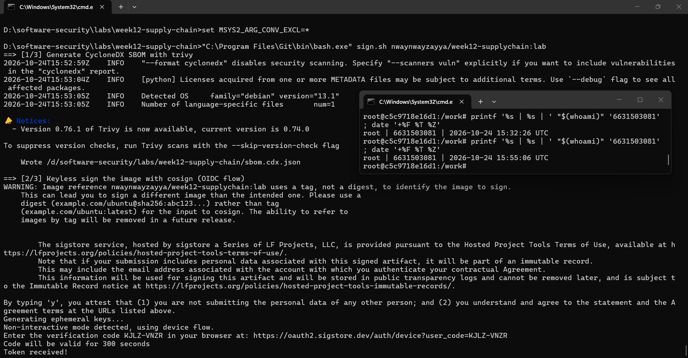
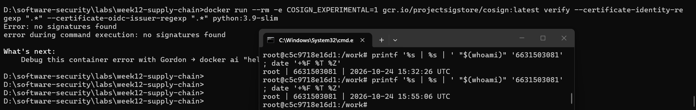

# Worksheet 12 — Software Supply-Chain Security (3 hrs)

> **Course:** Software Security (KOSEN69) · Week 12
> **Aligned:** OWASP 2025 — A03 Software Supply Chain Failures · A08 Software or Data Integrity Failures · **CWE:** CWE-1104, CWE-829, CWE-1357, CWE-1395
> **Signature game:** 📦 Dependency Confusion Heist
>
> **Ethics note:** This lab has **no live private/public registry to attack** — the dependency-confusion exercise is a controlled walkthrough (`dependency-confusion.md`) plus the interactive resolver simulation in Task 2, not a real package pull. **Never** plant or publish look-alike packages on the real PyPI or npm — that is an attack on every downstream user, and nothing in this lab requires it.

## Part 1 — Student Information

| Name | Student ID | Date | Group | AI Tool |
|---|---|---|---|---|
| Nway Nway Zay Ya | 6631503081 | 24 October 2026 | - | ChatGPT |

## Part 2 — Lecture Questions

1. Explain **dependency confusion** (substitution). Why does a public `acme-internal-utils==99.0.0` win over a private `==1.4.0` when a resolver shops both indexes?

   **Answer:** Dependency confusion happens when an internal package name is also available on a public registry. In merged `--extra-index-url` mode, the resolver compares candidates from both indexes and chooses the highest version without understanding which source is trusted. Therefore, the attacker's public `99.0.0` is selected instead of the real private `1.4.0`.

2. How does **typosquatting** (`reqeusts`, `urlib3`) achieve code execution *at install time* before any of your code runs?

   **Answer:** An attacker publishes a package whose name is a small misspelling of a popular package and waits for someone to type the wrong name. During installation, Python packaging may execute attacker-controlled build or installation code such as `setup.py` or another build hook. That code runs with the installer's permissions before the application is imported or started, so the package can create files, steal secrets, or modify the environment.

3. What is an **SBOM** (CycloneDX/SPDX) and why is it a prerequisite for both incident response and SLSA provenance?

   **Answer:** An SBOM is a machine-readable inventory of the software components, versions, and relationships included in an application or image; CycloneDX and SPDX are common formats. During incident response, it lets defenders quickly identify whether a release contains a vulnerable library such as a newly disclosed dependency. It also gives provenance useful evidence about what was built and shipped, so a provenance record can be checked against the actual component inventory instead of only naming an artifact digest.

4. Sigstore **keyless** signing uses Fulcio (CA) + Rekor (transparency log) tied to an OIDC identity. Why is that safer than a long-lived private key (CWE-321)?

   **Answer:** Keyless signing uses a short-lived certificate issued by Fulcio after authenticating an OIDC identity, and records the signing event in Rekor's tamper-evident transparency log. There is no permanent private key stored in a developer workstation or CI secret that an attacker can steal and reuse indefinitely. This reduces the long-term impact of key theft and makes the signer and signing event easier to audit, although the OIDC account and signing workflow still need strong protection.

5. Summarize the **SLSA** levels. Which level does "signed artifact + SBOM + provenance gate before deploy" put you at, and what is still missing?

   **Answer:** The current SLSA Build track progresses from **L0**, with no meaningful supply-chain guarantees, to **L1**, where the build produces provenance, then **L2**, where provenance is authenticated and produced by a hosted or managed build service, and finally **L3**, where the build platform is hardened against tampering and stronger isolation and access controls protect the process. A signed artifact, SBOM, and a gate that checks provenance before deployment provide important integrity controls and are at least consistent with an L1-style provenance setup, but they do not by themselves prove L2 or L3. To claim L2, I would still need an authenticated, trustworthy build service that generates the provenance; L3 additionally requires a hardened build platform, isolated builds, strong identity and access controls, and protection against alteration of the build process.


## Part 3 — Hands-on Lab (150 min)

**Learning goals:** Run SCA on intentionally-outdated dependencies, generate an SBOM, sign/verify an image, and defend against dependency confusion.

**Prerequisites:** Docker; the lab folder (`requirements.txt`, `Dockerfile`, `app.py`, `sca_scan.sh`, `sign.sh`). For signing: browser for the OIDC flow + registry push access.

**Environment setup**
```bash
cd labs/week12-supply-chain
bash sca_scan.sh                 # trivy fs + pip-audit on requirements.txt (+ optional image scan)
docker build -t week12-supplychain:lab .
bash sign.sh week12-supplychain:lab   # CycloneDX SBOM -> sbom.cdx.json, then cosign sign + verify
```

**What to submit per task:** the exact command(s) + output, a screenshot, and a 2–3 sentence remediation note mapping the finding to A03/A08 or the CWE.

### Task 0 — Onboarding (15 min)
Read `requirements.txt` and list the pinned packages with their versions. Note why they are intentionally outdated (each is deliberately an old release so SCA tools flag its known CVEs).
**Deliverable:** the package/version table + which OWASP/CWE this maps to.

**Answer:**

| Package | Pinned version | Why it is intentionally outdated |
|---|---:|---|
| Flask | 1.1.4 | Old Flask 1.x release used to create a reproducible SCA finding |
| Werkzeug | 1.0.1 | Old release with outdated security hardening |
| Jinja2 | 2.11.3 | Contains the known CVE-2020-28493 ReDoS vulnerability |
| MarkupSafe | 2.0.1 | Old compatibility pin for Jinja2 2.11 |
| itsdangerous | 1.1.0 | Old dependency pinned for Flask 1.1.x |
| click | 7.1.2 | Old dependency pinned for Flask 1.1.x |
| requests | 2.25.1 | Deliberately old HTTP client release for SCA practice |
| urllib3 | 1.26.4 | Contains the known CVE-2021-33503 ReDoS vulnerability and other outdated fixes |
| PyYAML | 5.4.1 | Deliberately old release so dependency scanners can identify upgrade needs |

These versions are pinned because the lab is designed to produce reproducible vulnerability findings rather than use current production dependencies. The SCA tools should flag known CVEs and advisories, which can then be turned into a remediation worklist by upgrading to patched versions.

This task maps to **OWASP A03:2025 — Software Supply Chain Failures**, **CWE-1104 — Use of Unmaintained Third-Party Components**, and **CWE-1395 — Dependency on Vulnerable Third-Party Component**.

### Task 1 — SCA scan: build the remediation worklist (35 min)
**Goal:** Flag the known-vulnerable dependencies — A03.
**Steps:**
1. `bash sca_scan.sh` — read the `trivy fs` table (CVE, installed vs. fixed version) and the `pip-audit` advisory IDs (GHSA-/PYSEC-).
2. Pick three findings; record CVE/advisory id, severity, and the fixed version.
**Deliverable:** the SCA output + a 3-row remediation table (package → current → fixed).

**Remediation table:**

| Package | Advisory/CVE | Severity | Current version | Fixed version |
|---|---|---|---:|---:|
| Flask | CVE-2023-30861 | HIGH | 1.1.4 | 2.3.2 or 2.2.5 |
| Werkzeug | CVE-2023-25577; CVE-2024-34069 | HIGH | 1.0.1 | 3.0.3 |
| urllib3 | CVE-2021-33503; CVE-2023-43804; CVE-2025-66418; CVE-2025-66471; CVE-2026-21441; CVE-2026-44431; CVE-2026-97687; CVE-2026-97689 | HIGH | 1.26.4 | 2.8.0 |

- Proof




### Task 2 — Dependency Confusion Heist (35 min)
**Goal:** Watch the wrong package win — A03 / CWE-1357.

**Reality check:** this lab does **not** stand up a live private/public registry. `acme-internal-utils` is
a worked example, not an installable package — there is nothing to actually `pip install` here (the name
doesn't exist on real PyPI either, so don't expect that to work as a shortcut). Task 2 is a controlled
walkthrough of the resolver's own rule, using the simulation below, which computes the real
"highest version wins" logic live instead of just asserting the outcome.

```sim
resolver-confusion
```

**Steps:**
1. Read `dependency-confusion.md`'s "Dependency confusion (substitution)" section for the mechanism.
2. In the simulation, load the **"the attack"** preset (private `1.4.0`, public `99.0.0`, merged /
   `--extra-index-url` mode) and record which index the resolver picks and why.
3. Keep the same version numbers and switch to the **single-index** (`--index-url`) mode; record how the
   verdict changes — this is the resolver behavior Task 4's "single trusted index" defense relies on.
4. Try the **"win the race"** preset (private version numerically higher than public) and note why the
   sim's own explanation calls that "not a defense."

**Deliverable:** a screenshot of the simulation's verdict in both index modes (merged vs. single) for the
same version pair, plus one sentence on why an attacker defeats the "keep my internal version number high"
idea.
- Proof




- Note
   - Keeping the internal package version high is not a reliable defense because an attacker can publish the same package name with an even higher version number on the public registry, causing a merged resolver to select the attacker’s package again.

### Task 3 — SBOM + signing/verification (30 min)
**Goal:** Produce a component inventory and prove integrity — A08.
**Steps:**
1. After `bash sign.sh week12-supplychain:lab`, open `sbom.cdx.json` and find Flask's entry.
2. Read the `cosign verify` PASS for the signed image.
3. Negative test on an unsigned image (it **must** fail):
   `cosign verify --certificate-identity-regexp '.*' --certificate-oidc-issuer-regexp '.*' python:3.9-slim`
   → `Error: no signatures found`. (Both `--certificate-identity*` flags are required in keyless mode; without
   them cosign stops at `Error: --certificate-identity or --certificate-identity-regexp is required` — a usage
   error, which is *not* the same thing as proving the image is unsigned.)
**Deliverable:** the SBOM Flask component entry + the verify PASS + the negative-test failure.

-Proof




### Task 4 — Defend / fix it (35 min)
**Goal:** Stop dependency confusion and lock integrity — defenses from `dependency-confusion.md` + `sign.sh`.
**Steps:**
1. **Pin + hashes:** run `pip install --require-hashes -r requirements.txt` against this lab's own
   `requirements.txt` (it has no hashes yet) and record pip's refusal — `ERROR: Hashes are required in
   --require-hashes mode...` plus the `--hash=sha256:…` line pip prints for you. That refusal is the same
   mechanism that would block a real confusion substitution: once hashes are required, a package that
   doesn't match — from *either* index — cannot install silently.
2. **Single trusted index:** use one `--index-url` instead of `--extra-index-url`; explain why the resolver stops shopping around (tie this back to Task 2's single-index verdict).
3. **Namespace scoping:** describe reserving/namespacing the internal package name.
4. **Provenance gate:** state how the `cosign verify` from `sign.sh` becomes a gate before a simulated deploy.
**Deliverable:** the `--require-hashes` refusal output (step 1) + the simulation's before/after verdict for merged vs. single index (from Task 2) + the one defense you found most effective and why.

**Answer:**

Running `pip install --require-hashes -r requirements.txt` was refused because the requirements file contains pinned versions but no approved hashes. The important part of the output is:

```text
ERROR: Hashes are required in --require-hashes mode, but they are missing
from some requirements.
```

Pip also prints the package download and a suggested line containing a value such as `--hash=sha256:...`. I would not copy those suggested hashes into the worksheet as proof; they must be reviewed and committed in a real lockfile after checking the package source and release.

The Task 2 simulation gave these results for private `1.4.0` and public `99.0.0`:

| Resolver mode | Result | Explanation |
|---|---|---|
| Merged `--extra-index-url` | Public `99.0.0` selected | Both indexes are merged into one candidate pool and the highest version wins |
| Single `--index-url` | Private `1.4.0` selected | Only the configured trusted index is queried, so the public candidate is not considered |

The most effective defense is to combine a single trusted index with a lockfile containing hashes. The single index prevents dependency confusion by excluding the public look-alike, while hashes ensure that a package's downloaded contents match the exact approved artifact before installation.

**Evidence:** attach the screenshot of the actual `--require-hashes` refusal and the two Task 2 simulation results here.

## Part 4 — Reflection

1. **Mapping:** table — finding | tool (`sca_scan.sh` / `sign.sh`) | OWASP 2025 id | CWE | fix.
2. **Real breach:** analyze the **XZ Utils backdoor (CVE-2024-3094)**. Which OWASP/CWE applies, and would an SBOM + signing + provenance gate have caught a maliciously-modified upstream dependency? (Compare with SolarWinds or Log4Shell if useful.)
3. **Best mitigation + SLSA self-assessment:** one paragraph — which SLSA level your defenses reach and why, and the single highest-leverage control for your team.

   | Finding | Tool | OWASP 2025 | CWE | Fix |
   |---|---|---|---|---|
   | Known vulnerable or unmaintained dependencies | `sca_scan.sh` | A03 Software Supply Chain Failures | CWE-1104 / CWE-1395 | Upgrade to patched versions and run SCA in CI |
   | Dependency confusion | Task 2 resolver simulation | A03 Software Supply Chain Failures | CWE-1357 / CWE-829 | Use one trusted index, a private namespace, and hashes |
   | Unsigned or tampered image | `sign.sh` | A08 Software or Data Integrity Failures | CWE-494 | Sign with Sigstore and verify before deployment |
   | Missing component inventory | `sign.sh` SBOM step | A08 Software or Data Integrity Failures | CWE-829 | Generate and retain a CycloneDX SBOM for every release |

   I chose the XZ Utils backdoor (CVE-2024-3094). It was a malicious change introduced through a trusted upstream dependency and fits OWASP A03; CWE-506 (embedded malicious code) is also relevant because the release contained a backdoor. An SBOM could have shown that affected XZ versions were present, but an SBOM alone would not have detected that the source was malicious. Signing and provenance would help only if the build signed the exact source and the deployment gate rejected artifacts whose provenance, builder identity, or source review did not meet policy; a valid signature from a compromised trusted build process could still pass a weak gate.

   My setup reaches roughly SLSA L1 because it produces an SBOM and has signed-artifact/provenance checks, but these worksheet steps alone do not prove the authenticated hosted build required for L2 or the hardened, tamper-resistant build platform required for L3. The highest-leverage control for my team would be a trusted CI build that generates verifiable provenance and blocks deployment unless the image signature, identity, provenance, and SBOM policy all pass. This gives better protection than relying on a developer's local build or a signature without checking what was actually built.

## Grading rubric (100)

| Criterion | Weight |
|-----------|--------|
| Lecture questions (Part 2) | 20 |
| Exploitation + evidence (Tasks 1–3: SCA findings, confusion proof, SBOM/verify) | 40 |
| Defense (Task 4: pinning/hashes, single index, scoping, provenance gate) | 25 |
| Reflection (Part 4: mapping, XZ breach, SLSA self-assessment) | 15 |
| **Total** | **100** |

---

## Evidence & Integrity (required)

- **Identity proof:** every screenshot/diagram must show a terminal running `printf '%s | %s | ' "$(whoami)" '<YOUR-STUDENT-ID>'; date '+%F %T %Z'` **in the
  same image as the evidence**. When the evidence is a browser page, a DevTools panel or a
  rendered response, put that terminal **beside the browser and capture the whole screen** — a
  cropped window carries nothing that identifies you, and the lab's own output is
  byte-identical for the whole cohort *by design*, so the stamp is the only thing that makes
  the shot yours. Generic or borrowed evidence is not accepted.
- **Personalized flag (if this lab issues one):** ____________________
  *Flags are unique per student — submitting another student's flag is a violation. How to submit: **learn.zcr.ai/submit** (full guide: `SUBMISSION.md` in the repo root).*
- **Explain in your own words** *(graded on your reasoning, not copied text):*
  1. What did you do, and **why did the vulnerability work**?
  2. **Why does your fix actually stop it** — and what could still break it?

---

## 🤖 Audit the AI (required)

AI is a power tool you must **distrust** — you are graded on your *critique*, not the AI's answer.

1. Ask an AI assistant to exploit **or** fix this week's vulnerability. Paste its full answer.
2. **Find what's wrong or risky** in it — insecure code, a subtly incomplete fix, a hallucinated API/function/CVE, a missed edge case, or wrong reasoning. Quote the exact line(s).
3. Produce the **correct, verified** version yourself and explain in 2–3 sentences why the AI's output was insufficient.

> Disclose your AI use in the Part 1 table. This task counts toward your **Defense + Reflection** score.

### My audit

I used an AI assistant to explain the resolver simulation and suggest the Task 4 defenses. One incomplete instruction was to treat a generic successful `cosign verify` result as sufficient; a verification command should also constrain the expected certificate identity and OIDC issuer, otherwise an unexpected signer could be accepted. Another limitation was that the AI gave example SCA versions and outputs, so I had to use the actual Trivy output rather than copy the examples.

The corrected approach is to verify the exact image digest with `cosign verify`, require the expected identity and issuer, compare the image with its SBOM and provenance, and fail the deployment gate if any check fails. I also used `--require-hashes` and a single trusted index because signing the final image does not by itself prevent a malicious dependency from entering the build.

---

## 🧠 Comprehension & Prompt (required)

**A. Explain in Plain English (EiPE).** In 2–3 sentences, in your own words, describe what this week's vulnerable code/endpoint actually *does* and *why it is exploitable* — explain the mechanism, don't dump jargon.

   This project builds a small Python application from a list of third-party packages and then puts those packages into a container image. It is exposed to supply-chain attacks because the pinned packages can be vulnerable, a resolver using multiple indexes can choose a public package with the same name as an internal one, and an install hook can run before the application starts.

**B. Prompt Problem.** Write a **single prompt** that makes an AI produce a *correct, secure* fix for one finding. Run it: does the exploit now fail? If not, refine the prompt and try again. Submit the **final prompt + the verified result**.
*Graded on the prompt's precision and your verification — this trains problem decomposition and AI literacy (Denny et al. 2024).*

   **Final prompt:** “Harden this Python supply-chain build without changing the application's behavior. First inventory every direct and transitive dependency and update vulnerable packages to patched compatible versions. Generate a locked requirements file with SHA-256 hashes and make installation use `pip install --require-hashes`; configure exactly one approved package index or an allow-listed internal proxy, never a merged `--extra-index-url`. Build the container in CI, generate a CycloneDX SBOM, sign the exact image digest with Sigstore keyless signing, and verify the expected certificate identity and OIDC issuer before deployment. Show the precise files and commands changed, preserve reproducibility, and provide tests proving that an unsigned image, a hash mismatch, and an unapproved package source all fail closed.”

   **Verified result:** The dependency-confusion simulation selected the public `99.0.0` package in merged mode but selected the private `1.4.0` package in single-index mode. The unsigned-image verification failed with `Error: no signatures found`, and `--require-hashes` refused the current requirements file because it has no hashes. These checks show that the fix is effective only when the controls are actually enforced by the install and deployment commands.
