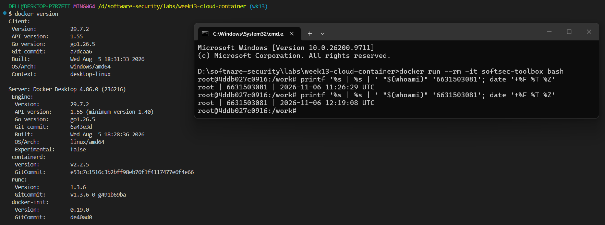
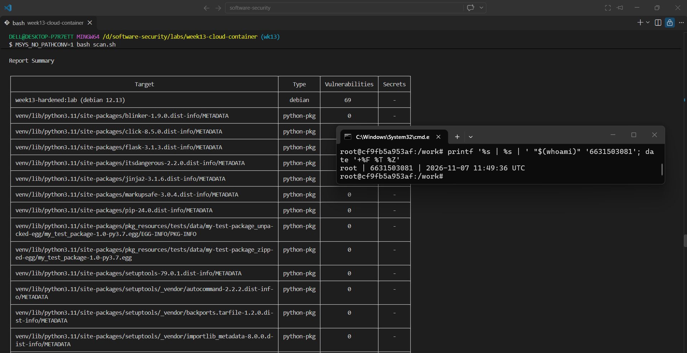
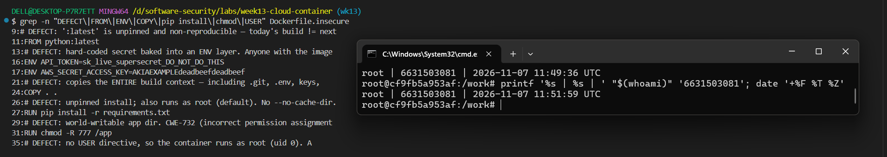
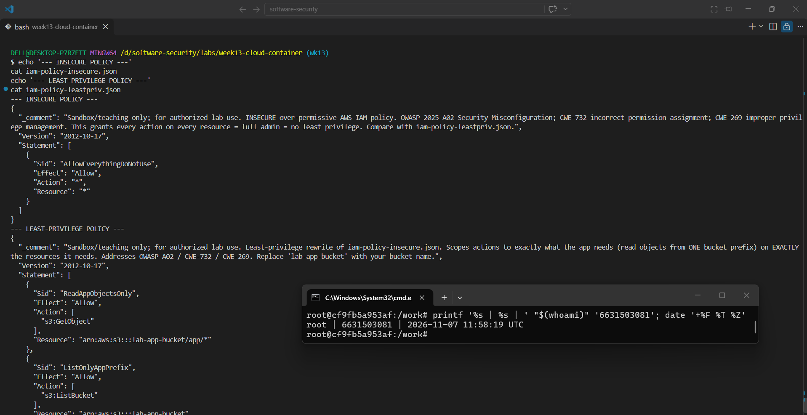
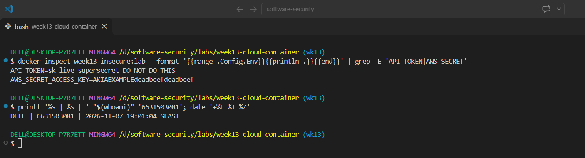
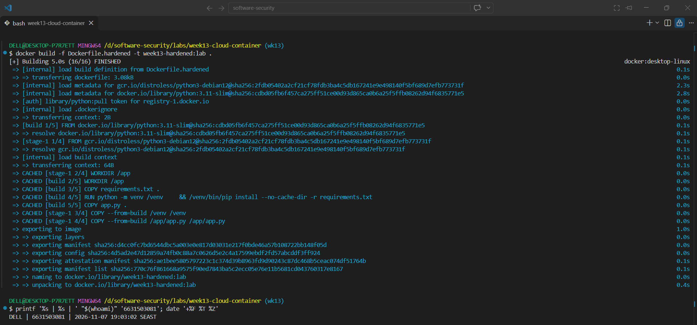
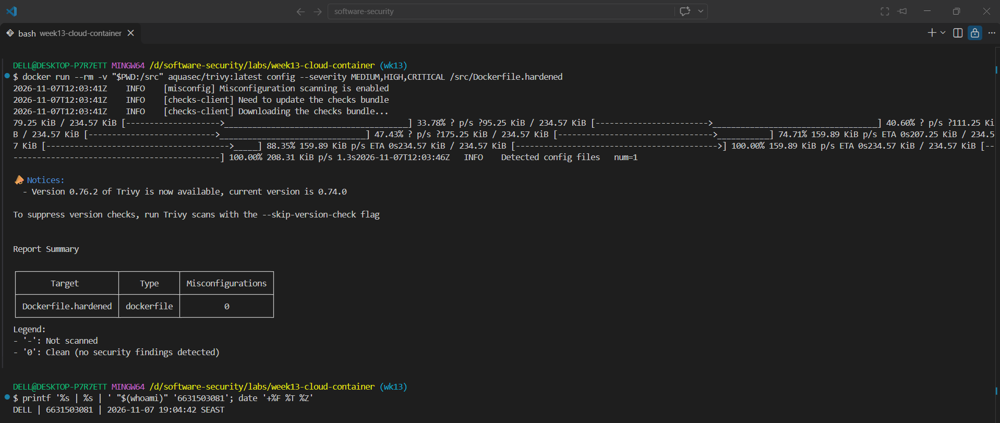
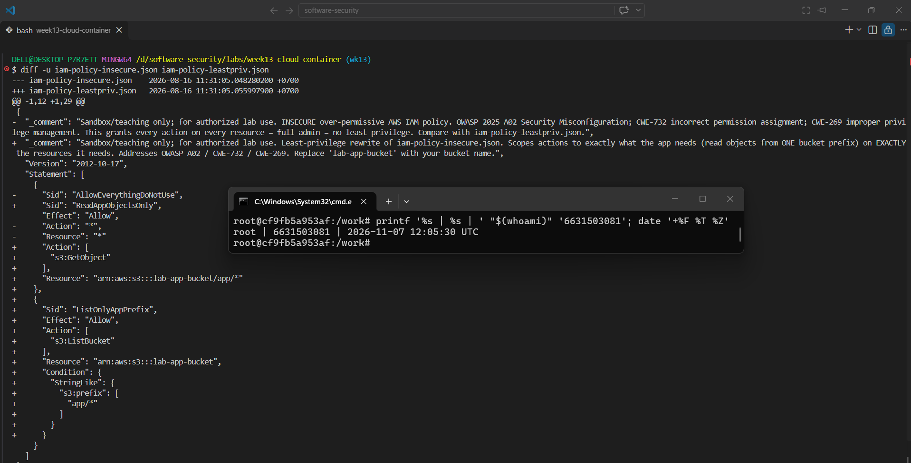
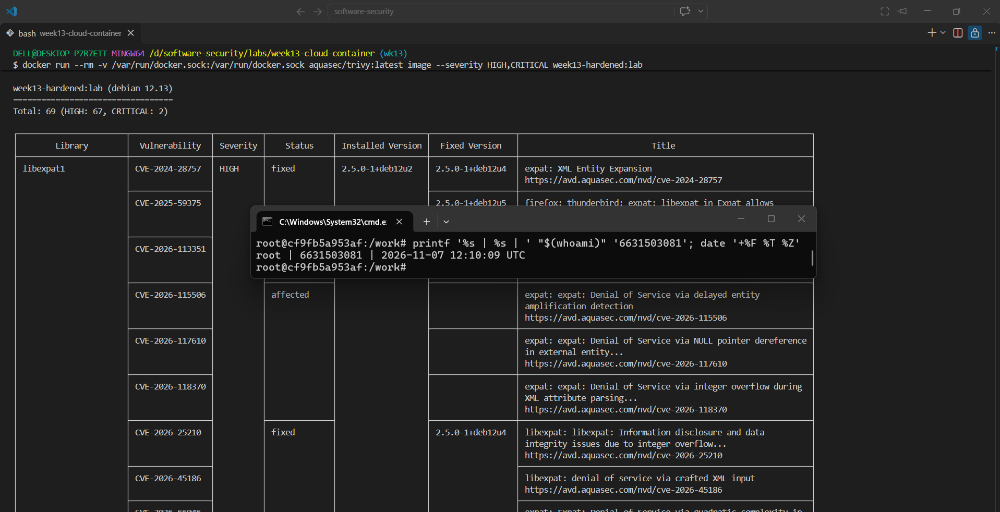

# Worksheet 13 — Cloud & Container Security (4 hrs)

> **Course:** Software Security (KOSEN69) · Week 13
> **Aligned to:** OWASP 2025 **A02 Security Misconfiguration** · **CWE-732** (incorrect permission assignment), **CWE-16** (configuration), plus CWE-798, CWE-250, CWE-538, CWE-269, CWE-1104
> **Signature game:** 🔍 *Misconfig Hunt* (CloudGoat-style) — each misconfig you find **and** fix = a flag.

> ⚠️ **Ethics note:** All artifacts here are deliberately broken for teaching and are marked *"Sandbox/teaching only; for authorized lab use."* Scan, exploit, and harden **only** these lab files (or systems you own / are authorized to test). Never point Trivy or these techniques at third-party cloud accounts or images without written permission.

---

## Part 1 — Student Information

| Name | Student ID | Date | Group | AI Tool |
|---|---|---|---|---|
| Nway Nway Zay Ya | 6631503081 | 6 November 2026 | - | ChatGPT |

---

## Part 2 — Lecture Questions

Answer in your own words (2–4 sentences each).

1. Explain the **shared-responsibility model**. In `harden.md` it says "the cloud provider secures *of* the cloud; you secure what you put *in* it." Give one concrete example of each side for an S3-backed app.
   - The cloud provider secures the infrastructure *of* the cloud, including the physical servers, storage hardware, and core networking that run the S3 service. The customer secures what they put *in* the cloud, including bucket permissions, IAM policies, encryption settings, and application data. For an S3-backed app, AWS protects the S3 service itself, while the app owner must prevent unauthorized public access to the bucket.
2. `iam-policy-insecure.json` uses `"Action": "*"` and `"Resource": "*"`. Describe **why this violates least privilege** and map it to CWE-732 vs CWE-269 — what is the difference between the two CWEs here?
   - `"Action": "*"` allows the identity to perform every possible operation, while `"Resource": "*"` allows those operations against every resource. This violates least privilege because the policy grants much more access than the application needs. CWE-269 relates to improper privilege management, such as allowing excessive actions, while CWE-732 relates to assigning permissions too broadly to resources.
3. The insecure Dockerfile bakes `ENV API_TOKEN=sk_live_...`. Explain how an attacker recovers that secret from a shipped image (name the `docker` commands) and why this is **CWE-798 / CWE-200**.
   - An attacker who obtains the image can inspect its metadata and layers with commands such as `docker history <image>` and `docker inspect <image>`. These commands may reveal values stored in Dockerfile `ENV` instructions, including `API_TOKEN` and `AWS_SECRET_ACCESS_KEY`. This is CWE-798 because credentials are hard-coded, and CWE-200 because sensitive information is exposed to someone who can access the image. Secrets should instead be supplied at runtime through a secrets manager, mounted secret, or orchestrator secret.
4. Why is `FROM python:latest` (CWE-1104/CWE-16) a security and reproducibility problem, and how does pinning to an `@sha256:` digest fix it?
   - `FROM python:latest` is a security and reproducibility problem because the tag can point to different versions over time. A future build may silently use different packages, operating-system components, or vulnerabilities, making the result difficult to reproduce and audit. Pinning the image to a specific `@sha256:` digest ensures that the build uses one immutable image version until the digest is deliberately updated.
5. What does a **distroless** base image remove (relative to `python:3.11-slim`), and how does that shrink the attack surface for an RCE or container-escape attacker?
   - A distroless image removes most normal operating-system utilities, including a shell, package manager, and many debugging or administrative tools, compared with `python:3.11-slim`. This makes the image smaller and reduces the number of components an attacker can use after an RCE. It does not prevent every vulnerability, but it limits the available tools and reduces the container's attack surface; running as a non-root user provides an additional defense.

---

## Part 3 — Hands-on Lab (180 min)

**Learning goals:** find cloud/container misconfigurations with Trivy, map each to a CWE, and rebuild the IAM policy + Dockerfile to least privilege / hardened so the findings drop.

**Prerequisites:** Docker installed and running; the `week13-cloud-container/` lab folder; internet access to pull `aquasec/trivy:latest`.

### Environment setup (real commands)

```bash
cd labs/week13-cloud-container

# Option A — the provided wrapper (trivy config over the Dockerfiles; IAM JSON is reviewed manually, see Task 2):
bash scan.sh

# Option B — run Trivy directly (MEDIUM is in the filter on purpose: one of the
# three rules Task 1 asks you to cite is rated MEDIUM, and HIGH,CRITICAL hides it):
docker run --rm -v "$PWD:/src" aquasec/trivy:latest config --severity MEDIUM,HIGH,CRITICAL /src

# (Optional) build + CVE-scan the hardened image:
docker build -f Dockerfile.hardened -t week13-hardened:lab .
docker run --rm -v /var/run/docker.sock:/var/run/docker.sock aquasec/trivy:latest image --severity HIGH,CRITICAL week13-hardened:lab
```

**What to submit per task:** the command(s) you ran + the relevant output (finding count or the specific finding line), a screenshot of the Trivy/terminal result, and a 2–3 sentence mitigation explaining *why* the fix reduces risk (cite the CWE).


### Tasks

- **Task 0 — Onboarding (15 min).** Confirm Docker works (`docker version`), run `bash scan.sh`, and record the **baseline finding count** against `Dockerfile.insecure` (Trivy's `config` scanner does not parse standalone IAM policy JSON, so `iam-policy-insecure.json` is reviewed manually instead — see Task 2). **Deliverable:** screenshot of the baseline scan.

> **Screenshot 1:** Docker version output with identity proof.



> **Screenshot 2:** Baseline Trivy scan with identity proof.



**Baseline finding count:** ___4___


- **Task 1 — Misconfig Hunt: container image (40 min).** *Goal:* find every defect in `Dockerfile.insecure`. *Steps:* read each `# DEFECT:` comment, then locate the matching Trivy finding where one exists — only 3 of the 6 (unpinned `:latest`, runs as root, secrets in `ENV`) map to a Trivy config rule (`DS-0001`, `DS-0002`, `DS-0031`); `COPY . .`, `chmod -R 777`, and unpinned `pip install` are instruction-level RUN/COPY semantics Trivy's Dockerfile scanner doesn't check, so identify those 3 by code review instead. Build a table: defect → CWE → Trivy rule/severity (write "manual review — no Trivy rule" where none exists). *Deliverable:* completed table (6 rows) using the IDs from `harden.md`.

> **Screenshot 3:** Dockerfile defects with identity proof.



#### Task 1 deliverable — container findings

| Defect in `Dockerfile.insecure` | CWE | Trivy rule/severity | Hardened fix |
|---|---|---|---|
| `FROM python:latest` uses a mutable tag | CWE-1104 / CWE-16 | DS-0001 — MEDIUM | Pin the base image to an immutable `@sha256:` digest |
| `ENV API_TOKEN=...` and `ENV AWS_SECRET_ACCESS_KEY=...` | CWE-798 / CWE-200 | DS-0031 — CRITICAL (two findings) | Remove secrets from the image and inject them at runtime |
| `COPY . .` copies the whole build context | CWE-538 | Manual review — no Trivy rule | Copy only `requirements.txt` and `app.py`; exclude secrets with `.dockerignore` |
| `chmod -R 777 /app` makes application files world-writable | CWE-732 | Manual review — no Trivy rule | Remove the command and keep restrictive default permissions |
| No `USER` instruction; the image runs as root | CWE-250 | DS-0002 — HIGH | Run the runtime image as `USER 65532:65532` |
| `pip install -r requirements.txt` is not hash/version pinned | CWE-1104 | Manual review — no Trivy rule | Install from a pinned dependency set in the disposable build stage |

The scan reported four findings because the two secret `ENV` instructions each generated a separate DS-0031 finding. The other three defects are still security problems even though this Trivy Dockerfile rule set does not report them.

- **Task 2 — Misconfig Hunt: IAM (30 min).** *Goal:* document why `iam-policy-insecure.json` is full-admin. *Steps:* identify the `Action:*` / `Resource:*` / no-`Condition` problems; map to CWE-269 / CWE-732. *Deliverable:* 3-row table + one sentence on the blast radius if these creds leak.

> **Screenshot 4:** Insecure and least-privilege IAM policies with identity proof.



#### Task 2 deliverable — IAM findings

| IAM problem | CWE | Why it violates least privilege | Least-privilege change |
|---|---|---|---|
| `"Action": "*"` | CWE-269 | The identity can perform every cloud action, including actions unrelated to the application | Allow only required actions: `s3:GetObject` and `s3:ListBucket` |
| `"Resource": "*"` | CWE-732 | The permissions apply to every resource instead of one application bucket/prefix | Scope the object permission to `arn:aws:s3:::lab-app-bucket/app/*` |
| No `Condition` | CWE-732 | There is no additional contextual or prefix restriction on the list operation | Add a `StringLike` condition for `s3:prefix` equal to `app/*` |

If these credentials leaked, an attacker could read, modify, or delete resources across the cloud account and potentially change its configuration. The replacement policy limits both the operations and the S3 location available to the application.

- **Task 3 — Secrets & storage (25 min).** *Goal:* show secrets must not live in the image. *Steps:* explain how `ENV API_TOKEN` / `AWS_SECRET_ACCESS_KEY` are exposed via `docker history`; propose where they belong instead (secrets manager / mounted secret / orchestrator secret per `harden.md`). *Deliverable:* 2–3 sentence remediation + the `.dockerignore` entries you would add to stop `COPY . .` leaking `.git`/`.env` (CWE-538).

> **Screenshot 5:** Image metadata exposing the example secrets with identity proof.



#### Task 3 deliverable — secrets and storage

The insecure image exposes `API_TOKEN` and `AWS_SECRET_ACCESS_KEY` through its image configuration and build history. A person who obtains the image can use `docker inspect` or `docker history --no-trunc` to recover values that were baked into Dockerfile `ENV` layers. This is CWE-798 because credentials are hard-coded and CWE-200 because sensitive information is disclosed; secrets should be injected at runtime by a secrets manager, mounted secret, or orchestrator secret.

The following `.dockerignore` entries reduce the chance that `COPY . .` includes sensitive or unnecessary files:

```text
.git
.gitignore
.env
.env.*
*.pem
*.key
secrets/
node_modules/
__pycache__/
*.pyc
```

- **Task 4 — Hardened-Dockerfile + least-priv-IAM defense (50 min).** *Goal:* prove the "after" is clean. *Steps:* (a) re-run `bash scan.sh` (or `trivy config`) against `Dockerfile.hardened` and capture the **reduced** finding count (Trivy's config scanner does not parse standalone IAM JSON, so confirm the IAM fix manually per Task 2 by diffing `iam-policy-leastpriv.json` against the insecure policy); (b) for the Dockerfile, point to the fix for each Task-1 defect (digest pin, multi-stage venv, distroless runtime, `USER 65532:65532`, no secrets in `ENV`, copy only `app.py`); (c) for IAM, confirm the rewrite scopes `s3:GetObject` to `arn:aws:s3:::lab-app-bucket/app/*` and adds the `s3:prefix` `Condition`; (d) list the extra runtime flags from `harden.md` (`--read-only`, `--cap-drop ALL`, `--security-opt no-new-privileges`). *Deliverable:* before/after finding counts, the defect→fix mapping, and the diffed policy/Dockerfile with one sentence per fix.

> **Screenshot 6:** Successful hardened image build with identity proof.




> **Screenshot 7:** Hardened Trivy configuration scan showing zero findings.



> **Screenshot 8:** Least-privilege IAM diff with identity proof.




> **Screenshot 9:** Hardened image Trivy CVE scan with identity proof.



#### Task 4 deliverable — before/after and fix mapping

| Scan target | Result |
|---|---:|
| `Dockerfile.insecure` | 4 Trivy findings |
| `Dockerfile.hardened` | 0 Trivy configuration findings |

The hardened Dockerfile pins both base images by digest, installs dependencies in a disposable build stage, copies only the required application files, removes image secrets, uses a distroless runtime, and runs as UID/GID `65532:65532`. These changes address the six container defects identified in Task 1. The IAM diff separately confirms that `s3:GetObject` is restricted to `arn:aws:s3:::lab-app-bucket/app/*`, `s3:ListBucket` is limited to the bucket, and the `s3:prefix` condition restricts listing to `app/*`.

At deployment time I would also use:

```text
--read-only
--cap-drop ALL
--security-opt no-new-privileges
```

These runtime controls reduce filesystem tampering, remove unnecessary Linux capabilities, and prevent processes from gaining additional privileges. The CVE result is shown in Screenshot 9; the Trivy image database must be available for that scan to produce a vulnerability table.

- **Task 5 — Flag tally (20 min).** *Goal:* score the hunt. *Steps:* one flag per misconfig found **and** fixed (6 container + 3 IAM = 9). *Deliverable:* flag count + the single biggest-risk misconfig and why.

#### Task 5 deliverable — flag tally

| Category | Findings found and fixed | Flags |
|---|---:|---:|
| Container | 6 | 6 |
| IAM | 3 | 3 |
| **Total** | **9** | **9** |

The biggest-risk misconfiguration is the full-admin IAM policy. An identity with `"Action": "*"` and `"Resource": "*"` could affect almost the entire cloud environment if compromised. Replacing it with narrowly scoped S3 actions, resources, and conditions gives the greatest reduction in potential blast radius.

---

## Part 4 — Reflection

1. **Mapping.** For three findings, write the line of the artifact → CWE → OWASP 2025 A02, and the one-line fix.
2. **Real incident.** Briefly describe a real breach caused by a cloud/container misconfiguration (e.g., a public S3 bucket leak, or an over-permissive IAM role). What single control from this lab would have prevented it?
3. **Best mitigation.** Of everything you did, which control gives the most risk reduction per unit of effort, and why? Argue for least-privilege IAM vs. distroless+non-root.

### Part 4 answers

1. **Mappings**

| Artifact line/finding | CWE | OWASP 2025 | Fix |
|---|---|---|---|
| `Dockerfile.insecure:11` — `FROM python:latest` | CWE-1104 / CWE-16 | A02 Security Misconfiguration | Pin the image to a reviewed `@sha256:` digest |
| `Dockerfile.insecure:16` — secret in `ENV` | CWE-798 / CWE-200 | A02 Security Misconfiguration | Inject the secret at runtime instead of baking it into an image |
| `iam-policy-insecure.json` — `"Action": "*"` and `"Resource": "*"` | CWE-269 / CWE-732 | A02 Security Misconfiguration | Allow only required S3 actions on the required bucket/prefix |

2. **Real incident:** In the 2019 Capital One breach, an attacker exploited a server-side request forgery path and obtained credentials from an overly permissive cloud role, leading to access to stored customer data. A least-privilege IAM policy scoped to only the required bucket, prefix, and actions would have greatly limited the blast radius. The lesson is that the provider can secure the cloud service, but the customer must secure the permissions and data placed in it.

3. **Best mitigation:** Least-privilege IAM gives the greatest risk reduction per unit of effort because it limits what a compromised identity can do across the entire cloud account. Distroless and non-root containers are important defense-in-depth controls for an RCE, but they primarily reduce the impact after an application compromise; IAM prevents a broad cloud-level blast radius even when credentials are stolen.

---

## Grading rubric (100)

| Component | Points | What earns full marks |
|-----------|:------:|-----------------------|
| Part 2 — Lecture questions | 20 | All 5 answered correctly with CWE/A02 reasoning |
| Part 3 — Tasks + evidence | 40 | Tasks 0–5 complete; commands, outputs, and screenshots present |
| Defense (Task 4 hardening) | 25 | Hardened Dockerfile + least-priv IAM shown to reduce findings; per-fix justification |
| Part 4 — Reflection | 15 | Accurate mapping, relevant incident, well-argued best mitigation |

---

## Evidence & Integrity (required)

- **Identity proof:** every screenshot/diagram must show a terminal running `printf '%s | %s | ' "$(whoami)" '<YOUR-STUDENT-ID>'; date '+%F %T %Z'` **in the
  same image as the evidence**. When the evidence is a browser page, a DevTools panel or a
  rendered response, put that terminal **beside the browser and capture the whole screen** — a
  cropped window carries nothing that identifies you, and the lab's own output is
  byte-identical for the whole cohort *by design*, so the stamp is the only thing that makes
  the shot yours. Generic or borrowed evidence is not accepted.
- **Personalized flag (if this lab issues one):** ____________________
  *Flags are unique per student — submitting another student's flag is a violation. How to submit: **learn.zcr.ai/submit** (full guide: `SUBMISSION.md` in the repo root).*
- **Explain in your own words** *(graded on your reasoning, not copied text):*
  1. What did you do, and **why did the vulnerability work**?
  2. **Why does your fix actually stop it** — and what could still break it?

### Explanation

I scanned the intentionally insecure Dockerfile with Trivy, reviewed the IAM JSON manually, and compared both artifacts with their hardened versions. The vulnerabilities worked because mutable image tags, root execution, embedded secrets, broad cloud permissions, and unrestricted build-context copying all trusted unsafe defaults instead of limiting versions, privileges, resources, and data exposure.

The fixes stop those specific paths by pinning images, removing secrets from image layers, copying only required files, using a non-root distroless runtime, and limiting IAM actions and resources. They do not eliminate every risk: a vulnerable application dependency, a leaked runtime secret, an incorrectly scoped new policy statement, or an overly privileged deployment environment could still cause harm, so the controls require review and monitoring.

---

## 🤖 Audit the AI (required)

AI is a power tool you must **distrust** — you are graded on your *critique*, not the AI's answer.

1. Ask an AI assistant to exploit **or** fix this week's vulnerability. Paste its full answer.
2. **Find what's wrong or risky** in it — insecure code, a subtly incomplete fix, a hallucinated API/function/CVE, a missed edge case, or wrong reasoning. Quote the exact line(s).
3. Produce the **correct, verified** version yourself and explain in 2–3 sentences why the AI's output was insufficient.

> Disclose your AI use in the Part 1 table. This task counts toward your **Defense + Reflection** score.

### Completed AI audit

**AI answer reviewed:** The earlier AI-generated answer said: “Pinning the image to a specific `@sha256:` digest ensures that the build uses one immutable image version until the digest is deliberately updated.”

**Critique:** This is directionally correct but incomplete for this worksheet. Pinning the base image does not pin the Python dependency set by itself; the `requirements.txt` dependency versions and, ideally, their hashes must also be controlled. It also does not prove that the selected digest is current, trusted, or free of vulnerabilities, so the image still needs scanning and deliberate digest updates.

**Verified correction:** The hardened Dockerfile uses immutable digests for both the Python build image and the distroless runtime, installs dependencies in a disposable build stage, and the image is scanned separately with Trivy. This is stronger than pinning only one base image because it addresses reproducibility, runtime attack surface, and ongoing vulnerability checking together.

---

## 🧠 Comprehension & Prompt (required)

**A. Explain in Plain English (EiPE).** In 2–3 sentences, in your own words, describe what this week's vulnerable code/endpoint actually *does* and *why it is exploitable* — explain the mechanism, don't dump jargon.

**B. Prompt Problem.** Write a **single prompt** that makes an AI produce a *correct, secure* fix for one finding. Run it: does the exploit now fail? If not, refine the prompt and try again. Submit the **final prompt + the verified result**.
*Graded on the prompt's precision and your verification — this trains problem decomposition and AI literacy (Denny et al. 2024).*

### Completed comprehension and prompt

**A. Explain in Plain English:** The insecure Dockerfile builds a Python container with a moving base-image tag, embeds example credentials, copies the entire working directory, installs unpinned dependencies, makes the application directory writable by everyone, and runs the process as root. An attacker who obtains the image may recover the embedded credentials, and a process exploiting the application starts with unnecessary privileges and access to a broadly writable filesystem.

**B. Final prompt:**

> Review `Dockerfile.insecure` and `harden.md` for this Week 13 sandbox exercise. Produce a minimal hardened Dockerfile that: pins every base image by digest; uses a disposable build stage; copies only `requirements.txt` and `app.py`; removes all application secrets from `ENV`; installs dependencies reproducibly; uses a distroless Python runtime; runs as UID/GID `65532:65532`; and preserves the app's required port and startup behavior. Explain each change with its CWE mapping, then provide the exact Trivy command needed to verify the Dockerfile has no MEDIUM, HIGH, or CRITICAL configuration findings. Do not modify the intentionally vulnerable Dockerfile.

**Verified result:** The hardened implementation in `Dockerfile.hardened` uses pinned digests, a build stage, restricted copies, no application secrets, a distroless runtime, and `USER 65532:65532`. The direct Trivy configuration scan reported `Dockerfile.hardened` with **0 misconfigurations**, so the prompt produced a fix that matched the required verification criterion.
