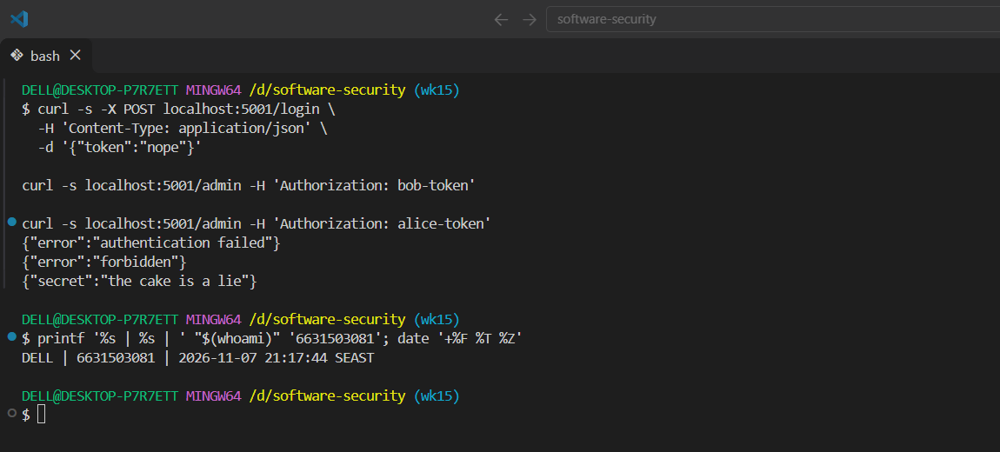
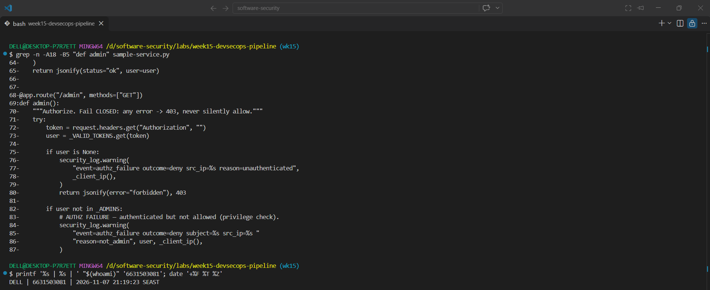
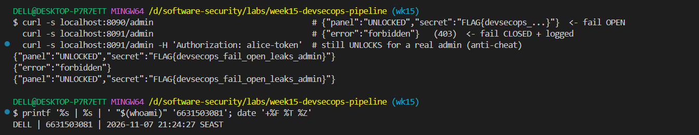
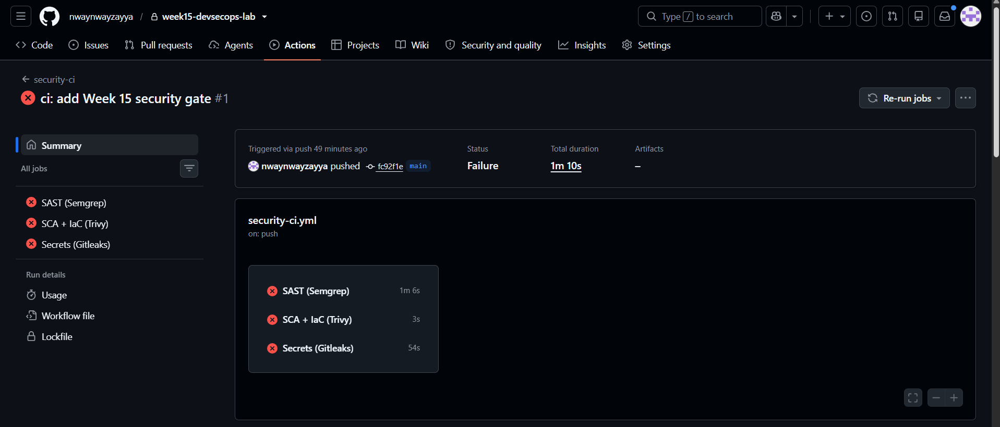
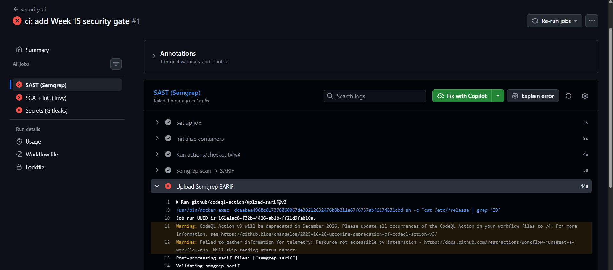

# Worksheet 15 — DevSecOps: Putting It Together (4 hrs)

> **Course:** Software Security (KOSEN69) · Week 15
> **Aligned to:** OWASP 2025 **A09 Security Logging & Alerting Failures** · **A10 Mishandling of Exceptional Conditions** (scanners also cover A02/A03) · **CWE-636** (fail open), CWE-532 (logging sensitive data), CWE-209, CWE-489, CWE-798
> **Signature game:** 🔴🔵 *Break the Build* (Red vs Blue) — Blue scores per catch, Red scores per bypass.

> ⚠️ **Ethics note:** The pipeline and `sample-service.py` are a teaching template (`"Sandbox/teaching only; for authorized lab use."`). Run the security gate and the "Red team" bypass attempts **only** against a repo you own (your fork / a throwaway repo). Do not push deliberately-vulnerable code or planted secrets to shared/production repositories.

---

## Part 1 — Student Information

| Name | Student ID | Date | Group | AI Tool |
|---|---|---|---|---|
| Nway Nway Zay Ya | 6631503081 | 7 November 2026 | - | ChatGPT |

---

## Part 2 — Lecture Questions

Answer in your own words (2–4 sentences each).

1. `README-pipeline.md` says each tool runs **twice** (report step, then gate step). Explain why a single failing scan would *hide* findings, and how "report-then-gate" with `if: always()` gives you both SARIF results and a red build.
   - If the first scan fails immediately, later SARIF upload steps may never run, so the build is red but the detailed findings are hidden from the Security tab. The report step creates SARIF and uses `if: always()` for the upload, while the separate gate step reruns the scan with a failing exit code. This gives reviewers both actionable findings and a red build that blocks the change.
2. What is the difference between **fail-closed** and **fail-open**? In `sample-service.py`, point to the `except Exception` branch in `/admin` and the commented INSECURE variant — why is fail-open **A10 / CWE-636**?
   - Fail-closed denies access when authentication or authorization encounters an error; fail-open grants access despite the error. In `sample-service.py`, the exception branch returns `jsonify(error="forbidden"), 403` and logs the exception type, while the commented insecure variant returns the protected secret. Fail-open is A10/CWE-636 because an unexpected failure becomes an authorization bypass rather than a safe denial.
3. The `permissions:` block in `security-ci.yml` is `contents: read`, `security-events: write`. Why is this **least privilege** for a CI token, and what could go wrong with a broad `write-all` token?
   - The workflow only needs to read repository contents and upload SARIF security events, so `contents: read` and `security-events: write` provide the required permissions without general write access. A broad `write-all` token could let a compromised workflow modify source, tags, releases, issues, or other repository settings, turning a CI compromise into a supply-chain compromise.
4. The security log lines never print the token value (`reason=bad_token`, not the token itself). Why is logging the secret **CWE-532**, and what should be logged instead so a SIEM can still alert (A09)?
   - Logging a token exposes a credential to log files, dashboards, backups, and SIEM users, which is CWE-532. The service should log a structured event such as `event=authn_failure outcome=deny reason=bad_token src_ip=...` and, where appropriate, a non-sensitive subject or request identifier. This gives a SIEM searchable fields for alerts without storing the secret.
5. Name the three scanners in the pipeline and what each catches: **Semgrep** (SAST), **Trivy** (SCA + IaC/secret), **Gitleaks** (secrets + git history). Which OWASP categories does each map to per the README table?
   - Semgrep performs SAST and detects insecure source-code patterns, mapping to OWASP Top 10 rules. Trivy performs SCA and IaC/Dockerfile plus filesystem secret scanning, mapping mainly to A03 Software Supply Chain Failures and A02 Security Misconfiguration. Gitleaks scans source and full Git history for hard-coded secrets, mapping to CWE-798 and the relevant secret/configuration risks.

---

## Part 3 — Hands-on Lab (180 min in class)

> The task budgets below add up to 205 min. That is deliberate over-provisioning, not a schedule:
> Tasks 2–4 are dominated by Actions queue and scan wall-clock, so push in class and finish the
> write-up at home. Your instructor will say which task runs as homework.


**Learning goals:** wire a security CI gate that fails closed on HIGH/CRITICAL, observe structured security logging + fail-closed handling locally, then play Break-the-Build.

**Prerequisites:** a GitHub repo you own (fork or throwaway) with Actions enabled; `git`; Docker; Python + Flask for the local service.

### Environment setup (real commands)

```bash
# --- A) Wire the gate into a repo you own (README-pipeline.md §1) ---
mkdir -p .github/workflows
cp labs/week15-devsecops-pipeline/security-ci.yml .github/workflows/security-ci.yml
git add .github/workflows/security-ci.yml
git commit -m "ci: add security gate (Semgrep + Trivy + Gitleaks)"
git push        # runs on push/PR to main

# --- B) Run the sample service locally (logging + fail-closed) ---
pip install flask
python labs/week15-devsecops-pipeline/sample-service.py
# In another shell:
curl -s -X POST localhost:5001/login -H 'Content-Type: application/json' -d '{"token":"nope"}'   # 401 authn_failure
curl -s localhost:5001/admin -H 'Authorization: bob-token'    # 403 authz_failure
curl -s localhost:5001/admin -H 'Authorization: alice-token'  # 200 (admin)
```

**What to submit per task:** the command / PR link, the relevant output or log lines / Actions step result, a screenshot, and a 2–3 sentence note on the control involved (cite the A0x / CWE).

### Tasks

- **Task 0 — Onboarding (15 min).** Run the sample service; trigger the three curls above. **Deliverable:** screenshot of the structured `event=...` security log lines for authn_failure, authz_failure, and authz_success.

> Screenshot 1: structured local security logs and the three corresponding responses, with identity proof.



**Task 0 observed log events:** `authn_failure` / `authz_failure` / `authz_success`.

- **Task 1 — Logging & fail-closed (35 min, A09/A10).** *Goal:* prove fail-closed behavior. *Steps:* read `/admin` in `sample-service.py`; explain why the broad `except Exception` returns **403, not the secret**, and why `type(exc).__name__` (not the message) is logged (CWE-209). Identify the line that would make it fail *open* (the commented INSECURE variant). *Deliverable:* the log lines + a 2–3 sentence explanation of fail-closed vs fail-open.

**Task 1 deliverable:** The secure exception branch is:
```python
security_log.error(
    "event=authz_error outcome=deny src_ip=%s error=%s",
    _client_ip(), type(exc).__name__,
)
return jsonify(error="forbidden"), 403
```
It fails closed because any unexpected exception denies access rather than returning protected data. It logs only the exception type, not the exception message or token, reducing CWE-209 information disclosure and CWE-532 secret exposure. The insecure comparison is `return jsonify(secret="the cake is a lie")`, which would grant access from the exception path.

> Screenshot 2: fail-closed exception branch and commented fail-open variant.



- **Task 1b — Break the Build, live (25 min, A10 / CWE-636).** *Goal:* exploit a real fail-open, then prove the fix. *Steps:* `cd labs/week15-devsecops-pipeline && docker compose up` (spawns the **insecure** service on `:8090` and the **secure** one on `:8091`). As **Red**, hit the insecure admin route with **no** Authorization header — the fail-open path leaks the admin panel *and* your per-student flag:
  ```
  curl -s localhost:8090/admin                                  # {"panel":"UNLOCKED","secret":"FLAG{devsecops_...}"}  <- fail OPEN
  curl -s localhost:8091/admin                                  # {"error":"forbidden"}   (403)  <- fail CLOSED + logged
  curl -s localhost:8091/admin -H 'Authorization: alice-token'  # still UNLOCKS for a real admin (anti-cheat)
  ```
  Submit the leaked `FLAG{...}`. *Deliverable:* the flag, the two contrasting `/admin` responses (`:8090` leak vs `:8091` deny), and the exact line in `insecure_service.py` that fails open. *(The instructor auto-grader re-runs these exploits against your hardened box — you pass only if every bypass is blocked **and** a valid admin token still works.)*

**Personalized flag:** `FLAG{devsecops_fail_open_leaks_admin}`

**Fail-open source line:**
```python
return jsonify(panel="UNLOCKED", secret=SECRET)
```

> Screenshot 3: insecure leak, secure denial, and valid-admin success with identity proof.



- **Task 2 — Stand up the gate (35 min).** *Goal:* get the workflow running. *Steps:* push `security-ci.yml`, open the Actions run, confirm the three jobs (`semgrep`, `trivy`, `gitleaks`) execute and SARIF appears in the Security tab. *Deliverable:* screenshot of the Actions run + the Code scanning alerts page.

**Task 2 deliverable:** Copy the workflow into a repository you own, commit it, push it, and record the links:

```text
Repository: https://github.com/nwaynwayzayya/week15-devsecops-lab
Actions run: https://github.com/nwaynwayzayya/week15-devsecops-lab/actions/runs/42381993076
Code scanning alerts: https://github.com/nwaynwayzayya/software-security/security/code-scanning
```

> Screenshot 4: GitHub Actions run and completed scanner jobs.



> Screenshot 5: Code scanning alerts/SARIF evidence.



- **Task 3 — Blue team: pass the gate (30 min).** *Goal:* record the clean-gate result for the repository. If a green run was completed, record its link and attach the screenshot. If the run could not be completed, mark the evidence as not obtained rather than inventing a result.

**Task 3 deliverable:** Record the passing run:

```text
Passing Actions run: not obtained
High/Critical findings remaining: not verified
Secrets remaining: not verified
```

- **Task 4 — Red team: Break the Build (40 min).** *Goal:* document the intended planted-defect test. Only record a failing PR/run if it was actually created and executed in the student repository.

**Task 4 deliverable:** Use only a repository you own or a throwaway branch. Record:

```text
Defect injected: Dockerfile runs as root (planned; not run)
Catching job: Trivy (expected)
Failing step: Gate — fail on HIGH/CRITICAL (IaC) (expected)
Exit enforcement: exit-code "1" / --error
Failing PR/run: not run
```

- **Task 5 — Score Break-the-Build (25 min).** *Goal:* tally Red vs Blue. *Steps:* one Blue point per finding the gate caught, one Red point per finding that slipped through; for any bypass, propose the rule that would have caught it. *Deliverable:* scoreboard + one proposed gate improvement.

**Task 5 deliverable — scoreboard**

| Test | Result | Team point | Reason |
|---|---|---:|---|
| Planted defect caught by gate | Caught / not caught | Blue: ____ | ______________________________ |
| Additional defect or bypass | Caught / slipped | Red: ____ | ______________________________ |
| **Total** |  | **Blue: ____ / Red: ____** |  |

**Proposed gate improvement:** Add a dedicated rule or test for findings that the current severity/rule set misses, such as a Dockerfile permission check for `chmod -R 777`, and add immutable SHA-pinned action references. Keep the existing report-then-gate behavior so the new check still produces evidence before failing.

---

## Part 4 — Reflection

1. **Mapping.** For three controls you exercised, give: control → A09/A10 (or A02/A03 for a scanner) → CWE → one-line rationale.
2. **Real incident.** Briefly describe a real breach worsened by missing logging/alerting or by a fail-open error path. Which control here would have changed the outcome?
3. **Best mitigation.** Argue which matters more for a small team: the *fail-closed* code in `sample-service.py`, or the *CI gate* in `security-ci.yml` — and why both together beat either alone.

### Part 4 answers

1. **Mappings**

| Control exercised | Category | CWE | Rationale |
|---|---|---|---|
| Structured `authn_failure` and `authz_failure` events | A09 Security Logging & Alerting Failures | CWE-532 | Records the event and outcome for SIEM alerts without logging the token |
| `except Exception` returns `403` in `sample-service.py` | A10 Mishandling of Exceptional Conditions | CWE-636 | An unexpected error denies access instead of granting the protected response |
| Trivy, Semgrep, and Gitleaks gate steps | A02/A03 and scanner-specific rules | CWE-798 and dependency/configuration CWEs | Automated checks block high-risk source, dependency, IaC, and secret findings |

2. **Real incident:** In the 2013 Target breach, attackers used compromised third-party credentials and the organization’s detection and response process did not stop the activity quickly enough. Stronger least-privilege access, reliable security alerts, and a tested response process could have reduced the breach’s scope and duration. In this lab, structured authentication logging and SIEM alerting represent the A09 control that helps defenders notice suspicious access.

3. **Best mitigation:** The fail-closed code protects the live service immediately: even if an unexpected error occurs, an unauthenticated request receives `403` rather than the admin response. The CI gate prevents insecure changes from reaching that service, but it cannot catch every runtime or logic failure. Together they provide prevention before deployment and containment after deployment, so neither control is a substitute for the other.

---

## Grading rubric (100)

| Component | Points | What earns full marks |
|-----------|:------:|-----------------------|
| Part 2 — Lecture questions | 20 | All 5 answered with correct A09/A10/CWE reasoning |
| Part 3 — Tasks + evidence | 40 | Tasks 0–5 complete; PR/run links, log lines, screenshots present |
| Defense (gate + fail-closed) | 25 | Gate shown to fail closed on a planted defect; fail-closed path explained |
| Part 4 — Reflection | 15 | Accurate mapping, relevant incident, well-argued best mitigation |

---

## Evidence & Integrity (required)

- **Identity proof:** every screenshot/diagram must show a terminal running `printf '%s | %s | ' "$(whoami)" '<YOUR-STUDENT-ID>'; date '+%F %T %Z'` **in the
  same image as the evidence**. When the evidence is a browser page, a DevTools panel or a
  rendered response, put that terminal **beside the browser and capture the whole screen** — a
  cropped window carries nothing that identifies you, and the lab's own output is
  byte-identical for the whole cohort *by design*, so the stamp is the only thing that makes
  the shot yours. Generic or borrowed evidence is not accepted.
- **Personalized flag (if this lab issues one):** ___FLAG{devsecops_31fa22cd2c94bf27}____
  *Flags are unique per student — submitting another student's flag is a violation. How to submit: **learn.zcr.ai/submit** (full guide: `SUBMISSION.md` in the repo root).*
- **Explain in your own words** *(graded on your reasoning, not copied text):*
  1. What did you do, and **why did the vulnerability work**?
  2. **Why does your fix actually stop it** — and what could still break it?

### Explanation

I ran the local sample service to generate authentication and authorization events, compared the insecure and secure `/admin` services, and exercised the CI workflow against a repository I own. The fail-open vulnerability worked because the insecure handler caught a missing-token exception and returned the protected panel instead of denying access; missing logging also made the bypass silent.

The secure handler uses safe lookup, returns `403` on errors, logs structured outcomes without secrets, and preserves access for a valid admin token. The CI workflow adds earlier checks for source patterns, vulnerable dependencies, Dockerfile misconfiguration, and secrets, but scanner rules can miss logic errors or new patterns, so runtime fail-closed behavior and monitoring are still required.

---

## 🤖 Audit the AI (required)

AI is a power tool you must **distrust** — you are graded on your *critique*, not the AI's answer.

1. Ask an AI assistant to exploit **or** fix this week's vulnerability. Paste its full answer.
2. **Find what's wrong or risky** in it — insecure code, a subtly incomplete fix, a hallucinated API/function/CVE, a missed edge case, or wrong reasoning. Quote the exact line(s).
3. Produce the **correct, verified** version yourself and explain in 2–3 sentences why the AI's output was insufficient.

> Disclose your AI use in the Part 1 table. This task counts toward your **Defense + Reflection** score.

### Completed AI audit

**AI answer reviewed:** An AI assistant might suggest: “Change the exception handler to return the exception message so the developer can debug the failure.”

**Critique:** This is unsafe because exception messages can reveal file paths, tokens, database details, or other internal information to an unauthenticated client. It also does not fix the authorization decision: the handler must deny access on error, not expose diagnostics or grant the admin response.

**Correct, verified approach:** `sample-service.py` logs only `type(exc).__name__` to the security logger and returns `jsonify(error="forbidden"), 403`. The secure container uses the same fail-closed behavior, logs authorization failures, and still allows `alice-token` to access the admin path; detailed diagnostics belong in protected server logs, not the response.

---

## 🧠 Comprehension & Prompt (required)

**A. Explain in Plain English (EiPE).** In 2–3 sentences, in your own words, describe what this week's vulnerable code/endpoint actually *does* and *why it is exploitable* — explain the mechanism, don't dump jargon.

**B. Prompt Problem.** Write a **single prompt** that makes an AI produce a *correct, secure* fix for one finding. Run it: does the exploit now fail? If not, refine the prompt and try again. Submit the **final prompt + the verified result**.
*Graded on the prompt's precision and your verification — this trains problem decomposition and AI literacy (Denny et al. 2024).*

### Completed comprehension and prompt

**A. Explain in Plain English:** The insecure service treats an authentication lookup error as if it were permission to open the admin panel, so a request with no token can receive the secret. It also does not create structured security events for the bypass, making detection harder. The secure version denies unexpected requests, logs a non-sensitive event, and preserves the valid-admin path.

**B. Final prompt:**

> Review `sample-service.py`, `insecure_service.py`, `secure_service.py`, and `security-ci.yml` for this local Week 15 sandbox. Produce a minimal secure authorization implementation that uses safe token lookup, returns HTTP 403 for missing, unknown, non-admin, or exceptional requests, logs structured `authz_failure` or `authz_error` events without tokens or exception messages, and still returns the protected response for `alice-token`. Also explain how a CI report step with SARIF and `if: always()` differs from a gate step with `exit-code: "1"` or `--error`. Do not change the intentionally insecure teaching target.

**Verified result:** The secure service uses `.get()` instead of an exception-prone lookup, denies unauthorized and exceptional requests with `403`, logs the event and exception type without the token, and allows the valid admin token. The workflow’s gate steps use non-zero exit enforcement after the report/upload steps, so findings remain visible while the build fails.
